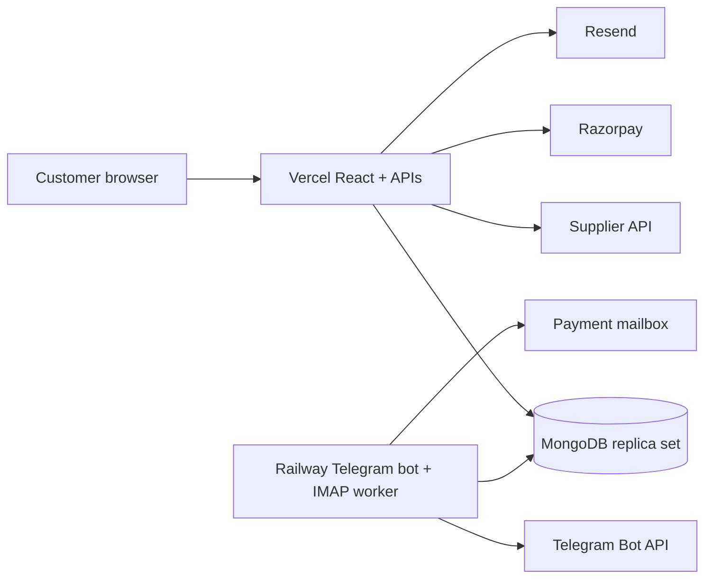

# SMM UP — Current Engineering Handover

> **Canonical production origin:** `https://smmup.co.in`
> **Repository:** `ExamCodesOfficial/SMM-UP`
> **Active branch:** `improvement/private-repo-and-bot-modules`
> **Current remote feature-branch checkpoint pushed on 2026-10-06:** `32205672bd8a1c7ea4d243c72391248cf57fdd26` (`improvement/full-audit-remediation`)
> **Architecture index:** [`architecture/full-architecture.md`](architecture/full-architecture.md)
> **Status:** the audited application/bot hardening is pushed to the feature branch and locally validated; the manual-only workflow is local-only because the authorized PAT lacked workflow scope; provider staging and production repair remain.

---

## 1. Purpose of this handover

This file gives the next engineer or agent the current operational truth without relying on obsolete implementation plans. It does not contain credentials, private pricing values, raw tokens, production banking data or readable passwords.

Use the following documents together:

| Document | Role |
|---|---|
| [`architecture/full-architecture.md`](architecture/full-architecture.md) | Complete cross-system architecture and feature registry |
| [`architecture/website-architecture.md`](architecture/website-architecture.md) | Website, API, data, SEO and security architecture |
| [`architecture/bot-architecture.md`](architecture/bot-architecture.md) | Telegram owner plane and Railway worker architecture |
| [`SECURITY_DEPLOYMENT_RUNBOOK.md`](SECURITY_DEPLOYMENT_RUNBOOK.md) | Staging, production, rollback and evidence gates |
| [`RAZORPAY_SETUP.md`](RAZORPAY_SETUP.md) | Razorpay test/live activation procedure |
| [`LATER_ON_UPGRADATIONS.md`](LATER_ON_UPGRADATIONS.md) | Completed phase ledger and approved post-launch backlog |
| [`planner.md`](planner.md) | Concise implementation planner and source-of-truth index |
| [`admin-bot/README.md`](admin-bot/README.md) | Railway bot operator quick start |
| [`admin-bot/ADMIN_BOT_DEVELOPMENT_PLAN.md`](admin-bot/ADMIN_BOT_DEVELOPMENT_PLAN.md) | Bot implementation and extension contract |

---

## 2. Repository state at handover

### Pushed baseline

The remote `improvement/private-repo-and-bot-modules` branch at `2c60e65` includes:

1. Phases 0–4 foundations.
2. Google-compatible ICO/PNG favicon and square logo assets.
3. Phase 5 Telegram owner control plane.
4. Phase 6 platform hardening.
5. Verified email registration, recovery and email changes.
6. Exact Direct UPI settlement and reconciliation.
7. Shared persistent limiting and critical-index validation.
8. Expanded `/api` developer documentation.
9. Three exhaustive architecture documents.
10. Replica-set integration tests and deployment runbook.

### Documentation and workflow state after the emergency push

The earlier exhaustive Markdown/API-documentation pass remained a separate local commit at that checkpoint. The current post-audit documentation pass is again local-only until a separate push is authorized. A manual-only GitHub Actions workflow is retained as a separate local commit because the emergency PAT cannot update `.github/workflows/ci.yml`. The pushed feature branch introduces no workflow file and therefore no push/PR-triggered Actions execution.

The emergency credential was supplied only through transient HTTP authorization and was not persisted in repository files, Git configuration, remotes or shell history. Revocation must be confirmed in the provider UI without recording the value.

### Never infer deployment from a GitHub push

A successful GitHub push does not prove that:

- Vercel production built successfully;
- Railway restarted successfully;
- Atlas accepted new indexes on production-shaped data;
- Resend sender/domain verification is complete;
- the Vercel cron has the correct bearer secret;
- Razorpay test/live dashboards are correctly configured;
- `www` redirects to the apex in production;
- Google has recrawled the homepage/favicon.

Those are explicit operational gates in the deployment runbook.

---

## 3. Product boundaries that must not regress

1. Keep the static top haze orb in `src/App.tsx`.
2. Keep permanent account navigation at `/account`.
3. Keep `/profile` as a permanent redirect to `/account`.
4. Keep Add Funds at `/add-funds`.
5. Dedicated platform SEO pages are exactly:
   - Telegram;
   - Instagram;
   - YouTube;
   - Twitter/X;
   - TikTok;
   - Spotify.
6. Do not add a rate calculator.
7. Do not turn breadcrumb labels into fake links.
8. Internal navigation should use real `<a href>` destinations where discoverability matters.
9. Support contact paths must remain clickable.
10. Service Terms must open the real Terms page.
11. Reviews require a valid prior purchase.
12. Preserve the six existing homepage reviews.
13. Review moderation remains Telegram-only.
14. Do not expose private markup multipliers in source, documentation, browser responses or Telegram.
15. Do not add a website admin panel.
16. Prefer Telegram inline navigation and confirmations for owner administration.
17. Do not introduce API-key IP allowlisting without a new approved requirement.

---

## 4. Security invariants

### Passwords and recovery

- Permanent passwords are bcrypt hashes.
- No owner or support workflow retrieves a prior password.
- Password complexity applies when creating or replacing a password, not during login.
- Strong passphrases up to the configured upper bound remain valid; there is no 10-character maximum.
- Owner temporary credentials default to a three-hour lifetime.
- Temporary credentials default to two successful uses and can be configured to one.
- Temporary login receives only a restricted password-change session.
- Permanent-password completion invalidates temporary credentials and related sessions.
- Owner-selected temporary values use five-minute AES-GCM-protected action state and are removed on confirmation/cancel.

### Sessions and Support Access

- Normal sessions are random opaque values; MongoDB stores only hashes.
- Raw session tokens never appear in Telegram or audit records.
- Support Access exchange codes are one-time and hash-only.
- Exchange window is five minutes.
- Resulting support session is read-only and lasts fifteen minutes.
- Owner actor and customer subject are stored and validated separately.
- Support sessions use a separate cookie and preserve the owner’s normal session.
- Support sessions cannot mutate orders, deposits, passwords, reviews, sessions or API keys.

### API keys

- Each integration has a separately named key identity.
- Raw key secrets are shown only once.
- MongoDB stores stable public identity, safe hint and secret hashes only.
- Pause preserves the current secret.
- Rotation/reissue is free and permanently revokes the old version.
- Archive requires exact-name confirmation, permanently revokes versions and gives no refund.
- Owner-required reissue cannot resume until website rotation succeeds.
- Explicit scopes, optional expiration, and atomic daily/monthly IST spending limits remain enforced.
- Complete operational order attribution may be retained; raw secrets, passwords, authorization headers and cookies may not.

### Payments and wallet

- Never request or store a UPI PIN, OTP, CVV or banking password.
- Direct UPI settlement must bind to one exact user-owned, unexpired pending transaction.
- Pending ID, amount in paise and receipt memo must match.
- UTR, transaction ID and memo anti-replay identities are uniquely indexed.
- Wallet mutation, pending claim, anti-replay record and ledger entry commit together.
- Missing/mismatched receipt data creates reconciliation state; it must not trigger a guessed credit.
- Razorpay wallet credit requires authoritative captured state.
- Razorpay browser verification and raw-body webhook processing are independently idempotent.
- Refund/dispute state may place ordering/payment holds.
- Every credit, debit, charge and refund has a durable settlement key.

### Internal services

- Rate limits use shared MongoDB counters and HMACed identifiers.
- Sensitive endpoints fail closed when the database/limiter is unavailable.
- Cron authentication fails closed when `CRON_SECRET` is absent or too short.
- Catalog refresh requires POST and a normal owner session.
- Critical indexes are awaited before database access is considered ready.
- Security events are persistent and bounded by retention/index policy.

### Telegram

- Every command and callback checks immutable numeric owner ID.
- The transport is Bot API long polling, not webhooks.
- Sensitive actions require mandatory reasons and five-minute actor-bound confirmation.
- Confirmation tokens are hash-only, one-time, expiring and atomically claimed.
- Stale and replayed buttons cannot execute twice.
- Telegram may show full operational user/order/deposit data to the owner.
- Telegram must never show permanent passwords/hashes, raw API secrets, cookies, authorization headers, OTPs, CVVs, UPI PINs or banking passwords.

---

## 5. Current architecture summary



### Browser layer

- React 19 and Vite.
- Tailwind CSS.
- Real-path SPA navigation with history support.
- Permanent account, add-funds, API, legal, company and platform routes.
- Route-specific canonical metadata and structured data.
- Responsive desktop/mobile navigation.

### Vercel API layer

- Account, email, session, Support Access and API-key actions under `/api/auth/[action]`.
- Website order actions under `/api/orders/[action]`.
- Direct UPI actions under `/api/payments/[action]`.
- Razorpay actions and raw webhook endpoint.
- Standard reseller API at `/api/v2`.
- Fail-closed status cron.
- Public catalog with owner-only refresh.

### Railway layer

- Owner-only Telegram long polling.
- Inline administrative navigation.
- Transactional credit/debit/refund/control/API-key actions.
- Recovery and Support Access status synchronization.
- Lease-protected IMAP settlement worker.
- Payment reconciliation and owner alerts.
- Worker heartbeat/error records.

### MongoDB layer

- Replica-set transactions are mandatory for financial and multi-record security operations.
- Unique indexes enforce identities and replay protection.
- TTL indexes expire sessions, action tokens, limiter windows and bounded events.
- The complete collection inventory is in `architecture/website-architecture.md`.

---

## 6. Important source files

| File | Responsibility |
|---|---|
| `src/App.tsx` | Application routing, shared state, support banner and permanent haze orb |
| `src/components/AuthPage.tsx` | Login, verified registration, email recovery and token consumption |
| `src/components/AddFundsPage.tsx` | Direct UPI and Razorpay browser flows |
| `src/components/pages/AccountPages.tsx` | Sessions, email change, named API keys, activity and reports |
| `src/components/ApiDocs.tsx` | Public reseller API reference and key lifecycle documentation |
| `api/auth/[action].ts` | Account/email/session/key HTTP control plane |
| `api/orders/[action].ts` | Website order lifecycle |
| `api/payments/[action].ts` | Direct UPI pending and exact verification lifecycle |
| `api/razorpay/[action].ts` | Razorpay authenticated actions |
| `api/razorpay-webhook.ts` | HMAC-protected raw-body webhook |
| `api/v2.ts` | Scoped named-key reseller API |
| `server/lib/db.ts` | MongoDB client and awaited critical indexes |
| `server/lib/auth.ts` | Password policy, cookies and server sessions |
| `server/lib/apiKeys.ts` | Key identities, versions, limits, spend and telemetry |
| `server/lib/directUpiSettlement.ts` | Exact transactional UPI settlement |
| `server/lib/email.ts` | Resend and hash-only email action tokens |
| `server/lib/rateLimit.ts` | Shared persistent limiter |
| `server/lib/recovery.ts` | Temporary-password restricted sessions |
| `admin-bot/bot.ts` | Telegram owner plane and Railway workers |

---

## 7. Validation commands

Run root and admin suites sequentially to reduce memory pressure:

```bash
npm ci
npm run typecheck
npm run build
npm run test:search-appearance
npm run test:api-keys
npm run test:recovery
npm run test:support-access
npm run test:rate-limit
npm run test:direct-upi
npm run test:email-delivery
npm run test:email-auth
npm run test:core-indexes
npm run test:order-reservations
npm audit --omit=dev

git diff --check

cd admin-bot
npm ci
npx tsc --noEmit
npm run test:admin-actions
npm audit --omit=dev
```

Do not run memory-heavy replica-set suites concurrently in a constrained sandbox.

If `node_modules` is absent, run `npm ci` first. Do not allow `npx` to download the unrelated deprecated `tsc` package.

---

## 8. Deployment gates still pending

1. Verify GitHub remote commit and required checks.
2. Deploy Vercel preview/staging with a separate staging database.
3. Deploy Railway staging with a separate bot token and owner ID.
4. Verify every critical index on production-shaped staging data.
5. Verify Resend sender/domain and all one-time email flows.
6. Verify cron missing/bad/good-secret behavior.
7. Verify public catalog and owner-only refresh.
8. Verify Direct UPI wrong user/ID/amount/memo/expiry/concurrency failures.
9. Verify Razorpay test callback/webhook ordering and duplicate delivery.
10. Run two Railway replicas and prove one lease and one settlement.
11. Verify Telegram stale/replay buttons and forbidden-data boundaries.
12. Verify apex/`www` redirect and all icon content types.
13. Perform controlled production smoke tests.
14. Request Search Console homepage indexing after deployment.

---

## 9. Credential and push procedure

- Never commit or persist a PAT.
- Never place a PAT in `.git/config`, a remote URL, a workspace file or shell history.
- Treat any token pasted into a conversation as exposed and revoke it immediately after its explicitly authorized use.
- A push authorization applies only to the stated push, not later documentation or code commits.
- Verify local and remote commit hashes after a push.
- Confirm credential revocation outside the repository.

---

## 10. Known non-blocking considerations

- Vite currently reports an advisory warning for a JavaScript chunk larger than 500 KB; the production build succeeds. A future performance pass may introduce route/component code splitting without changing behavior.
- Search favicon/logo changes require deployment and recrawl; code alone cannot update Google immediately.
- Existing production data may expose historical duplicate/index conflicts. Staging must validate index creation against a production-shaped snapshot before release.
- External providers can be delayed or unavailable. Reconciliation and idempotency must remain more authoritative than browser success screens.

---

## 11. Definition of a safe continuation

A continuation is safe only when it:

1. reads the current source and architecture documents;
2. checks Git status and the actual remote commit;
3. preserves all product boundaries above;
4. makes no security claim without a reproducible test or provider-side evidence;
5. adds or updates tests for changed transactional/security behavior;
6. runs the complete relevant validation suite;
7. leaves credentials out of source, logs and documentation;
8. distinguishes local implementation, GitHub push, staging deployment and production verification.

## 12. Emergency hardening delta at `2c60e65`

The pushed feature-branch commit adds or changes:

- lazy, bounded API initialization/error boundaries so configuration/database failures return controlled JSON;
- mandatory 32+ character `JWT_SECRET` for authentication and 32+ character `CRON_SECRET` for internal cron authorization;
- bounded content-type-aware browser API parsing in `src/lib/apiResponse.ts`;
- local Direct UPI QR generation with `qrcode`, removing third-party QR URI disclosure;
- transactional website and reseller order reservation before supplier execution;
- durable `Submitting`, `Failed` and `Submission uncertain` states with owner review instead of blind retry/refund;
- strict supplier response normalization and stale-submission review signals;
- corrected reseller activity attribution and order-reservation concurrency tests;
- exhaustive `vercel.env.example` and `railway.env.example`, synchronized with conventional `.env.example` files;
- public-copy corrections that remove unsupported timing/refund/operational promises;
- behavior-preserving Telegram bot modularization and full local validation.

### Current production repair

The observed production authentication family returned Vercel `FUNCTION_INVOCATION_FAILED`. The source now fails through controlled boundaries, but source alone cannot repair a deployed environment. Before production redeployment:

1. set a unique high-entropy Vercel Production `JWT_SECRET` of at least 32 characters;
2. set a separate `CRON_SECRET` of at least 32 characters;
3. compare every applicable Vercel value with `vercel.env.example`;
4. redeploy rather than assuming an environment update affects an old deployment;
5. smoke `register`, `login`, `me`, logout and cron bad/good-secret behavior;
6. retain deployment ID and bounded evidence without secret values.

### Git topology

- Historical emergency baseline: `2c60e657c5759f7a22cf9fbb872e1d1e051e7201`; current full-audit branch: `32205672bd8a1c7ea4d243c72391248cf57fdd26`.
- The emergency PAT cannot create/update `.github/workflows/ci.yml` because it lacks workflow scope.
- The manual-only `workflow_dispatch` file is retained in a separate local commit and must not be replaced with automatic triggers.
- Documentation reconciliation remains a separate local-only follow-up until a new push is explicitly authorized; the completed one-push PAT must not be reused.

### Remaining design note

Concurrent email-token issuance can still require a stronger deterministic active-record or transaction/uniqueness design. Do not add a naïve unique partial index or lock without migration and concurrency analysis. Existing token use remains one-time and transactional.

## 13. Full-audit remediation release checkpoint — 2026-10-06

### Source state

- Branch: `improvement/full-audit-remediation`
- Pushed commit: `32205672bd8a1c7ea4d243c72391248cf57fdd26`
- Commit author: `ExamCodesOfficial <examcodesofficial@gmail.com>`
- Remote branch and local commit were verified equal after push.
- The temporary push PAT was used only through `GIT_ASKPASS`; it was not stored in the remote URL, Git configuration, workspace files or shell history. The owner should revoke it because the authorized push is complete.
- This checkpoint is source evidence only. No Vercel or Railway deployment was performed.

### Material website changes

- Auth query secrets are scrubbed before requests; guarded routes have explicit auth resolution and allowlisted continuation handling.
- Vercel has 35 explicit SPA rewrites, `/profile` redirects to `/account`, and unknown paths fall through to the self-contained static 404.
- The supplied `public/404.html` is retained exactly and is `noindex,nofollow`.
- Mobile navigation now behaves as an accessible modal dialog.
- Order History distinguishes loading/account-empty/filter-empty/error, supports supplier cancellation requests, responsive cards, status/refill feedback and safe reorder.
- Direct UPI limits are server-owned; method eligibility is calculated separately for Direct UPI and Razorpay.
- Public review reads no longer mutate/seed; homepage reviews remain separate and Telegram owns moderation.
- Account profile editing, initials-avatar colour, settlement-gated erasure, favourites and privacy-safe templates were added.
- Dead `SupportModal` code was removed and internal links use the central route registry.

### Validation evidence

The pushed commit passed `npm ci` with zero reported package vulnerabilities, root TypeScript, all API-key/recovery/Support Access/rate-limit/Direct-UPI/email/index/order-reservation/preset integration suites, search appearance checks, Vite production build, byte-for-byte 404 build verification, `git diff --check`, route-map parity checks, secret/markup scans and the Playwright browser audit. The browser audit covers public routes, guarded redirects/metadata, auth-token scrubbing, mobile modal focus behavior, the animated 404 interaction and authenticated Account/Order History/New Order/Add Funds rendering with bounded mocks.

### Next operator actions

1. create/review the GitHub pull request for the pushed feature branch;
2. inspect the large `index.html` JSON-LD formatting diff semantically, not only visually;
3. deploy to Vercel Preview and prove real 404 status/headers, API routing precedence and CSP behavior;
4. execute authentication, payment-config, cancellation, reorder, profile and deletion staging workflows;
5. retain deployment ID and redacted evidence;
6. do not merge or deploy solely because local validation passed.
