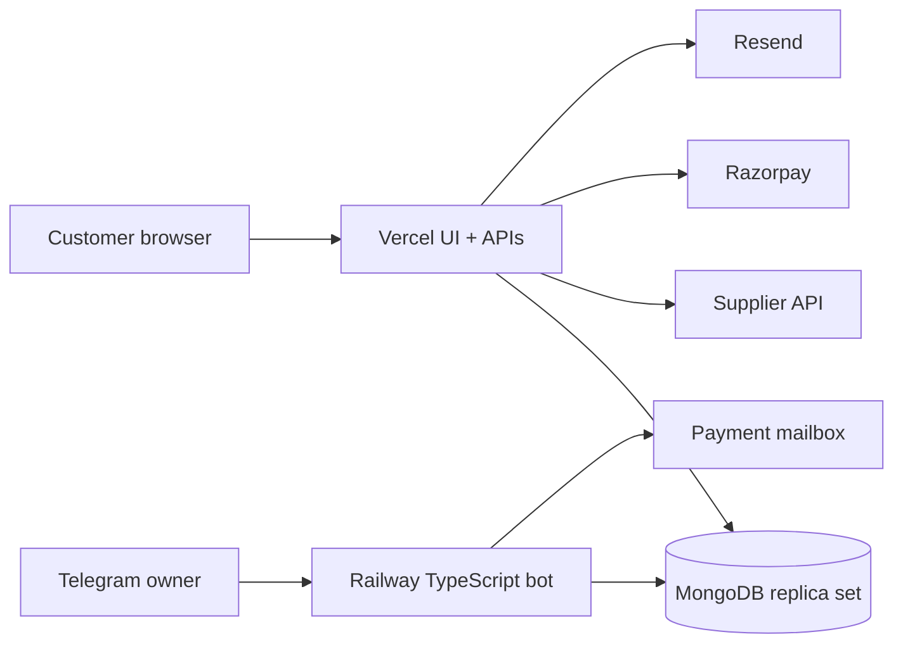

<p align="center">
  
</p>
<h1 align="center">SMM UP</h1>
<p align="center"><strong>Security-first SMM ordering, wallet and reseller platform</strong></p>

> **Private and proprietary repository.** No open-source license is granted. Do not copy, redistribute, publish, sublicense or reuse this source without the copyright owner’s written permission.
>
> **Release truth (2026-10-06):** audited application/bot changes are pushed to `improvement/private-repo-and-bot-modules` at `2c60e657c5759f7a22cf9fbb872e1d1e051e7201` and pass the local release suite. Production sign-in still requires a strong Vercel `JWT_SECRET` and redeployment; `CRON_SECRET` must also be at least 32 characters. GitHub state alone does not prove provider or production readiness.

## System overview

SMM UP combines:

- a React/Vite customer website;
- Vercel account, order, wallet, payment and reseller APIs;
- MongoDB replica-set transactions, unique indexes and TTL state;
- Direct UPI and Razorpay funding rails;
- verified-email account lifecycle and revocable hash-only sessions;
- multiple named, scoped API keys with limits and one-time secret reveal;
- a Railway TypeScript Telegram owner bot using long polling;
- a lease-protected IMAP settlement and reconciliation worker.



## Repository map

| Path | Responsibility |
|---|---|
| `src/` | React application, permanent pages and browser interaction |
| `api/` | Vercel request handlers |
| `server/lib/` | Authentication, sessions, payments, API keys, rate limits and providers |
| `tests/` | Root replica-set and static integration gates |
| `admin-bot/` | Owner-only Telegram bot and IMAP settlement worker |
| `architecture/` | Exhaustive `WEB-*`, `BOT-*` and `SYS-*` registries |
| `API_REFERENCE.md` | Complete reseller and first-party HTTP contract |
| `vercel.env.example` | Exhaustive website/API Vercel variable inventory |
| `railway.env.example` | Exhaustive bot/worker Railway variable inventory |
| `SECURITY_DEPLOYMENT_RUNBOOK.md` | Staging, deployment, rollback and incidents |
| `RAZORPAY_SETUP.md` | Razorpay activation and reconciliation |

## Product invariants

- Account remains at `/account`; `/profile` redirects to it.
- Add Funds remains at `/add-funds`.
- Dedicated platform pages remain Telegram, Instagram, YouTube, Twitter/X, TikTok and Spotify.
- The static top haze orb remains in `src/App.tsx`.
- Reviews require a prior purchase; moderation is Telegram-only.
- There is no website admin panel.
- Permanent passwords remain bcrypt hashes and are never retrievable.
- Raw API secrets and session tokens are never stored.
- No UPI PIN, OTP, CVV or banking password is requested or stored.
- Private pricing configuration must not be disclosed.

## Local development

Requirements:

- Node.js 22 or a compatible current LTS release;
- npm;
- a transaction-capable MongoDB replica set for integration behavior;
- controlled non-production provider credentials only when testing provider flows.

```bash
npm ci
npm run typecheck
npm run dev
```

Never use production credentials in local `.env` files, screenshots, issues, pull requests or logs.

## Root validation

Run memory-heavy replica-set suites sequentially:

```bash
npm ci
npm run typecheck
npm run build
npm run test:search-appearance
npm run test:api-keys
npm run test:recovery
npm run test:support-access
npm run test:rate-limit
npm run test:direct-upi
npm run test:email-delivery
npm run test:email-auth
npm run test:core-indexes
npm run test:order-reservations
npm audit --omit=dev
```

Bot validation:

```bash
cd admin-bot
npm ci
npx tsc --noEmit
npm run test:admin-actions
npm audit --omit=dev
```

## Configuration and deployment

Use `vercel.env.example` as the exhaustive Vercel website/API inventory and `railway.env.example` as the exhaustive Railway bot/worker inventory. `.env.example` and `admin-bot/.env.example` are synchronized local-development counterparts. Templates contain names, comments and safe placeholders only—not deployable secrets.

Environment-variable boundaries and provider gates are documented in:

- [`SECURITY_DEPLOYMENT_RUNBOOK.md`](SECURITY_DEPLOYMENT_RUNBOOK.md)
- [`RAZORPAY_SETUP.md`](RAZORPAY_SETUP.md)
- [`admin-bot/README.md`](admin-bot/README.md)

Values belong in Vercel, Railway or provider secret stores. Variables prefixed with `VITE_` are browser-visible and must never contain credentials.

Do not infer production readiness from a successful build or GitHub push. Complete isolated Vercel/Railway staging, provider checks, Atlas index verification, payment concurrency tests, domain checks and controlled production smoke tests.

## Architecture and operating documents

1. [`API_REFERENCE.md`](API_REFERENCE.md)
2. [`architecture/full-architecture.md`](architecture/full-architecture.md)
3. [`architecture/website-architecture.md`](architecture/website-architecture.md)
4. [`architecture/bot-architecture.md`](architecture/bot-architecture.md)
5. [`HANDOVER.md`](HANDOVER.md)
6. [`planner.md`](planner.md)
7. [`LATER_ON_UPGRADATIONS.md`](LATER_ON_UPGRADATIONS.md)

## Security reporting

Follow [`SECURITY.md`](SECURITY.md). Do not disclose vulnerabilities, credentials, user information, order targets or payment evidence in public issues.

## Internal contribution policy

This is not an open contribution project. Authorized collaborators must follow [`CONTRIBUTING.md`](CONTRIBUTING.md), pass required checks and update architecture/runbook documentation with behavior changes.

## Rights

This repository intentionally has no MIT, Apache, GPL or other open-source license. Source visibility does not grant permission to use it. Keep the GitHub repository private and restrict collaborator, Actions, deployment and secret access to authorized accounts.

## Current deployment cautions

- Authentication deliberately fails closed when Vercel `JWT_SECRET` is absent or shorter than 32 characters. Configure a high-entropy Production value and redeploy before treating sign-in as restored.
- Status synchronization deliberately returns `503` when `CRON_SECRET` is absent/short. Configure a separate 32+ character value and redeploy.
- Direct UPI QR images are generated in the browser; payment URIs are not sent to a public QR-rendering service.
- Website and reseller order creation reserve the wallet debit, ledger entry and local `Submitting` order transactionally before contacting the supplier. An uncertain provider response must be reconciled, not blindly retried or automatically refunded.
- The emergency PAT lacked workflow-write scope. The pushed feature branch contains no Actions workflow; a `workflow_dispatch`-only workflow remains an isolated local commit.

See [`HANDOVER.md`](HANDOVER.md) for the exact Git/push state and [`API_REFERENCE.md`](API_REFERENCE.md) for retry semantics.
