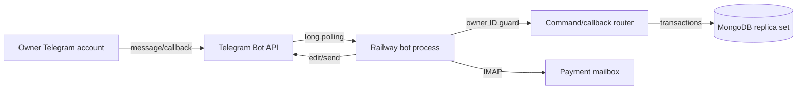
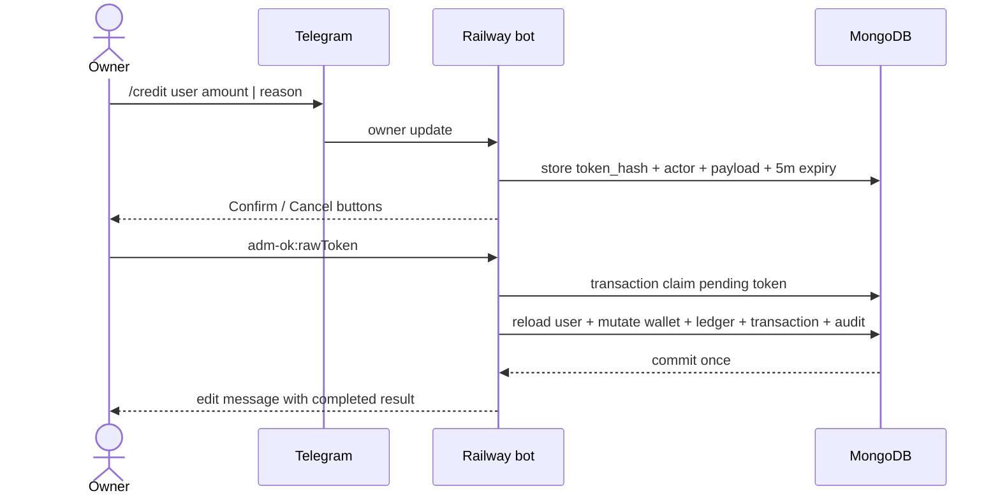
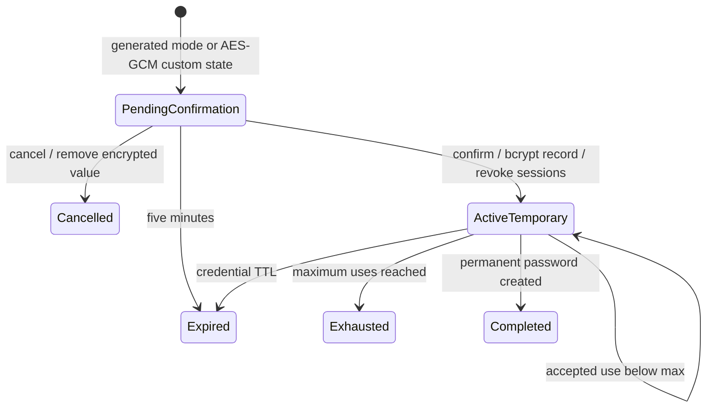
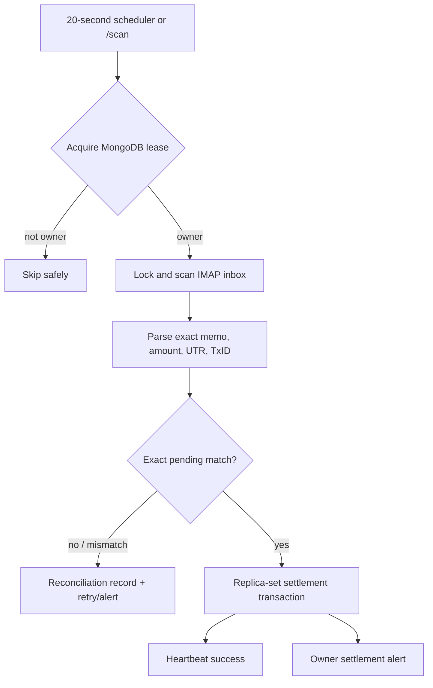

  

<h1 align="center">SMM UP Telegram Bot Architecture</h1>

<strong>Source-derived architecture snapshot · 2026-10-06</strong>

<code>FEATURE BRANCH @ 2c60e65</code> · <code>MODULE REFACTOR PUSHED</code> · <code>RAILWAY DEPLOYMENT PENDING</code>

> **Inventory size:** 147 atomic bot, owner-control and worker capabilities.
> **Runtime:** Railway Node.js process using Telegram Bot API long polling.
> **Companions:** [Website architecture](website-architecture.md) · [Full architecture](full-architecture.md)

<strong>Architecture drawer — click to expand/collapse</strong>

- [Purpose](#purpose)
- [Transport](#transport-topology)
- [Command map](#command-map)
- [Confirmation](#confirmation-sequence)
- [Recovery](#temporary-password-state)
- [Worker](#worker-topology)
- [Registry](#atomic-bot-feature-registry)
- [Data boundaries](#telegram-data-boundaries)
- [Persistence](#bot-persistence-map)
- [Environment](#bot-environment-contract)
- [Operations](#railway-operations)
- [Failure modes](#failure-mode-matrix)
- [Observability](#observability-and-retention)
- [Release boundary](#release-and-rollback-boundary)

## Purpose

The bot is the sole administrative control plane. There is no website admin panel. It grants comprehensive owner authority while requiring actor authentication, mandatory reasons, short-lived confirmation and database auditability.

## Transport topology

### Why no webhook secret

- This bot does not expose an HTTP webhook.
- Telegram updates are pulled over authenticated Bot API long polling.
- Equivalent hardening is numeric owner authorization, startup identity verification, restricted update types and stale-update dropping.

## Command map

| Command | Purpose |
|---|---|
| `/start, /help` | opens persistent inline main menu and authoritative syntax help |
| `/stats` | aggregates users, balances, orders, spend and settled-deposit counts |
| `/reviews [limit]` | lists bounded recent reviews with moderation buttons |
| `/user <email>` | shows full operational account data and inline control navigation |
| `/lock <email> \| reason` | queues account lock and session revocation |
| `/unlock <email> \| reason` | queues account unlock |
| `/orderhold <email> \| reason` | queues website/API ordering hold |
| `/orderrelease <email> \| reason` | queues ordering release |
| `/paymenthold <email> \| reason` | queues deposit hold |
| `/paymentrelease <email> \| reason` | queues deposit release |
| `/keypause <keyId> \| reason` | queues API-key pause without secret revocation |
| `/keyresume <keyId> \| reason` | queues resume unless secure reissue remains required |
| `/keyarchive <keyId> \| reason` | queues permanent archive and version revocation |
| `/keyreissue <keyId> \| reason` | queues secret revocation and website-rotation requirement |
| `/note <email> \| note` | writes owner note and admin audit |
| `/userorders <email>` | shows bounded orders including target and refund state |
| `/deposits <email>` | shows bounded deposit identifiers and state |
| `/wallet <email>` | shows wallet balance and bounded ledger entries |
| `/events <email>` | shows bounded security events and notes |
| `/resetpassword <email> <auto\|custom> \| reason` | creates protected five-minute reset action with identity attestation |
| `/supportaccess <email> \| reason` | issues one-time five-minute read-only support exchange code |
| `/credit <email> <amount> \| reason` | queues transactional wallet credit |
| `/debit <email> <amount> \| reason` | queues non-negative transactional debit |
| `/pending` | lists recent pending Direct UPI deposits |
| `/orders [limit]` | lists recent provider orders |
| `/failed` | lists failures requiring review |
| `/refund <orderId> \| reason` | queues idempotent transactional refund |
| `/checkmemo <memo>` | inspects exact payment memo record |
| `/scan` | runs lease-protected owner-requested IMAP scan |

## Callback map

| Callback pattern | Purpose |
|---|---|
| `menu:*` | top-level buttons that return bounded command guidance for overview/users/orders/payments/security/reviews |
| `adm-ok:<token>` | atomically claims actor-bound five-minute action and executes in transaction |
| `adm-no:<token>` | atomically cancels eligible action |
| `review-toggle:<id>` | toggles approved/hidden and records owner audit |
| `user-sessions:<id>` | lists active safe session metadata |
| `user-support:<id>` | offers Support Access creation path |
| `user-controls:<id>` | shows account/order/payment control syntax and state |
| `user-keys:<id>` | shows named-key metadata without secrets |
| `user-records:<id>` | loads order/deposit/ledger/security/note counts |
| `session-revoke-prompt:<id>` | stages one-session revoke |
| `session-revoke-confirm:<id>` | revokes one session and related support state |
| `sessions-revoke-prompt:<userId>` | stages all-session revoke |
| `sessions-revoke-confirm:<userId>` | transactionally revokes normal/support/restricted sessions |
| `pwdreset-confirm:<token>` | claims protected reset state, creates bcrypt temporary credential, revokes sessions |
| `pwdreset-cancel:<token>` | cancels and removes encrypted temporary value |

## Confirmation sequence

## Temporary-password state

## Worker topology

## Atomic bot feature registry

### Transport and authorization

- **BOT-0001** — Railway starts the bot only after MongoDB connection, index creation and Telegram `getMe` identity verification.
- **BOT-0002** — Long polling accepts only message and callback-query update types.
- **BOT-0003** — Long polling drops stale pending updates at startup.
- **BOT-0004** — Webhook-secret validation is intentionally not used because this bot does not use webhooks.
- **BOT-0005** — Each incoming update is checked against immutable numeric `TELEGRAM_OWNER_ID`.
- **BOT-0006** — Unauthorized senders receive a rejection and no command handler executes.

### Commands

- **BOT-0007** — `/start, /help` opens persistent inline main menu and authoritative syntax help.
- **BOT-0008** — `/stats` aggregates users, balances, orders, spend and settled-deposit counts.
- **BOT-0009** — `/reviews [limit]` lists bounded recent reviews with moderation buttons.
- **BOT-0010** — `/user <email>` shows full operational account data and inline control navigation.
- **BOT-0011** — `/lock <email> | reason` queues account lock and session revocation.
- **BOT-0012** — `/unlock <email> | reason` queues account unlock.
- **BOT-0013** — `/orderhold <email> | reason` queues website/API ordering hold.
- **BOT-0014** — `/orderrelease <email> | reason` queues ordering release.
- **BOT-0015** — `/paymenthold <email> | reason` queues deposit hold.
- **BOT-0016** — `/paymentrelease <email> | reason` queues deposit release.
- **BOT-0017** — `/keypause <keyId> | reason` queues API-key pause without secret revocation.
- **BOT-0018** — `/keyresume <keyId> | reason` queues resume unless secure reissue remains required.
- **BOT-0019** — `/keyarchive <keyId> | reason` queues permanent archive and version revocation.
- **BOT-0020** — `/keyreissue <keyId> | reason` queues secret revocation and website-rotation requirement.
- **BOT-0021** — `/note <email> | note` writes owner note and admin audit.
- **BOT-0022** — `/userorders <email>` shows bounded orders including target and refund state.
- **BOT-0023** — `/deposits <email>` shows bounded deposit identifiers and state.
- **BOT-0024** — `/wallet <email>` shows wallet balance and bounded ledger entries.
- **BOT-0025** — `/events <email>` shows bounded security events and notes.
- **BOT-0026** — `/resetpassword <email> <auto|custom> | reason` creates protected five-minute reset action with identity attestation.
- **BOT-0027** — `/supportaccess <email> | reason` issues one-time five-minute read-only support exchange code.
- **BOT-0028** — `/credit <email> <amount> | reason` queues transactional wallet credit.
- **BOT-0029** — `/debit <email> <amount> | reason` queues non-negative transactional debit.
- **BOT-0030** — `/pending` lists recent pending Direct UPI deposits.
- **BOT-0031** — `/orders [limit]` lists recent provider orders.
- **BOT-0032** — `/failed` lists failures requiring review.
- **BOT-0033** — `/refund <orderId> | reason` queues idempotent transactional refund.
- **BOT-0034** — `/checkmemo <memo>` inspects exact payment memo record.
- **BOT-0035** — `/scan` runs lease-protected owner-requested IMAP scan.

### Inline callbacks

- **BOT-0036** — `menu:*` routes top-level buttons to bounded command guidance for overview/users/orders/payments/security/reviews.
- **BOT-0037** — `adm-ok:<token>` atomically claims actor-bound five-minute action and executes in transaction.
- **BOT-0038** — `adm-no:<token>` atomically cancels eligible action.
- **BOT-0039** — `review-toggle:<id>` toggles approved/hidden and records owner audit.
- **BOT-0040** — `user-sessions:<id>` lists active safe session metadata.
- **BOT-0041** — `user-support:<id>` offers Support Access creation path.
- **BOT-0042** — `user-controls:<id>` shows account/order/payment control syntax and state.
- **BOT-0043** — `user-keys:<id>` shows named-key metadata without secrets.
- **BOT-0044** — `user-records:<id>` loads order/deposit/ledger/security/note counts.
- **BOT-0045** — `session-revoke-prompt:<id>` stages one-session revoke.
- **BOT-0046** — `session-revoke-confirm:<id>` revokes one session and related support state.
- **BOT-0047** — `sessions-revoke-prompt:<userId>` stages all-session revoke.
- **BOT-0048** — `sessions-revoke-confirm:<userId>` transactionally revokes normal/support/restricted sessions.
- **BOT-0049** — `pwdreset-confirm:<token>` claims protected reset state, creates bcrypt temporary credential, revokes sessions.
- **BOT-0050** — `pwdreset-cancel:<token>` cancels and removes encrypted temporary value.

### Confirmation engine

- **BOT-0051** — Every financial/control confirmation stores only a SHA-256 callback token hash.
- **BOT-0052** — Confirmation records bind immutable owner Telegram ID and optional username snapshot.
- **BOT-0053** — Confirmation expiry is exactly five minutes at creation.
- **BOT-0054** — The bot bounds the number of recent pending actions per actor.
- **BOT-0055** — Mandatory reasons are trimmed and bounded before persistence.
- **BOT-0056** — Confirmation summaries escape Telegram HTML.
- **BOT-0057** — Current database state is reloaded inside the execution transaction.
- **BOT-0058** — The confirmation changes from pending to executing before domain mutation.
- **BOT-0059** — The domain mutation and completed status commit together.
- **BOT-0060** — An execution exception aborts the complete transaction.
- **BOT-0061** — Expired, cancelled, consumed and wrong-actor tokens cannot claim.
- **BOT-0062** — Stale-button responses reveal no sensitive state.
- **BOT-0063** — Financial amounts are converted through integer paise for validation.
- **BOT-0064** — Debits require sufficient current balance in the transaction.
- **BOT-0065** — Wallet ledger settlement keys make repeat actions idempotent.
- **BOT-0066** — Refund settlement keys bind to order identity.
- **BOT-0067** — Refund updates order, wallet, totals, transaction and admin audit together.
- **BOT-0068** — Account lock revokes website/recovery/support sessions.
- **BOT-0069** — API pause does not revoke the secret.
- **BOT-0070** — API archive and reissue-required revoke current versions.

### Inspection and privacy

- **BOT-0071** — Owner views may include complete user email and operational order/deposit data.
- **BOT-0072** — User lookup excludes password hashes and raw session tokens.
- **BOT-0073** — API-key views show name, public identity, status, scopes, limits and dates but no raw secret/hash.
- **BOT-0074** — Session views show safe device/purpose/activity metadata but no raw cookie/token hash.
- **BOT-0075** — Order views may show target, quantity, provider ID, charge and refund state.
- **BOT-0076** — Deposit views may show memo, UTR/provider payment ID, amount and status.
- **BOT-0077** — Wallet views are bounded and include settlement keys for auditability.
- **BOT-0078** — Event and note output is length-bounded to Telegram message limits.
- **BOT-0079** — Confirmation and newer sensitive outputs use the shared Telegram HTML escaper; legacy list/error paths require a final production encoding audit.
- **BOT-0080** — No UPI PIN, OTP, CVV or banking password is requested or displayed.
- **BOT-0081** — No permanent password or password hash is displayed.
- **BOT-0082** — No API secret, cookie or authorization header is displayed.

### Temporary password recovery

- **BOT-0083** — Owner can select generated mode or provide a policy-compliant custom temporary password.
- **BOT-0084** — Custom temporary values are AES-256-GCM protected in five-minute MongoDB action state.
- **BOT-0085** — The encryption key derives from dedicated admin state secret, falling back only to strong bot token material.
- **BOT-0086** — Custom values survive a Railway restart during the five-minute confirmation window.
- **BOT-0087** — Custom encrypted value and staging hash are unset on cancel or successful claim.
- **BOT-0088** — Generated temporary values are created only after confirmation.
- **BOT-0089** — Only bcrypt hash persists in `temporary_passwords`.
- **BOT-0090** — Default lifetime is three hours with bounded environment override.
- **BOT-0091** — Default maximum uses is two and can be configured to one.
- **BOT-0092** — New reset supersedes prior active temporary credentials.
- **BOT-0093** — Reset revokes every related website and recovery session.
- **BOT-0094** — Telegram creation message shows temporary credential, expiry, use count and reason.
- **BOT-0095** — Each successful use updates count, timestamp and remaining uses.
- **BOT-0096** — Permanent-password completion edits the Telegram message to completed state.
- **BOT-0097** — Failed Telegram status edits are marked for Railway retry.

### Support Access

- **BOT-0098** — Code generation uses random high-entropy raw value and stores only a hash.
- **BOT-0099** — Code exchange lifetime is five minutes.
- **BOT-0100** — Code is one-time and single-active per actor/subject scope.
- **BOT-0101** — Resulting support session lifetime is fifteen minutes.
- **BOT-0102** — Support session is read-only and preserves actor and subject separately.
- **BOT-0103** — Telegram message is edited when code is used, replaced, expired or session ends.
- **BOT-0104** — Owner can revoke one or all sessions from inline controls.

### Railway worker

- **BOT-0105** — The IMAP worker is enabled unless `ENABLE_IMAP_WORKER=false`; deployment must set the intended bot-only/worker role explicitly.
- **BOT-0106** — `workerActive` prevents overlap inside one Node process.
- **BOT-0107** — `worker_leases` prevents overlap between Railway replicas.
- **BOT-0108** — The lease records holder, expiry and heartbeat.
- **BOT-0109** — Manual `/scan` uses the same local activity guard and distributed lease.
- **BOT-0110** — IMAP uses a mailbox app password rather than a normal account password.
- **BOT-0111** — The worker locks INBOX while fetching candidate messages.
- **BOT-0112** — The sender filter and recent time window bound scanning.
- **BOT-0113** — Quoted-printable content is decoded before matching.
- **BOT-0114** — Memos use the exact SUP plus five-character format.
- **BOT-0115** — UTR extraction accepts a bounded 12-digit reference pattern.
- **BOT-0116** — FamPay transaction IDs use the expected prefix pattern.
- **BOT-0117** — Amount parsing uses payment-language and subject patterns.
- **BOT-0118** — Only an exact memo can select a pending Direct UPI transaction.
- **BOT-0119** — The pending transaction must be unexpired and FAMPAY_UPI method.
- **BOT-0120** — Observed and expected amounts must match in integer paise.
- **BOT-0121** — Missing/mismatched amounts create reconciliation state and no credit.
- **BOT-0122** — Worker settlement claims anti-replay identifiers, pending transaction, wallet and ledger in one replica-set transaction.
- **BOT-0123** — One settlement key binds one wallet credit to one pending transaction.
- **BOT-0124** — Concurrent settlement attempts yield exactly one commit.
- **BOT-0125** — Payment holds roll back transaction claim, anti-replay insert and wallet update.
- **BOT-0126** — Duplicate-key and stale-pending outcomes are treated as already handled rather than credited twice.
- **BOT-0127** — Open reconciliation issues accumulate retry attempts.
- **BOT-0128** — Retry-limit issues generate owner alerts once.
- **BOT-0129** — Expired pending deposits are marked expired during reconciliation.
- **BOT-0130** — Success resolves matching open reconciliation records.
- **BOT-0131** — Owner success alerts include operational identifiers but no banking secrets.
- **BOT-0132** — Worker health resets consecutive errors after success.
- **BOT-0133** — Worker health records bounded error details after failure.
- **BOT-0134** — Three consecutive failures and later multiples of ten alert the owner.
- **BOT-0135** — One minute-based synchronization worker processes temporary-password and Support Access Telegram status updates independently by record.
- **BOT-0136** — Graceful SIGINT/SIGTERM stops long polling and closes MongoDB.

### Persistence and indexes

- **BOT-0137** — Bot startup awaits confirmation token uniqueness and expiry indexes.
- **BOT-0138** — Bot startup awaits admin audit, notes and security-event indexes.
- **BOT-0139** — Bot startup awaits payment memo, anti-replay and settlement uniqueness indexes.
- **BOT-0140** — Index creation failures prevent normal bot startup.
- **BOT-0141** — Admin audit records actor, subject, action, outcome, reason and bounded details.
- **BOT-0142** — Worker leases and health use stable string identities.

### Validation

- **BOT-0143** — Admin TypeScript must compile with no emit.
- **BOT-0144** — `test:admin-actions` uses a real in-memory MongoDB replica set.
- **BOT-0145** — Tests cover credit/debit rollback, replay safety, refund idempotency, holds and API-key controls.
- **BOT-0146** — Tests cover concurrent IMAP settlement and payment-hold rollback.
- **BOT-0147** — Production dependency audit must report zero known vulnerabilities before release.

## Telegram data boundaries

| May be shown to the owner | Must never be shown |
|---|---|
| Full user email and username | Permanent password or password hash |
| Account lock/order/payment hold state | Raw website session cookie/token/hash |
| Complete operational order target/quantity/charge | Raw API-key secret or secret hash |
| Deposit memo, UTR/provider ID, amount and state | Authorization header |
| Wallet ledger and settlement keys | OTP, CVV, UPI PIN, banking password |
| Safe session device/purpose/activity metadata | GitHub, supplier, Razorpay, email or bot credentials |
| Named API-key metadata/scopes/limits/status | Encrypted custom temporary value |
| Bounded security events and owner notes | Unbounded raw provider/email payload |

## Bot persistence map

| Collection | Bot responsibility |
|---|---|
| `admin_pending_actions` | Actor-bound five-minute financial/control confirmations and one-time status transitions |
| `admin_action_tokens` | Protected reset confirmation state with immediate TTL |
| `admin_audit` | Administrative actor/subject/action/outcome/reason trail |
| `admin_notes` | Owner-only notes attached to users |
| `users` | Account lookup, balances, totals, locks and ordering/payment holds |
| `sessions` | Safe inspection and owner revocation of normal/support sessions |
| `restricted_sessions` | Recovery-session invalidation |
| `temporary_passwords` | bcrypt temporary credentials, usage, expiry and Telegram status references |
| `support_access_codes` | Hash-only exchange code and support-session status synchronization |
| `api_keys` / `api_key_versions` | Safe metadata and transactional pause/resume/archive/reissue state |
| `orders` | Operational inspection and idempotent refund state |
| `transactions` / `processed_transactions` | Pending deposit source and anti-replay claims |
| `wallet_ledger` | Exactly-once credits, debits and refunds |
| `payment_reconciliation` | Retry/anomaly/owner-alert state |
| `reviews` | Telegram-only moderation state |
| `security_events` | Bounded user/security/payment events |
| `worker_leases` | Cross-replica singleton lease |
| `system_health` | Heartbeat, success, error and consecutive failure state |

### Bot source map

| Source | Responsibility |
|---|---|
| `admin-bot/bot.ts` | Thin composition, long-polling launch, worker startup, shutdown and compatibility re-exports |
| `admin-bot/src/config.ts` | Environment loading, startup validation and bounded recovery configuration |
| `admin-bot/src/db/client.ts` | Shared lazy MongoDB client/database lifecycle |
| `admin-bot/src/db/indexes.ts` | Startup uniqueness, audit, lookup and idempotency index gate |
| `admin-bot/src/security/adminState.ts` | Protected action-state encryption, token hashing and temporary credential generation |
| `admin-bot/src/security/telegramHtml.ts` | Shared Telegram HTML escaping primitive |
| `admin-bot/src/domain/pendingActions.ts` | Reason parsing and actor-bound confirmation staging |
| `admin-bot/src/domain/adminActions.ts` | Confirmed transaction execution and administrative audit writes |
| `admin-bot/src/middleware/ownerAuthorization.ts` | Global numeric owner authorization |
| `admin-bot/src/callbacks/adminActions.ts` | Generic confirmation cancellation/claim/transaction orchestration |
| `admin-bot/src/commands/general.ts` | Help/menu, aggregate/recent inspection and review moderation |
| `admin-bot/src/commands/users.ts` | User/account/order/session/key records and control staging |
| `admin-bot/src/commands/recovery.ts` | Temporary-password and Support Access workflows |
| `admin-bot/src/commands/operations.ts` | Wallet, refund and payment/order operations |
| `admin-bot/src/ui/reviews.ts` | Review moderation text and keyboard rendering |
| `admin-bot/src/worker/runtime.ts` | Thin composition for payment and recovery-status workers |
| `admin-bot/src/worker/paymentScanner.ts` | IMAP parsing/scanning, exact matching and settlement invocation |
| `admin-bot/src/worker/paymentRuntime.ts` | `/scan`, local guard, lease, reconciliation, health and 20-second scheduler |
| `admin-bot/src/worker/recoveryStatus.ts` | Temporary-password and Support Access Telegram status synchronization |
| `admin-bot/src/worker/settlement.ts` | Exactly-once transaction for Direct UPI worker settlement |
| `admin-bot/tests/adminActions.integration.ts` | Replica-set transaction, replay, control, key and worker concurrency gate |
| `admin-bot/package.json` | Runtime/typecheck/test scripts and dependency boundary |
| `admin-bot/README.md` | Railway setup, source layout and operator command reference |
| `admin-bot/ADMIN_BOT_DEVELOPMENT_PLAN.md` | Trust-boundary and implementation design record |

These are internal code boundaries in one Railway Node.js service. They do not create separate network services, queues or deployment units. Handler registration remains owner middleware, generic action callbacks, general commands, user controls, recovery, operations and finally the worker-owned `/scan` handler.

## Bot environment contract

| Variable | Purpose |
|---|---|
| `TELEGRAM_BOT_TOKEN` | Secret Bot API credential |
| `TELEGRAM_OWNER_ID` | Immutable numeric owner authorization boundary |
| `ADMIN_BOT_STATE_SECRET` | High-entropy AES-GCM action-state key material |
| `MONGODB_URI` | Shared replica-set/Atlas connection |
| `MONGODB_DB_NAME` / `DATABASE_NAME` | Shared logical database |
| `IMAP_USER` / `IMAP_PASSWORD` | Payment mailbox and app password |
| `FAMPAY_SENDER_FILTER` | Expected sender constraint |
| `ENABLE_IMAP_WORKER` | Explicit settlement-worker enablement |
| `TEMP_PASSWORD_TTL_MINUTES` | Bounded temporary credential lifetime |
| `TEMP_PASSWORD_MAX_USES` | Bounded one-or-two usage policy |
| `ADMIN_BOT_DISABLE_AUTOSTART` | Integration-test import switch; never a production bypass |

## Railway operations

### Required startup order

1. Load Railway environment variables.
2. Require bot token and warn/fail ownership configuration as designed.
3. Connect MongoDB.
4. Await admin/payment uniqueness indexes.
5. Call Telegram `getMe` and log verified bot username.
6. Launch long polling with allowed update types and stale-update drop.
7. Start lease-protected IMAP scheduler.
8. Start recovery/support Telegram status retry scheduler.
9. Register graceful shutdown handlers.

### Required production checks

- Use a dedicated owner-only bot token.
- Use an app password for IMAP.
- Set a high-entropy `ADMIN_BOT_STATE_SECRET`.
- Confirm two Railway replicas produce one active lease and one wallet credit.
- Confirm stale confirmation buttons and wrong Telegram IDs cannot mutate state.
- Complete an HTML encoding/redaction audit of legacy list and error output.
- Confirm bot output contains no forbidden secret classes.
- Monitor `system_health` and Telegram repeated-failure alerts.

## Failure-mode matrix

| Failure | Safe behavior | Operator action |
|---|---|---|
| Bot token or owner mismatch | startup/updates fail rather than granting another user | stop service; verify `getMe` and numeric owner; rotate token if exposed |
| MongoDB unavailable | commands/worker fail; no Telegram message is accounting proof | stop sensitive operations; restore DB connectivity; inspect transaction outcome before retry |
| Index conflict | startup is blocked | reconcile conflicting production data; never remove uniqueness casually |
| Telegram unavailable after commit | committed mutation remains authoritative | inspect ledger/audit; retry only notification, not financial action |
| Stale/replayed callback | claim fails with no mutation | build a new confirmation from current state |
| Railway restart during confirmation | MongoDB state survives until expiry | resume only if token still valid and actor-bound |
| Railway restart during scan | lease expires/takeover occurs; unique keys protect settlement | inspect lease, health and exact transaction before resuming |
| IMAP authentication/network error | no guessed credit; health error and bounded retry/alert | rotate app password or restore provider; reconcile pending deposits |
| Receipt memo/amount mismatch | open reconciliation record; no credit | compare exact pending record and bank evidence |
| Payment hold during settlement | transaction rolls back | investigate account; release only after review |
| Duplicate receipt/concurrent scan | unique memo/identifier/settlement keys produce one winner | verify one ledger and one balance delta |

## Observability and retention

### Signals

- Railway process restarts and fatal startup errors;
- verified bot username and long-polling health;
- `worker_leases` holder, expiry and heartbeat;
- `system_health` last success/error and consecutive failures;
- open `payment_reconciliation` age/attempts;
- pending deposits approaching/after expiry;
- failed/stale administrative confirmations;
- temporary-password and Support Access status-sync retries;
- wallet/order/refund/key audit records.

### Data minimization

Detailed financial/audit records are retained according to business/legal policy and must not be TTL-deleted by assumption. Short-lived confirmation/code/session records use expiry/cleanup indexes. Security telemetry is bounded where the shared data contract specifies TTL. Logs and Telegram must exclude passwords/hashes, API secrets, raw sessions/cookies, authorization headers, provider/database/mailbox credentials and complete email bodies.

Backups are an Atlas/platform responsibility: verify backup/PITR before enabling financial mutations, test restoration into an isolated database, and validate indexes plus transaction/ledger relations after restore. A Railway rollback cannot undo database mutations.

## Release and rollback boundary

The bot code is pushed on `improvement/private-repo-and-bot-modules` at `2c60e657c5759f7a22cf9fbb872e1d1e051e7201`; this does not prove Railway deployment. Production requires separate staging bot/owner/database/mailbox, real Telegram authorization tests, a two-replica lease test and redacted evidence.

For authorization, secret exposure or duplicate-credit risk:

1. stop Railway immediately;
2. disable the worker or set `ENABLE_IMAP_WORKER=false` before a controlled restart;
3. revoke/rotate bot, state, mailbox or database credentials as indicated;
4. preserve action/transaction/ledger/lease IDs and deployment metadata;
5. reconcile committed mutations;
6. roll back code only after schema/data compatibility review;
7. rerun owner/non-owner, callback replay, lease and settlement gates.

The canonical procedure is [`../SECURITY_DEPLOYMENT_RUNBOOK.md`](../SECURITY_DEPLOYMENT_RUNBOOK.md).

## 2026-10-06 modularization reconciliation

The feature-branch checkpoint now includes the previously local behavior-preserving split. `bot.ts` is the composition root; focused modules own config, database/index setup, owner middleware, command families, callbacks, pending-action state, domain mutations, review UI and payment/recovery workers.

### Cross-runtime contracts added to review

- The Vercel order paths can create `Submitting`, `Failed` and `Submission uncertain` records after transactional wallet reservation. Bot inspection/refund tooling must preserve those states and never infer a safe refund solely from an HTTP error.
- Stale supplier submissions may be flagged by recovery/status logic for owner review with supplier identity retained.
- Railway environment ownership is exhaustively listed in `railway.env.example`; web/API-only variables belong in `vercel.env.example`.
- Direct UPI browser QR generation is local, but Railway remains authoritative only for exact receipt parsing and transactional settlement—not for rendering/payment initiation.
- Manual-only GitHub workflow state is repository governance, not a Railway runtime feature; Railway deployment still requires explicit provider action and evidence.

### Module regression gate

For structural changes, compare registered commands, callbacks, middleware order, update types, action-token claims, lease acquisition, timers and shutdown hooks before and after. TypeScript success alone does not prove behavior preservation.

---

**End of bot registry: 147 atomic entries.**
