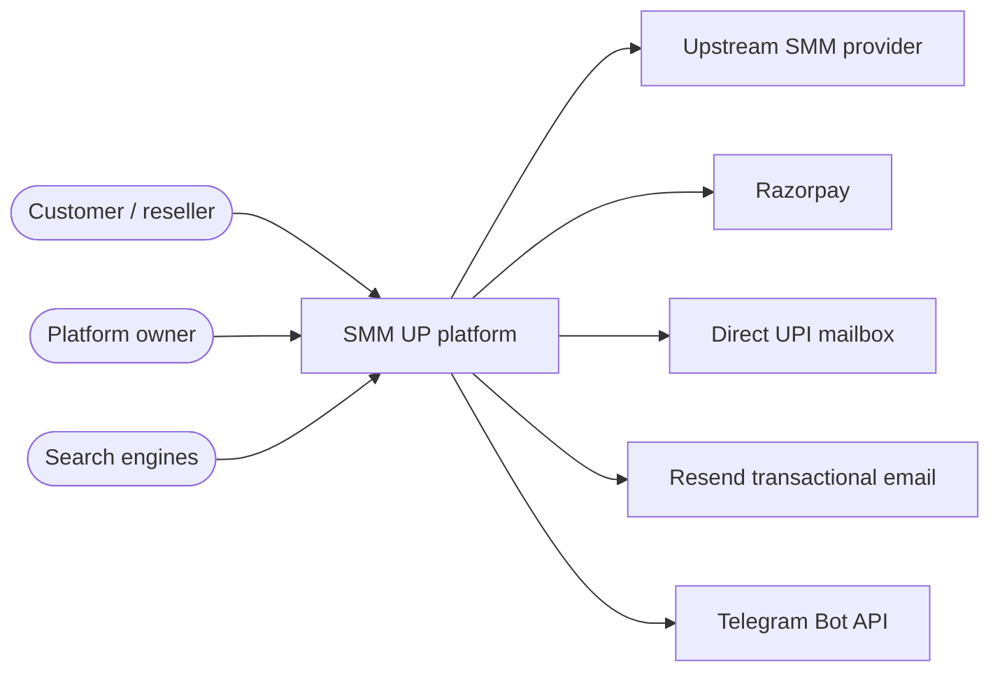
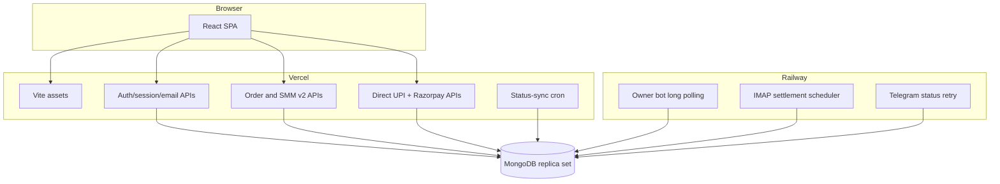
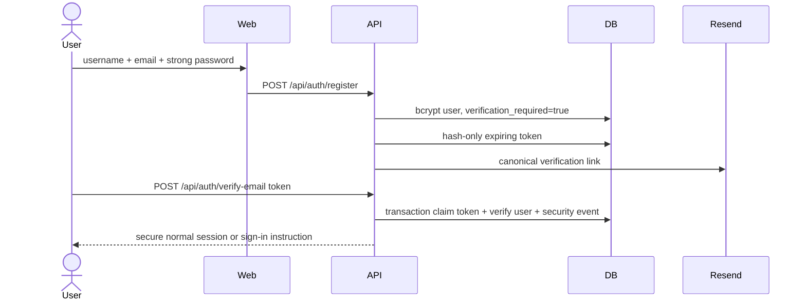
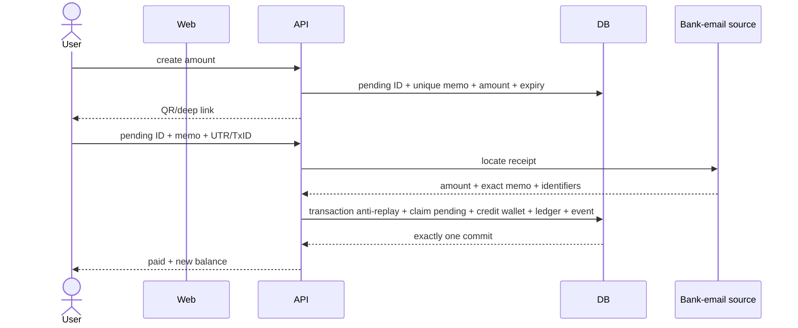
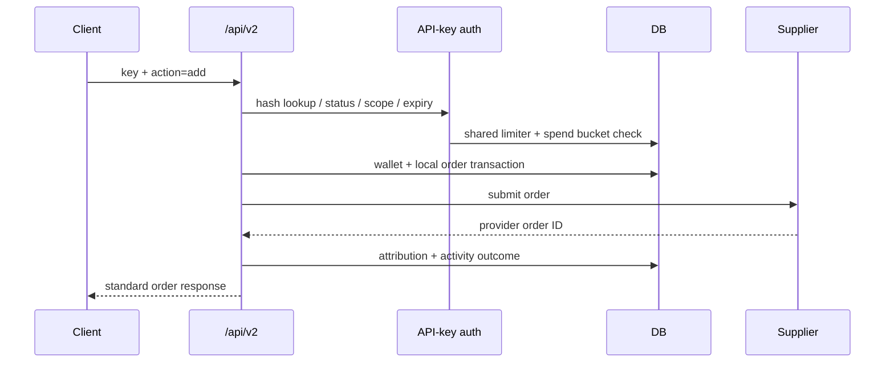
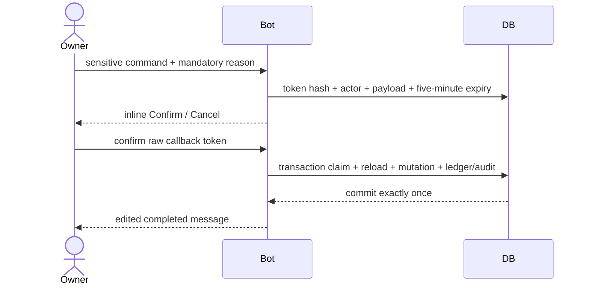
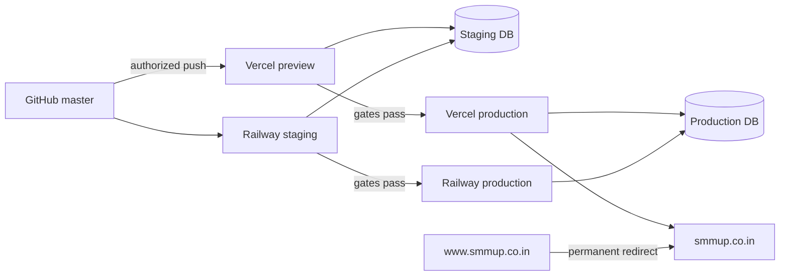

<p align="center">
  
</p>
<h1 align="center">SMM UP Full-System Architecture</h1>
<p align="center"><strong>Source-derived architecture snapshot · 2026-10-06</strong></p>
<p align="center"><code>IMPLEMENTED LOCALLY</code> · <code>SECURITY-FIRST</code> · <code>DEPLOYMENT PENDING</code></p>


> **Master registry:** 290 cross-system capabilities plus the complete embedded 730-entry website registry and 147-entry bot registry.
> **Total explicitly enumerated entries in this document:** 1167.
> **Specialized views:** [Website architecture](website-architecture.md) · [Bot architecture](bot-architecture.md)

<details open>
<summary><strong>Architecture drawer — click to expand/collapse</strong></summary>

- [Executive map](#executive-map)
- [Context](#c4-context)
- [Containers](#container-topology)
- [Trust and data](#trust-and-data-classification)
- [Journeys](#sequence-diagrams)
- [Master registry](#master-cross-system-registry)
- [Website registry](#embedded-website-registry)
- [Bot registry](#embedded-bot-registry)
- [Collections](#complete-collection-ownership)
- [Source map](#source-map)
- [Deployment](#deployment-topology)
- [Phases](#phase-ledger)
- [Launch gate](#final-launch-gate)

</details>


## Executive map

SMM UP is a security-first SMM ordering platform composed of a public/customer React application, Vercel serverless APIs, a MongoDB replica set, supplier/payment/email adapters, and an owner-only Telegram/Railway control plane. The system treats authentication secrets, financial settlement and administrative mutation as separate trust domains.

```text
CUSTOMER PLANE                    OWNER PLANE
Browser                           Telegram owner account
  | HTTPS                           | Bot API long polling
Vercel React + APIs               Railway bot + IMAP worker
  |             \                  /          |
  |              \                /           | IMAP
MongoDB replica set <------------/        Payment mailbox
  |       |       |
Supplier  Razorpay Resend
```

## C4 context



## Container topology



## Trust and data classification

| Class | Examples | Storage/transport rule |
|---|---|---|
| Public | service IDs, public rates, route metadata, approved reviews | May be cached/rendered publicly after sanitization |
| Account-private | email, wallet, orders, targets, deposit IDs | Authenticated owner/user access; bounded support visibility |
| Operational-sensitive | provider IDs, admin reasons, security events, device metadata | MongoDB + owner-controlled views; bounded retention where appropriate |
| Credential-derived | token hashes, password hashes, API-key hashes | Server/database only; never returned |
| One-time secret | API-key secret, email link token, support code, temporary credential | Shown/delivered once; hash-only durable state; encrypted only for five-minute owner action when necessary |
| Provider secret | supplier key, Razorpay secret, webhook secret, Resend key, bot token, IMAP password | Provider secret store only; never browser/MongoDB/audit/Telegram |
| Forbidden collection | UPI PIN, OTP, CVV, banking password | Never requested or stored |

## Sequence diagrams

### Verified registration



### Exact Direct UPI settlement



### API-key order



### Telegram administrative mutation



## Master cross-system registry


### End-to-end journey: Public discovery

- **SYS-0001** — Public discovery step: Google/user reaches apex canonical route.
- **SYS-0002** — Public discovery step: React shell resolves route from pathname.
- **SYS-0003** — Public discovery step: SEO registry applies canonical metadata and JSON-LD.
- **SYS-0004** — Public discovery step: real internal anchors remain crawlable.
- **SYS-0005** — Public discovery step: service catalog is fetched and sanitized.
- **SYS-0006** — Public discovery step: user can navigate to order/auth/support/legal/platform pages.

### End-to-end journey: Verified registration

- **SYS-0007** — Verified registration step: shared IP limiter permits bounded attempt.
- **SYS-0008** — Verified registration step: username/email/password validated.
- **SYS-0009** — Verified registration step: password bcrypt hash created.
- **SYS-0010** — Verified registration step: user stored unverified.
- **SYS-0011** — Verified registration step: prior account uniqueness checked.
- **SYS-0012** — Verified registration step: hash-only one-time registration token stored.
- **SYS-0013** — Verified registration step: Resend receives action link.
- **SYS-0014** — Verified registration step: no normal session exists yet.
- **SYS-0015** — Verified registration step: verification transaction claims token once.
- **SYS-0016** — Verified registration step: user marked verified.
- **SYS-0017** — Verified registration step: security event written.
- **SYS-0018** — Verified registration step: normal session optionally issued.

### End-to-end journey: Normal login

- **SYS-0019** — Normal login step: shared IP limiter increments.
- **SYS-0020** — Normal login step: identity lookup uses email or case-insensitive username.
- **SYS-0021** — Normal login step: account lock enforced.
- **SYS-0022** — Normal login step: bcrypt verifies supplied password.
- **SYS-0023** — Normal login step: unverified new account blocked.
- **SYS-0024** — Normal login step: server session random token generated.
- **SYS-0025** — Normal login step: only token hash stored.
- **SYS-0026** — Normal login step: HttpOnly SameSite cookie set.
- **SYS-0027** — Normal login step: login security event persisted.
- **SYS-0028** — Normal login step: safe account state returned.

### End-to-end journey: Temporary recovery

- **SYS-0029** — Temporary recovery step: owner queues Telegram reset with reason.
- **SYS-0030** — Temporary recovery step: five-minute action requires confirmation.
- **SYS-0031** — Temporary recovery step: custom value encrypted or generated after confirmation.
- **SYS-0032** — Temporary recovery step: old sessions and temporary values revoked.
- **SYS-0033** — Temporary recovery step: bcrypt temporary hash stored.
- **SYS-0034** — Temporary recovery step: temporary login increments use atomically.
- **SYS-0035** — Temporary recovery step: only restricted password-change cookie issued.
- **SYS-0036** — Temporary recovery step: user submits policy-compliant permanent password.
- **SYS-0037** — Temporary recovery step: transaction replaces permanent hash and revokes every session.
- **SYS-0038** — Temporary recovery step: Telegram status edit reports completion.

### End-to-end journey: Verified email reset

- **SYS-0039** — Verified email reset step: generic forgot response prevents enumeration.
- **SYS-0040** — Verified email reset step: shared limiter applies.
- **SYS-0041** — Verified email reset step: old reset token superseded.
- **SYS-0042** — Verified email reset step: hash-only short-lived token stored.
- **SYS-0043** — Verified email reset step: Resend action link delivered.
- **SYS-0044** — Verified email reset step: new password policy checked.
- **SYS-0045** — Verified email reset step: token/user/email claimed in transaction.
- **SYS-0046** — Verified email reset step: password bcrypt hash replaced.
- **SYS-0047** — Verified email reset step: mailbox treated as verified.
- **SYS-0048** — Verified email reset step: all session classes revoked.
- **SYS-0049** — Verified email reset step: token replay fails.

### End-to-end journey: Email change

- **SYS-0050** — Email change step: normal session and current password required.
- **SYS-0051** — Email change step: new normalized email uniqueness checked.
- **SYS-0052** — Email change step: new-mailbox token sent.
- **SYS-0053** — Email change step: current email remains unchanged until verification.
- **SYS-0054** — Email change step: token claimed transactionally.
- **SYS-0055** — Email change step: user email and verification timestamp change.
- **SYS-0056** — Email change step: normal/support/restricted sessions revoked.
- **SYS-0057** — Email change step: security event recorded.
- **SYS-0058** — Email change step: user signs in again with new email.

### End-to-end journey: Website order

- **SYS-0059** — Website order step: service selected from sanitized catalog.
- **SYS-0060** — Website order step: type-specific inputs validated.
- **SYS-0061** — Website order step: normal auth required.
- **SYS-0062** — Website order step: Support Access mutation denied.
- **SYS-0063** — Website order step: shared account order limiter checked.
- **SYS-0064** — Website order step: ordering hold checked.
- **SYS-0065** — Website order step: server reloads service/rate rules.
- **SYS-0066** — Website order step: wallet sufficiency verified.
- **SYS-0067** — Website order step: transaction creates local order and wallet charge.
- **SYS-0068** — Website order step: provider call runs with private supplier key.
- **SYS-0069** — Website order step: provider status stored.
- **SYS-0070** — Website order step: UI refreshes balance and logs.

### End-to-end journey: API-key creation

- **SYS-0071** — API-key creation step: normal session required.
- **SYS-0072** — API-key creation step: key-management limiter checked.
- **SYS-0073** — API-key creation step: name/scopes/limits/expiry validated.
- **SYS-0074** — API-key creation step: idempotency request checked.
- **SYS-0075** — API-key creation step: wallet fee validated.
- **SYS-0076** — API-key creation step: transaction debits wallet once.
- **SYS-0077** — API-key creation step: stable public identity and version created.
- **SYS-0078** — API-key creation step: only secret hash stored.
- **SYS-0079** — API-key creation step: raw secret returned once.
- **SYS-0080** — API-key creation step: audit and ledger attribution stored.

### End-to-end journey: API v2 order

- **SYS-0081** — API v2 order step: raw key accepted through supported transport.
- **SYS-0082** — API v2 order step: key hash resolves current active version.
- **SYS-0083** — API v2 order step: expiry/status/reissue state checked.
- **SYS-0084** — API v2 order step: shared per-key limiter checked.
- **SYS-0085** — API v2 order step: orders:create scope required.
- **SYS-0086** — API v2 order step: daily/monthly IST spend bucket checked atomically.
- **SYS-0087** — API v2 order step: account ordering hold checked.
- **SYS-0088** — API v2 order step: wallet and local order transaction commits.
- **SYS-0089** — API v2 order step: activity records key/version/action/outcome.
- **SYS-0090** — API v2 order step: response returns standard SMM order ID.

### End-to-end journey: Direct UPI

- **SYS-0091** — Direct UPI step: normal account and payment-hold check.
- **SYS-0092** — Direct UPI step: shared creation limiter checked.
- **SYS-0093** — Direct UPI step: bounded two-decimal amount validated.
- **SYS-0094** — Direct UPI step: unique memo and exact pending transaction stored.
- **SYS-0095** — Direct UPI step: QR/deep link contains amount and memo.
- **SYS-0096** — Direct UPI step: browser polls exact transaction ID.
- **SYS-0097** — Direct UPI step: worker or manual path finds receipt.
- **SYS-0098** — Direct UPI step: receipt amount matches exact paise.
- **SYS-0099** — Direct UPI step: receipt memo matches pending memo.
- **SYS-0100** — Direct UPI step: UTR/TxID/memo anti-replay inserts.
- **SYS-0101** — Direct UPI step: wallet/pending/ledger/security commit together.
- **SYS-0102** — Direct UPI step: concurrent retry cannot double credit.

### End-to-end journey: Razorpay

- **SYS-0103** — Razorpay step: server validates amount and mode.
- **SYS-0104** — Razorpay step: server creates provider order in paise.
- **SYS-0105** — Razorpay step: unique pending transaction stored.
- **SYS-0106** — Razorpay step: browser opens checkout with public key ID only.
- **SYS-0107** — Razorpay step: verification checks HMAC and captured state.
- **SYS-0108** — Razorpay step: webhook independently checks raw-body signature.
- **SYS-0109** — Razorpay step: provider event ID deduplicates replay.
- **SYS-0110** — Razorpay step: wallet settlement key credits once.
- **SYS-0111** — Razorpay step: refund/dispute state can hold account.
- **SYS-0112** — Razorpay step: test-mode credits are explicitly controlled.

### End-to-end journey: Purchase review

- **SYS-0113** — Purchase review step: public approved list loads.
- **SYS-0114** — Purchase review step: authenticated eligibility checks completed purchase.
- **SYS-0115** — Purchase review step: one-review-per-user uniqueness applies.
- **SYS-0116** — Purchase review step: shared submit limiter applies.
- **SYS-0117** — Purchase review step: bounded rating/text stored pending.
- **SYS-0118** — Purchase review step: owner sees Telegram review queue.
- **SYS-0119** — Purchase review step: inline toggle approves or hides.
- **SYS-0120** — Purchase review step: admin audit logs moderation.

### End-to-end journey: Support Access

- **SYS-0121** — Support Access step: owner creates one-time code in Telegram.
- **SYS-0122** — Support Access step: only code hash persists.
- **SYS-0123** — Support Access step: normal owner session required for exchange.
- **SYS-0124** — Support Access step: five-minute code is atomically consumed.
- **SYS-0125** — Support Access step: separate support cookie issued.
- **SYS-0126** — Support Access step: session stores actor and subject separately.
- **SYS-0127** — Support Access step: read-only banner and countdown render.
- **SYS-0128** — Support Access step: page views are audited.
- **SYS-0129** — Support Access step: all mutation endpoints deny support purpose.
- **SYS-0130** — Support Access step: exit/revocation ends only support context.

### End-to-end journey: Telegram wallet action

- **SYS-0131** — Telegram wallet action step: numeric owner guard runs.
- **SYS-0132** — Telegram wallet action step: mandatory reason syntax parsed.
- **SYS-0133** — Telegram wallet action step: user and amount validated.
- **SYS-0134** — Telegram wallet action step: random confirmation token generated.
- **SYS-0135** — Telegram wallet action step: only hash stored with five-minute expiry.
- **SYS-0136** — Telegram wallet action step: owner presses actor-bound confirm.
- **SYS-0137** — Telegram wallet action step: transaction claims current pending action.
- **SYS-0138** — Telegram wallet action step: current balance is reloaded.
- **SYS-0139** — Telegram wallet action step: ledger/transaction/audit mutate together.
- **SYS-0140** — Telegram wallet action step: message edits to completed.
- **SYS-0141** — Telegram wallet action step: replay returns stale response.

### End-to-end journey: Railway IMAP settlement

- **SYS-0142** — Railway IMAP settlement step: scheduler checks local activity.
- **SYS-0143** — Railway IMAP settlement step: replica acquires MongoDB lease.
- **SYS-0144** — Railway IMAP settlement step: INBOX lock bounds scan.
- **SYS-0145** — Railway IMAP settlement step: sender/date filters select mail.
- **SYS-0146** — Railway IMAP settlement step: quoted-printable body decoded.
- **SYS-0147** — Railway IMAP settlement step: memo/UTR/TxID/amount parsed.
- **SYS-0148** — Railway IMAP settlement step: exact pending record selected by memo.
- **SYS-0149** — Railway IMAP settlement step: integer-paise amount checked.
- **SYS-0150** — Railway IMAP settlement step: transaction credits once.
- **SYS-0151** — Railway IMAP settlement step: reconciliation tracks anomalies.
- **SYS-0152** — Railway IMAP settlement step: health heartbeat persists.
- **SYS-0153** — Railway IMAP settlement step: repeated failures alert owner.

### End-to-end journey: Cron status synchronization

- **SYS-0154** — Cron status synchronization step: Vercel invokes scheduled GET.
- **SYS-0155** — Cron status synchronization step: missing/short secret returns 503.
- **SYS-0156** — Cron status synchronization step: bad bearer returns 401.
- **SYS-0157** — Cron status synchronization step: constant-time comparison validates configured secret.
- **SYS-0158** — Cron status synchronization step: bounded order set selected.
- **SYS-0159** — Cron status synchronization step: provider status normalized.
- **SYS-0160** — Cron status synchronization step: local statuses updated.
- **SYS-0161** — Cron status synchronization step: failures are logged without exposing supplier key.

### End-to-end journey: Catalog refresh

- **SYS-0162** — Catalog refresh step: public GET reads normal catalog cache.
- **SYS-0163** — Catalog refresh step: public refresh query cannot force supplier call.
- **SYS-0164** — Catalog refresh step: refresh requires POST.
- **SYS-0165** — Catalog refresh step: normal owner session required.
- **SYS-0166** — Catalog refresh step: supplier data is sanitized.
- **SYS-0167** — Catalog refresh step: private markup configuration stays server-side.
- **SYS-0168** — Catalog refresh step: client receives public calculated rates only.

### End-to-end journey: Release

- **SYS-0169** — Release step: clean dependency install.
- **SYS-0170** — Release step: root/admin TypeScript.
- **SYS-0171** — Release step: production Vite build.
- **SYS-0172** — Release step: replica-set suites run sequentially.
- **SYS-0173** — Release step: production dependency audits.
- **SYS-0174** — Release step: diff whitespace check.
- **SYS-0175** — Release step: tracked/history secret scan.
- **SYS-0176** — Release step: Vercel preview and Railway staging.
- **SYS-0177** — Release step: production smoke after explicit push approval.
- **SYS-0178** — Release step: fresh push credential revoked immediately.
- **SYS-0179** — Release step: Search Console homepage indexing requested.

### Architecture invariants

- **SYS-0180** — Permanent passwords are bcrypt hashes and are never retrievable by owner or user.
- **SYS-0181** — Password complexity runs on registration and password creation/reset, never as a login rejection rule.
- **SYS-0182** — Normal sessions are random hash-only MongoDB records in HttpOnly SameSite cookies.
- **SYS-0183** — Legacy JWT acceptance is bounded by per-user revocation cutoffs during migration.
- **SYS-0184** — Support Access uses a separate cookie and cannot replace or destroy the owner normal session.
- **SYS-0185** — Support actor and subject IDs are preserved independently on every support audit/session record.
- **SYS-0186** — Support sessions are read-only across orders, deposits, reviews, keys, sessions, registration and password mutation.
- **SYS-0187** — API-key raw secrets are returned once; only version hashes and masked hints persist.
- **SYS-0188** — API-key pause preserves the secret; archive and reissue revoke versions.
- **SYS-0189** — Owner-required reissue cannot resume until secure website rotation completes.
- **SYS-0190** — Wallet charges/refunds/credits use settlement keys and replica-set transactions.
- **SYS-0191** — Direct UPI requires exact user, pending ID, unexpired status, amount-in-paise and receipt memo.
- **SYS-0192** — UTR, transaction ID and memo have independent sparse uniqueness constraints.
- **SYS-0193** — Razorpay checkout orders are server-created in paise and signatures are server verified.
- **SYS-0194** — Razorpay webhooks require raw-body HMAC and provider event deduplication.
- **SYS-0195** — Refund/dispute signals can place holds that block new spend or deposits.
- **SYS-0196** — Rate limits are shared MongoDB counters rather than process memory.
- **SYS-0197** — Rate-limit identifiers are HMACed before storage.
- **SYS-0198** — Cron execution fails closed when CRON_SECRET is absent or short.
- **SYS-0199** — Cron bearer comparison is constant time when lengths match.
- **SYS-0200** — Catalog refresh requires POST plus a normal owner session.
- **SYS-0201** — Critical indexes are awaited before getDb resolves.
- **SYS-0202** — Security events are persistent and TTL bounded.
- **SYS-0203** — Email action tokens are random, hash-only, expiring, superseded and one-time.
- **SYS-0204** — Resend and forgot-password responses avoid account enumeration.
- **SYS-0205** — Email change requires the current password and new-mailbox confirmation.
- **SYS-0206** — Email change and password reset revoke normal, support and restricted sessions.
- **SYS-0207** — Telegram commands and callbacks reject every non-owner numeric Telegram ID.
- **SYS-0208** — Telegram confirmations bind to actor, token hash, status and five-minute expiry.
- **SYS-0209** — Confirmation claiming and mutation occur in one MongoDB transaction.
- **SYS-0210** — Telegram stale/replayed buttons cannot execute twice.
- **SYS-0211** — Owner-selected temporary-password action state is AES-GCM protected and removed on completion/cancel.
- **SYS-0212** — Temporary-password login can create only a restricted password-change session.
- **SYS-0213** — IMAP settlement replicas coordinate through a MongoDB lease and exact transactional settlement.
- **SYS-0214** — Worker health records heartbeat, success, errors and consecutive failure counts.
- **SYS-0215** — Payment reconciliation never guesses a credit when amount or memo cannot be proven.
- **SYS-0216** — No UPI PIN, OTP, CVV or banking password is requested or stored.
- **SYS-0217** — No raw cookie, authorization header, API secret or password is placed in activity/audit records.
- **SYS-0218** — Content Security Policy restricts scripts, frames, images, fonts and connections to required origins.
- **SYS-0219** — All API routes return no-store/noindex headers through Vercel configuration.
- **SYS-0220** — The apex domain is the canonical target and www is configured for permanent redirect.
- **SYS-0221** — The website and bot share MongoDB but have separate process lifecycles and provider credentials.
- **SYS-0222** — The bot is an administrative transport, never an alternative place to expose website secrets.
- **SYS-0223** — Every financial mutation has a durable idempotency or settlement identity.
- **SYS-0224** — Every one-time credential is random, expiring, hash-only at rest or short-lived encrypted action state where plaintext must survive confirmation.
- **SYS-0225** — Every read-only support capability is purpose-checked server-side rather than enforced only by disabled UI.
- **SYS-0226** — Every public route uses real internal hrefs for crawlability.
- **SYS-0227** — Every deployment-dependent assertion remains a gate until provider-side smoke verification passes.

### Approved product constraints

- **SYS-0228** — The static top haze orb remains in `App.tsx`.
- **SYS-0229** — Dedicated platform SEO pages are exactly Telegram, Instagram, YouTube, Twitter/X, TikTok and Spotify.
- **SYS-0230** — No rate calculator is introduced.
- **SYS-0231** — Breadcrumb middle labels never imitate nonexistent links.
- **SYS-0232** — Support destinations are genuinely clickable.
- **SYS-0233** — Reviews require prior purchase and six existing homepage reviews remain.
- **SYS-0234** — Review moderation is Telegram-only.
- **SYS-0235** — Private markup multipliers are not disclosed in public source or documentation.
- **SYS-0236** — Service Terms opens the real Terms page.
- **SYS-0237** — Account remains `/account`; `/profile` redirects there.
- **SYS-0238** — Add Funds remains `/add-funds`.
- **SYS-0239** — Telegram inline controls are preferred and no website admin panel exists.
- **SYS-0240** — Permanent passwords remain unreadable bcrypt hashes.
- **SYS-0241** — Temporary-password default lifetime is three hours and max uses two, both bounded by configuration.
- **SYS-0242** — Support Access exchange is five minutes and support session is fifteen minutes.
- **SYS-0243** — API keys may retain operational order data but no raw secrets/headers/cookies.
- **SYS-0244** — API-key expiration is optional and IP allowlisting is excluded.
- **SYS-0245** — New key identity fee defaults to ₹29; secure rotation is free; archive has no refund.
- **SYS-0246** — No UPI PIN, OTP, CVV or banking password is requested or stored.

### Deployment and operations

- **SYS-0247** — MONGODB_URI (Vercel + Railway): MongoDB replica-set/Atlas connection; secret.
- **SYS-0248** — DATABASE_NAME / MONGODB_DB_NAME (Vercel / Railway): Shared logical database name.
- **SYS-0249** — JWT_SECRET (Vercel): Legacy token and fallback HMAC secret; high entropy.
- **SYS-0250** — SESSION_METADATA_HASH_SECRET (Vercel): Hashes session device/network metadata.
- **SYS-0251** — RATE_LIMIT_HASH_SECRET (Vercel): HMACs persistent limiter keys.
- **SYS-0252** — PANEL_URL / PANEL_KEY (Vercel): Supplier API endpoint and secret.
- **SYS-0253** — TIER1_MARKUP / TIER2_MARKUP (Vercel): Private pricing configuration; values must never be disclosed in public source/docs.
- **SYS-0254** — UPI_VPA / UPI_MERCHANT_NAME (Vercel): Direct UPI destination and display name.
- **SYS-0255** — DIRECT_UPI_PENDING_TTL_MINUTES (Vercel): Bounded pending QR lifetime.
- **SYS-0256** — DIRECT_UPI_MAX_AMOUNT_INR (Vercel): Bounded Direct UPI amount ceiling.
- **SYS-0257** — RAZORPAY_KEY_ID / RAZORPAY_KEY_SECRET (Vercel): Razorpay API credentials.
- **SYS-0258** — RAZORPAY_WEBHOOK_SECRET (Vercel): Webhook HMAC secret.
- **SYS-0259** — RAZORPAY_MODE / RAZORPAY_ALLOW_TEST_WALLET_CREDIT (Vercel): Explicit test/live safeguards.
- **SYS-0260** — RESEND_API_KEY / EMAIL_FROM (Vercel): Transactional email provider and verified sender.
- **SYS-0261** — PUBLIC_SITE_URL (Vercel): Canonical origin used in email links.
- **SYS-0262** — CRON_SECRET (Vercel): At least 32-character internal cron bearer secret.
- **SYS-0263** — API_KEY_CREATION_FEE_INR / API_KEY_MAX_IDENTITIES (Vercel): Key product policy with bounded defaults.
- **SYS-0264** — API_ACTIVITY_HASH_SECRET (Vercel): Hashes sensitive activity dimensions where used.
- **SYS-0265** — TELEGRAM_BOT_TOKEN / TELEGRAM_OWNER_ID (Railway): Bot API secret and immutable owner identity.
- **SYS-0266** — ADMIN_BOT_STATE_SECRET (Railway): AES-GCM key material for short-lived protected action state.
- **SYS-0267** — TELEGRAM_ADMIN_CHAT_ID (Vercel): Payment/security alert destination.
- **SYS-0268** — IMAP_USER / IMAP_PASSWORD (Railway or Vercel manual verifier): Mailbox credentials; app password only.
- **SYS-0269** — FAMPAY_EMAIL / FAMPAY_APP_PASSWORD (Vercel compatibility): Direct UPI mailbox configuration.
- **SYS-0270** — FAMPAY_SENDER_FILTER (Railway): Expected payment-email sender.
- **SYS-0271** — ENABLE_IMAP_WORKER (Railway): Explicit worker enable switch.
- **SYS-0272** — TEMP_PASSWORD_TTL_MINUTES / TEMP_PASSWORD_MAX_USES (Both): Bounded temporary-credential policy.
- **SYS-0273** — TEMP_PASSWORD_SESSION_TTL_MINUTES (Vercel): Restricted change-session lifetime.

### Validation gates

- **SYS-0274** — npm run typecheck: Root TypeScript.
- **SYS-0275** — npm run build: Vite production build.
- **SYS-0276** — npm run test:search-appearance: favicon/logo/schema static eligibility.
- **SYS-0277** — npm run test:api-keys: replica-set API-key financial/lifecycle concurrency.
- **SYS-0278** — npm run test:recovery: temporary credential and session concurrency.
- **SYS-0279** — npm run test:support-access: actor/subject, read-only and one-time exchange.
- **SYS-0280** — npm run test:rate-limit: shared limiter concurrency and raw-key exclusion.
- **SYS-0281** — npm run test:direct-upi: exact, held, expired and concurrent settlement.
- **SYS-0282** — npm run test:email-delivery: hash-only token and provider payload.
- **SYS-0283** — npm run test:email-auth: verified registration/reset/email-change/replay.
- **SYS-0284** — npm run test:core-indexes: critical index availability/options.
- **SYS-0285** — admin: npx tsc --noEmit: bot TypeScript.
- **SYS-0286** — admin: npm run test:admin-actions: wallet/refund/control/API/worker transactional checks.
- **SYS-0287** — npm audit --omit=dev: root production dependency audit.
- **SYS-0288** — admin npm audit --omit=dev: bot production dependency audit.
- **SYS-0289** — git diff --check: whitespace integrity.
- **SYS-0290** — credential-pattern scan: working tree and Git history secret patterns.

## Embedded website registry

<details>
<summary><strong>Expand all 730 website capabilities</strong></summary>


### Application shell and routing

- **WEB-0001** — The browser application is a React/Vite single-page application rooted in `src/App.tsx`.
- **WEB-0002** — `src/lib/routes.ts` is the canonical tab-to-path registry used by navigation and canonical URL generation.
- **WEB-0003** — Initial route state is derived from `window.location.pathname` with trailing-slash normalization.
- **WEB-0004** — Unknown paths render a dedicated not-found page instead of silently becoming the homepage.
- **WEB-0005** — Same-origin real `<a href>` links remain crawlable and are intercepted only for eligible unmodified clicks.
- **WEB-0006** — Browser back/forward events re-resolve route state, SEO metadata and structured data.
- **WEB-0007** — Route transitions scroll to the top and update title, description, canonical, Open Graph and JSON-LD.
- **WEB-0008** — Guarded account routes redirect unauthenticated users to the permanent authentication page.
- **WEB-0009** — The static top ambient haze orb remains part of the application shell.
- **WEB-0010** — Mobile bottom navigation and desktop navigation share real canonical destinations.
- **WEB-0011** — Support Access adds a persistent read-only banner and one-second expiry countdown.
- **WEB-0012** — Support Access automatically exits when its server-issued expiry time passes.

### Route /

- **WEB-0013** — Route `/` maps to tab `home` and renderer `LandingHero + GuaranteesBento + ReviewsSection + FaqSection`.
- **WEB-0014** — Route `/` access model is: Public.
- **WEB-0015** — Route `/` provides cinematic brand hero.
- **WEB-0016** — Route `/` provides embedded sign-in and registration terminal.
- **WEB-0017** — Route `/` provides live service-count display.
- **WEB-0018** — Route `/` provides platform discovery cards.
- **WEB-0019** — Route `/` provides guarantee and trust bento.
- **WEB-0020** — Route `/` provides preserved homepage review carousel.
- **WEB-0021** — Route `/` provides FAQ preview with real link to the full FAQ.
- **WEB-0022** — Route `/` provides real calls to order, catalog, API and account routes.

### Route /order

- **WEB-0023** — Route `/order` maps to tab `order` and renderer `NewOrder`.
- **WEB-0024** — Route `/order` access model is: Public; authentication required to submit.
- **WEB-0025** — Route `/order` provides service search and platform/category filtering.
- **WEB-0026** — Route `/order` provides service selection and preselection from catalog.
- **WEB-0027** — Route `/order` provides dynamic minimum/maximum validation.
- **WEB-0028** — Route `/order` provides Default, Package, Custom Comments and Poll input modes.
- **WEB-0029** — Route `/order` provides quantity, comments and answer-number handling.
- **WEB-0030** — Route `/order` provides live charge calculation without exposing internal markup.
- **WEB-0031** — Route `/order` provides public-target guidance.
- **WEB-0032** — Route `/order` provides wallet balance check.
- **WEB-0033** — Route `/order` provides authenticated order submission.
- **WEB-0034** — Route `/order` provides success-state account totals refresh.

### Route /catalog

- **WEB-0035** — Route `/catalog` maps to tab `catalog` and renderer `ServicesCatalog`.
- **WEB-0036** — Route `/catalog` access model is: Public.
- **WEB-0037** — Route `/catalog` provides live supplier-backed service list.
- **WEB-0038** — Route `/catalog` provides brand sanitization.
- **WEB-0039** — Route `/catalog` provides platform and category filters.
- **WEB-0040** — Route `/catalog` provides search.
- **WEB-0041** — Route `/catalog` provides sorting and responsive card/table views.
- **WEB-0042** — Route `/catalog` provides rate, minimum, maximum, refill, cancellation and average-time metadata.
- **WEB-0043** — Route `/catalog` provides real select-service navigation into /order.

### Route /mass

- **WEB-0044** — Route `/mass` maps to tab `mass` and renderer `MassOrder`.
- **WEB-0045** — Route `/mass` access model is: Public; authentication required to submit.
- **WEB-0046** — Route `/mass` provides multiline batch parser.
- **WEB-0047** — Route `/mass` provides service/target/quantity row syntax.
- **WEB-0048** — Route `/mass` provides row-level validation.
- **WEB-0049** — Route `/mass` provides batch submission sequencing.
- **WEB-0050** — Route `/mass` provides aggregate success and failure reporting.

### Route /logs

- **WEB-0051** — Route `/logs` maps to tab `logs` and renderer `OrderHistory`.
- **WEB-0052** — Route `/logs` access model is: Authenticated.
- **WEB-0053** — Route `/logs` provides bounded account order history.
- **WEB-0054** — Route `/logs` provides provider status synchronization.
- **WEB-0055** — Route `/logs` provides status badges.
- **WEB-0056** — Route `/logs` provides target and service metadata.
- **WEB-0057** — Route `/logs` provides refill eligibility/action.
- **WEB-0058** — Route `/logs` provides cancel eligibility/action.
- **WEB-0059** — Route `/logs` provides charge and quantity display.
- **WEB-0060** — Route `/logs` provides refresh control.

### Route /auth

- **WEB-0061** — Route `/auth` maps to tab `auth` and renderer `AuthPage`.
- **WEB-0062** — Route `/auth` access model is: Public.
- **WEB-0063** — Route `/auth` provides sign-in and registration modes.
- **WEB-0064** — Route `/auth` provides verified-email registration handoff.
- **WEB-0065** — Route `/auth` provides email-verification link consumption.
- **WEB-0066** — Route `/auth` provides verification resend.
- **WEB-0067** — Route `/auth` provides forgot-password request.
- **WEB-0068** — Route `/auth` provides email-reset link consumption.
- **WEB-0069** — Route `/auth` provides temporary-password routing to mandatory permanent-password change.
- **WEB-0070** — Route `/auth` provides strong-password guidance.
- **WEB-0071** — Route `/auth` provides generic anti-enumeration recovery responses.

### Route /api

- **WEB-0072** — Route `/api` maps to tab `api` and renderer `ApiDocs`.
- **WEB-0073** — Route `/api` access model is: Public.
- **WEB-0074** — Route `/api` provides standard SMM v2 endpoint documentation.
- **WEB-0075** — Route `/api` provides named-key onboarding.
- **WEB-0076** — Route `/api` provides authentication methods.
- **WEB-0077** — Route `/api` provides scope mapping.
- **WEB-0078** — Route `/api` provides daily/monthly limits.
- **WEB-0079** — Route `/api` provides optional expiration.
- **WEB-0080** — Route `/api` provides pause/resume/rotate/archive lifecycle.
- **WEB-0081** — Route `/api` provides one-time secret warning.
- **WEB-0082** — Route `/api` provides request/response examples.
- **WEB-0083** — Route `/api` provides error and rate-limit matrix.
- **WEB-0084** — Route `/api` provides language examples.
- **WEB-0085** — Route `/api` provides responsive documentation index.

### Route /playground

- **WEB-0086** — Route `/playground` maps to tab `playground` and renderer `ApiPlayground`.
- **WEB-0087** — Route `/playground` access model is: Public shell; key required for calls.
- **WEB-0088** — Route `/playground` provides interactive action selection.
- **WEB-0089** — Route `/playground` provides parameter editing.
- **WEB-0090** — Route `/playground` provides request execution against /api/v2.
- **WEB-0091** — Route `/playground` provides JSON response inspection.
- **WEB-0092** — Route `/playground` provides key stays browser-entered and is not persisted by documentation code.
- **WEB-0093** — Route `/playground` provides links back to API documentation.

### Route /account

- **WEB-0094** — Route `/account` maps to tab `account` and renderer `AccountPage`.
- **WEB-0095** — Route `/account` access model is: Authenticated.
- **WEB-0096** — Route `/account` provides identity and verified-email display.
- **WEB-0097** — Route `/account` provides wallet/order/spend summary.
- **WEB-0098** — Route `/account` provides email-change request with current-password confirmation.
- **WEB-0099** — Route `/account` provides session inventory and revocation.
- **WEB-0100** — Route `/account` provides multiple named API-key identities.
- **WEB-0101** — Route `/account` provides scope editor and synchronized Full Access.
- **WEB-0102** — Route `/account` provides daily/monthly key limits.
- **WEB-0103** — Route `/account` provides optional key expiration.
- **WEB-0104** — Route `/account` provides one-time secret reveal/copy.
- **WEB-0105** — Route `/account` provides pause/resume/rotate/archive/reissue handling.
- **WEB-0106** — Route `/account` provides key activity filters.
- **WEB-0107** — Route `/account` provides lifetime key reports.
- **WEB-0108** — Route `/account` provides support-session read-only rendering.

### Route /account/password-change

- **WEB-0109** — Route `/account/password-change` maps to tab `password-change` and renderer `PasswordChangePage`.
- **WEB-0110** — Route `/account/password-change` access model is: Restricted temporary-password session.
- **WEB-0111** — Route `/account/password-change` provides recovery-session validation.
- **WEB-0112** — Route `/account/password-change` provides new-password policy.
- **WEB-0113** — Route `/account/password-change` provides confirmation input.
- **WEB-0114** — Route `/account/password-change` provides transactional permanent-password replacement.
- **WEB-0115** — Route `/account/password-change` provides temporary credential invalidation.
- **WEB-0116** — Route `/account/password-change` provides normal/support/recovery session revocation.
- **WEB-0117** — Route `/account/password-change` provides normal session issuance after completion.

### Route /support-access

- **WEB-0118** — Route `/support-access` maps to tab `support-access` and renderer `SupportAccessPage`.
- **WEB-0119** — Route `/support-access` access model is: Normal owner session to exchange; support session to view.
- **WEB-0120** — Route `/support-access` provides one-time code input.
- **WEB-0121** — Route `/support-access` provides owner-role validation.
- **WEB-0122** — Route `/support-access` provides five-minute exchange window.
- **WEB-0123** — Route `/support-access` provides 15-minute read-only subject session.
- **WEB-0124** — Route `/support-access` provides separate support cookie.
- **WEB-0125** — Route `/support-access` provides actor and subject separation.
- **WEB-0126** — Route `/support-access` provides live support banner handoff.

### Route /transactions

- **WEB-0127** — Route `/transactions` maps to tab `transactions` and renderer `TransactionsPage`.
- **WEB-0128** — Route `/transactions` access model is: Authenticated or read-only Support Access.
- **WEB-0129** — Route `/transactions` provides bounded deposit and wallet-facing history.
- **WEB-0130** — Route `/transactions` provides Direct UPI and Razorpay identifiers.
- **WEB-0131** — Route `/transactions` provides amount, status and timestamp presentation.
- **WEB-0132** — Route `/transactions` provides no banking secret collection.

### Route /add-funds

- **WEB-0133** — Route `/add-funds` maps to tab `add-funds` and renderer `AddFundsPage`.
- **WEB-0134** — Route `/add-funds` access model is: Authenticated; blocked in Support Access/payment hold.
- **WEB-0135** — Route `/add-funds` provides separate Direct UPI and Razorpay rails.
- **WEB-0136** — Route `/add-funds` provides amount validation.
- **WEB-0137** — Route `/add-funds` provides dynamic memo and QR creation.
- **WEB-0138** — Route `/add-funds` provides exact pending transaction identifier retention.
- **WEB-0139** — Route `/add-funds` provides UPI deep link and copy controls.
- **WEB-0140** — Route `/add-funds` provides automatic status polling.
- **WEB-0141** — Route `/add-funds` provides manual UTR/transaction-ID verification.
- **WEB-0142** — Route `/add-funds` provides expired-request handling.
- **WEB-0143** — Route `/add-funds` provides confetti and balance refresh on success.
- **WEB-0144** — Route `/add-funds` provides Razorpay test/live configuration.
- **WEB-0145** — Route `/add-funds` provides server-created Razorpay order checkout.
- **WEB-0146** — Route `/add-funds` provides server verification and status checks.
- **WEB-0147** — Route `/add-funds` provides deposit history.

### Route /faq

- **WEB-0148** — Route `/faq` maps to tab `faq` and renderer `FaqPage`.
- **WEB-0149** — Route `/faq` access model is: Public.
- **WEB-0150** — Route `/faq` provides full categorized FAQ.
- **WEB-0151** — Route `/faq` provides crawlable content.
- **WEB-0152** — Route `/faq` provides breadcrumb navigation.
- **WEB-0153** — Route `/faq` provides support and policy cross-links.

### Route /review

- **WEB-0154** — Route `/review` maps to tab `reviews` and renderer `ReviewsPage`.
- **WEB-0155** — Route `/review` access model is: Public list; authenticated purchase required to submit.
- **WEB-0156** — Route `/review` provides approved-review list.
- **WEB-0157** — Route `/review` provides six preserved homepage seed reviews.
- **WEB-0158** — Route `/review` provides purchase eligibility check.
- **WEB-0159** — Route `/review` provides one review per eligible account.
- **WEB-0160** — Route `/review` provides rating and bounded text.
- **WEB-0161** — Route `/review` provides pending moderation state.
- **WEB-0162** — Route `/review` provides Telegram-only owner moderation.

### Route /support

- **WEB-0163** — Route `/support` maps to tab `support` and renderer `SupportPage`.
- **WEB-0164** — Route `/support` access model is: Public.
- **WEB-0165** — Route `/support` provides clickable support channels.
- **WEB-0166** — Route `/support` provides operational help content.
- **WEB-0167** — Route `/support` provides security guidance.
- **WEB-0168** — Route `/support` provides authenticated support context where available.

### Route /about

- **WEB-0169** — Route `/about` maps to tab `about` and renderer `AboutPage`.
- **WEB-0170** — Route `/about` access model is: Public.
- **WEB-0171** — Route `/about` provides company narrative.
- **WEB-0172** — Route `/about` provides founder/brand context.
- **WEB-0173** — Route `/about` provides internal links.
- **WEB-0174** — Route `/about` provides structured breadcrumb context.

### Route /responsible-growth

- **WEB-0175** — Route `/responsible-growth` maps to tab `responsible-growth` and renderer `ResponsibleGrowthPage`.
- **WEB-0176** — Route `/responsible-growth` access model is: Public.
- **WEB-0177** — Route `/responsible-growth` provides responsible-use guidance.
- **WEB-0178** — Route `/responsible-growth` provides expectation setting.
- **WEB-0179** — Route `/responsible-growth` provides platform-policy disclaimers.
- **WEB-0180** — Route `/responsible-growth` provides service selection guidance.

### Route /terms

- **WEB-0181** — Route `/terms` maps to tab `terms` and renderer `TermsPage`.
- **WEB-0182** — Route `/terms` access model is: Public.
- **WEB-0183** — Route `/terms` provides real Service Terms page.
- **WEB-0184** — Route `/terms` provides account/order/payment terms.
- **WEB-0185** — Route `/terms` provides limitation and acceptable-use cross-links.

### Route /privacy

- **WEB-0186** — Route `/privacy` maps to tab `privacy` and renderer `PrivacyPage`.
- **WEB-0187** — Route `/privacy` access model is: Public.
- **WEB-0188** — Route `/privacy` provides data categories.
- **WEB-0189** — Route `/privacy` provides processing purposes.
- **WEB-0190** — Route `/privacy` provides security boundaries.
- **WEB-0191** — Route `/privacy` provides retention and contact information.

### Route /refunds

- **WEB-0192** — Route `/refunds` maps to tab `refunds` and renderer `RefundsPage`.
- **WEB-0193** — Route `/refunds` access model is: Public.
- **WEB-0194** — Route `/refunds` provides wallet refund policy.
- **WEB-0195** — Route `/refunds` provides provider outcome rules.
- **WEB-0196** — Route `/refunds` provides non-refundable conditions.
- **WEB-0197** — Route `/refunds` provides support escalation.

### Route /acceptable-use

- **WEB-0198** — Route `/acceptable-use` maps to tab `acceptable-use` and renderer `AcceptableUsePage`.
- **WEB-0199** — Route `/acceptable-use` access model is: Public.
- **WEB-0200** — Route `/acceptable-use` provides prohibited conduct.
- **WEB-0201** — Route `/acceptable-use` provides platform-account responsibilities.
- **WEB-0202** — Route `/acceptable-use` provides abuse enforcement.
- **WEB-0203** — Route `/acceptable-use` provides security restrictions.

### Route /cookie-policy

- **WEB-0204** — Route `/cookie-policy` maps to tab `cookie-policy` and renderer `CookiePolicyPage`.
- **WEB-0205** — Route `/cookie-policy` access model is: Public.
- **WEB-0206** — Route `/cookie-policy` provides session-cookie explanation.
- **WEB-0207** — Route `/cookie-policy` provides restricted/support cookie purposes.
- **WEB-0208** — Route `/cookie-policy` provides browser preference disclosure.
- **WEB-0209** — Route `/cookie-policy` provides security attributes.

### Route /security

- **WEB-0210** — Route `/security` maps to tab `security` and renderer `SecurityPage`.
- **WEB-0211** — Route `/security` access model is: Public.
- **WEB-0212** — Route `/security` provides hash-only secret claims.
- **WEB-0213** — Route `/security` provides session and payment safeguards.
- **WEB-0214** — Route `/security` provides responsible disclosure path.
- **WEB-0215** — Route `/security` provides credential safety guidance.

### Route /abuse

- **WEB-0216** — Route `/abuse` maps to tab `abuse` and renderer `AbusePage`.
- **WEB-0217** — Route `/abuse` access model is: Public.
- **WEB-0218** — Route `/abuse` provides abuse reporting.
- **WEB-0219** — Route `/abuse` provides required evidence.
- **WEB-0220** — Route `/abuse` provides enforcement process.
- **WEB-0221** — Route `/abuse` provides contact path.

### Route /press

- **WEB-0222** — Route `/press` maps to tab `press` and renderer `PressPage`.
- **WEB-0223** — Route `/press` access model is: Public.
- **WEB-0224** — Route `/press` provides brand facts.
- **WEB-0225** — Route `/press` provides official identity links.
- **WEB-0226** — Route `/press` provides press/contact context.

### Route /status

- **WEB-0227** — Route `/status` maps to tab `status` and renderer `StatusPage`.
- **WEB-0228** — Route `/status` access model is: Public.
- **WEB-0229** — Route `/status` provides platform-status presentation.
- **WEB-0230** — Route `/status` provides dependency categories.
- **WEB-0231** — Route `/status` provides incident expectations.

### Route /changelog

- **WEB-0232** — Route `/changelog` maps to tab `changelog` and renderer `ChangelogPage`.
- **WEB-0233** — Route `/changelog` access model is: Public.
- **WEB-0234** — Route `/changelog` provides product change history.
- **WEB-0235** — Route `/changelog` provides security and capability highlights.

### Route /sitemap

- **WEB-0236** — Route `/sitemap` maps to tab `sitemap` and renderer `SitemapPage`.
- **WEB-0237** — Route `/sitemap` access model is: Public.
- **WEB-0238** — Route `/sitemap` provides human-readable route directory.
- **WEB-0239** — Route `/sitemap` provides real anchors to public pages.
- **WEB-0240** — Route `/sitemap` provides platform and legal grouping.

### Route /telegram-smm-panel

- **WEB-0241** — Route `/telegram-smm-panel` maps to tab `p-telegram` and renderer `PlatformPage`.
- **WEB-0242** — Route `/telegram-smm-panel` access model is: Public.
- **WEB-0243** — Route `/telegram-smm-panel` provides Telegram-specific services and copy.
- **WEB-0244** — Route `/telegram-smm-panel` provides platform-filtered catalog CTA.
- **WEB-0245** — Route `/telegram-smm-panel` provides platform FAQ and schema.

### Route /instagram-smm-panel

- **WEB-0246** — Route `/instagram-smm-panel` maps to tab `p-instagram` and renderer `PlatformPage`.
- **WEB-0247** — Route `/instagram-smm-panel` access model is: Public.
- **WEB-0248** — Route `/instagram-smm-panel` provides Instagram-specific services and copy.
- **WEB-0249** — Route `/instagram-smm-panel` provides platform-filtered catalog CTA.
- **WEB-0250** — Route `/instagram-smm-panel` provides platform FAQ and schema.

### Route /youtube-smm-panel

- **WEB-0251** — Route `/youtube-smm-panel` maps to tab `p-youtube` and renderer `PlatformPage`.
- **WEB-0252** — Route `/youtube-smm-panel` access model is: Public.
- **WEB-0253** — Route `/youtube-smm-panel` provides YouTube-specific services and copy.
- **WEB-0254** — Route `/youtube-smm-panel` provides platform-filtered catalog CTA.
- **WEB-0255** — Route `/youtube-smm-panel` provides platform FAQ and schema.

### Route /twitter-smm-panel

- **WEB-0256** — Route `/twitter-smm-panel` maps to tab `p-twitter` and renderer `PlatformPage`.
- **WEB-0257** — Route `/twitter-smm-panel` access model is: Public.
- **WEB-0258** — Route `/twitter-smm-panel` provides Twitter/X-specific services and copy.
- **WEB-0259** — Route `/twitter-smm-panel` provides platform-filtered catalog CTA.
- **WEB-0260** — Route `/twitter-smm-panel` provides platform FAQ and schema.

### Route /tiktok-smm-panel

- **WEB-0261** — Route `/tiktok-smm-panel` maps to tab `p-tiktok` and renderer `PlatformPage`.
- **WEB-0262** — Route `/tiktok-smm-panel` access model is: Public.
- **WEB-0263** — Route `/tiktok-smm-panel` provides TikTok-specific services and copy.
- **WEB-0264** — Route `/tiktok-smm-panel` provides platform-filtered catalog CTA.
- **WEB-0265** — Route `/tiktok-smm-panel` provides platform FAQ and schema.

### Route /spotify-smm-panel

- **WEB-0266** — Route `/spotify-smm-panel` maps to tab `p-spotify` and renderer `PlatformPage`.
- **WEB-0267** — Route `/spotify-smm-panel` access model is: Public.
- **WEB-0268** — Route `/spotify-smm-panel` provides Spotify-specific services and copy.
- **WEB-0269** — Route `/spotify-smm-panel` provides platform-filtered catalog CTA.
- **WEB-0270** — Route `/spotify-smm-panel` provides platform FAQ and schema.

### Route /profile

- **WEB-0271** — Route `/profile` maps to tab `account alias` and renderer `Vercel redirect`.
- **WEB-0272** — Route `/profile` access model is: Permanent redirect.
- **WEB-0273** — Route `/profile` provides 308-style permanent redirect to /account.
- **WEB-0274** — Route `/profile` provides prevents duplicate profile/account URLs.

### Route unknown route

- **WEB-0275** — Route `unknown route` maps to tab `notfound` and renderer `NotFoundPage`.
- **WEB-0276** — Route `unknown route` access model is: Public.
- **WEB-0277** — Route `unknown route` provides safe not-found presentation.
- **WEB-0278** — Route `unknown route` provides real navigation back to valid routes.

### Component/module: App.tsx

- **WEB-0279** — `App.tsx` implements owns SPA route state derived from pathname.
- **WEB-0280** — `App.tsx` implements intercepts same-origin real anchors while retaining crawlable href values.
- **WEB-0281** — `App.tsx` implements handles history back/forward.
- **WEB-0282** — `App.tsx` implements applies route SEO and structured data.
- **WEB-0283** — `App.tsx` implements loads authentication, services and orders.
- **WEB-0284** — `App.tsx` implements enforces guarded-page fallback.
- **WEB-0285** — `App.tsx` implements keeps the static top haze orb.
- **WEB-0286** — `App.tsx` implements updates local user wallet/order totals.
- **WEB-0287** — `App.tsx` implements records Support Access page views.
- **WEB-0288** — `App.tsx` implements renders persistent support-session countdown banner.

### Component/module: Navbar

- **WEB-0289** — `Navbar` implements desktop primary navigation.
- **WEB-0290** — `Navbar` implements authenticated and unauthenticated actions.
- **WEB-0291** — `Navbar` implements account/wallet shortcuts.
- **WEB-0292** — `Navbar` implements real href navigation.
- **WEB-0293** — `Navbar` implements logout handling.
- **WEB-0294** — `Navbar` implements responsive mobile menu.

### Component/module: MobileBottomNav

- **WEB-0295** — `MobileBottomNav` implements mobile-first permanent navigation.
- **WEB-0296** — `MobileBottomNav` implements current-tab state.
- **WEB-0297** — `MobileBottomNav` implements real route destinations.
- **WEB-0298** — `MobileBottomNav` implements authenticated wallet/account access.

### Component/module: LandingHero

- **WEB-0299** — `LandingHero` implements brand headline and live metrics.
- **WEB-0300** — `LandingHero` implements embedded authentication.
- **WEB-0301** — `LandingHero` implements service/platform discovery.
- **WEB-0302** — `LandingHero` implements primary conversion actions.
- **WEB-0303** — `LandingHero` implements responsive layout.
- **WEB-0304** — `LandingHero` implements verified-registration messaging.

### Component/module: NewOrder

- **WEB-0305** — `NewOrder` implements service filtering and selection.
- **WEB-0306** — `NewOrder` implements type-specific fields.
- **WEB-0307** — `NewOrder` implements client validation.
- **WEB-0308** — `NewOrder` implements price calculation.
- **WEB-0309** — `NewOrder` implements server submission.
- **WEB-0310** — `NewOrder` implements auth prompt.
- **WEB-0311** — `NewOrder` implements success handling.

### Component/module: MassOrder

- **WEB-0312** — `MassOrder` implements multiline parsing.
- **WEB-0313** — `MassOrder` implements batch validation.
- **WEB-0314** — `MassOrder` implements per-row submission/results.

### Component/module: OrderHistory

- **WEB-0315** — `OrderHistory` implements status display.
- **WEB-0316** — `OrderHistory` implements refresh.
- **WEB-0317** — `OrderHistory` implements cancel/refill actions.
- **WEB-0318** — `OrderHistory` implements provider metadata.
- **WEB-0319** — `OrderHistory` implements empty/loading states.

### Component/module: ServicesCatalog

- **WEB-0320** — `ServicesCatalog` implements search/filter/sort.
- **WEB-0321** — `ServicesCatalog` implements responsive views.
- **WEB-0322** — `ServicesCatalog` implements service metadata.
- **WEB-0323** — `ServicesCatalog` implements order preselection link.

### Component/module: AddFundsPage

- **WEB-0324** — `AddFundsPage` implements Direct UPI state machine.
- **WEB-0325** — `AddFundsPage` implements Razorpay checkout state machine.
- **WEB-0326** — `AddFundsPage` implements polling and timers.
- **WEB-0327** — `AddFundsPage` implements manual verification.
- **WEB-0328** — `AddFundsPage` implements history.
- **WEB-0329** — `AddFundsPage` implements clipboard and success feedback.

### Component/module: AuthPage

- **WEB-0330** — `AuthPage` implements login/register/recovery/reset modes.
- **WEB-0331** — `AuthPage` implements verification-token auto-consumption.
- **WEB-0332** — `AuthPage` implements resend flow.
- **WEB-0333** — `AuthPage` implements password policy and confirmation.
- **WEB-0334** — `AuthPage` implements temporary-login redirect.

### Component/module: PasswordChangePage

- **WEB-0335** — `PasswordChangePage` implements restricted recovery context.
- **WEB-0336** — `PasswordChangePage` implements permanent-password completion.

### Component/module: SupportAccessPage

- **WEB-0337** — `SupportAccessPage` implements code exchange.
- **WEB-0338** — `SupportAccessPage` implements owner-only access checks.
- **WEB-0339** — `SupportAccessPage` implements support-session activation.

### Component/module: AccountPage

- **WEB-0340** — `AccountPage` implements account identity and metrics.
- **WEB-0341** — `AccountPage` implements email-change request.
- **WEB-0342** — `AccountPage` implements session controls.
- **WEB-0343** — `AccountPage` implements API-key CRUD/lifecycle.
- **WEB-0344** — `AccountPage` implements activity and reporting.

### Component/module: TransactionsPage

- **WEB-0345** — `TransactionsPage` implements deposit history view.
- **WEB-0346** — `TransactionsPage` implements method/status/identifier formatting.

### Component/module: ApiDocs

- **WEB-0347** — `ApiDocs` implements developer onboarding.
- **WEB-0348** — `ApiDocs` implements lifecycle/scopes/limits/security docs.
- **WEB-0349** — `ApiDocs` implements endpoint reference.
- **WEB-0350** — `ApiDocs` implements examples and responsive index.

### Component/module: ApiPlayground

- **WEB-0351** — `ApiPlayground` implements interactive API requests.
- **WEB-0352** — `ApiPlayground` implements structured input and output.

### Component/module: ReviewsPage

- **WEB-0353** — `ReviewsPage` implements review listing.
- **WEB-0354** — `ReviewsPage` implements eligibility.
- **WEB-0355** — `ReviewsPage` implements submission.
- **WEB-0356** — `ReviewsPage` implements auth prompt.

### Component/module: ReviewsSection

- **WEB-0357** — `ReviewsSection` implements homepage review presentation.
- **WEB-0358** — `ReviewsSection` implements preserved seed content.

### Component/module: FaqPage/FaqSection

- **WEB-0359** — `FaqPage/FaqSection` implements full and preview FAQ renderers.
- **WEB-0360** — `FaqPage/FaqSection` implements real link from preview to full page.

### Component/module: ContentPage/Breadcrumbs

- **WEB-0361** — `ContentPage/Breadcrumbs` implements shared page shell.
- **WEB-0362** — `ContentPage/Breadcrumbs` implements non-fake middle breadcrumb labels.
- **WEB-0363** — `ContentPage/Breadcrumbs` implements real linked crumbs only when destinations exist.

### Component/module: CompanyPages

- **WEB-0364** — `CompanyPages` implements about, responsible growth, support, status, changelog, security, abuse and press content.

### Component/module: LegalPages

- **WEB-0365** — `LegalPages` implements terms, privacy, refunds, acceptable use and cookie policy.

### Component/module: PlatformPage

- **WEB-0366** — `PlatformPage` implements six approved SEO platform pages only.
- **WEB-0367** — `PlatformPage` implements platform-specific content and service filtering.

### Component/module: Footer

- **WEB-0368** — `Footer` implements crawlable internal links.
- **WEB-0369** — `Footer` implements legal/company/platform navigation.
- **WEB-0370** — `Footer` implements support path.

### Component/module: Reveal

- **WEB-0371** — `Reveal` implements intersection-based progressive reveal.
- **WEB-0372** — `Reveal` implements reduced content duplication.

### Component/module: Skeleton

- **WEB-0373** — `Skeleton` implements catalog/order loading placeholders.

### Component/module: BackToTop

- **WEB-0374** — `BackToTop` implements scroll restoration control.

### Component/module: ExecutiveIcons

- **WEB-0375** — `ExecutiveIcons` implements brand logo and primary product icons.

### Component/module: PlatformIcons

- **WEB-0376** — `PlatformIcons` implements platform icon set and category-to-platform mapping.

### Component/module: seo.ts

- **WEB-0377** — `seo.ts` implements dynamic title/description/canonical/Open Graph.
- **WEB-0378** — `seo.ts` implements route robots directives.
- **WEB-0379** — `seo.ts` implements breadcrumb and page structured data.

### Component/module: routes.ts

- **WEB-0380** — `routes.ts` implements single tab-to-path source of truth.
- **WEB-0381** — `routes.ts` implements absolute canonical helper.
- **WEB-0382** — `routes.ts` implements /profile compatibility alias.

### Component/module: utils.ts

- **WEB-0383** — `utils.ts` implements INR/number formatting.
- **WEB-0384** — `utils.ts` implements brand sanitization.
- **WEB-0385** — `utils.ts` implements service-description cleaning.
- **WEB-0386** — `utils.ts` implements refill-policy parsing.

### Endpoint: POST /api/auth/register

- **WEB-0387** — `POST /api/auth/register` access boundary: Public.
- **WEB-0388** — `POST /api/auth/register` behavior: Creates a bcrypt-protected, unverified account; enforces registration rate limit and password policy; sends a one-time verification email; creates no normal session.
- **WEB-0389** — `POST /api/auth/register` is covered by the central no-store/noindex API response policy.
- **WEB-0390** — `POST /api/auth/register` does not intentionally return passwords, raw stored tokens, API-key hashes or provider secrets.

### Endpoint: POST /api/auth/resend-verification

- **WEB-0391** — `POST /api/auth/resend-verification` access boundary: Public.
- **WEB-0392** — `POST /api/auth/resend-verification` behavior: Returns a generic response; rate limits by IP/email key; supersedes prior registration token; avoids account enumeration.
- **WEB-0393** — `POST /api/auth/resend-verification` is covered by the central no-store/noindex API response policy.
- **WEB-0394** — `POST /api/auth/resend-verification` does not intentionally return passwords, raw stored tokens, API-key hashes or provider secrets.

### Endpoint: POST /api/auth/verify-email

- **WEB-0395** — `POST /api/auth/verify-email` access boundary: Public token.
- **WEB-0396** — `POST /api/auth/verify-email` behavior: Atomically claims registration/email-change token; verifies or changes email; records security event; registration may issue a normal session; email change revokes sessions.
- **WEB-0397** — `POST /api/auth/verify-email` is covered by the central no-store/noindex API response policy.
- **WEB-0398** — `POST /api/auth/verify-email` does not intentionally return passwords, raw stored tokens, API-key hashes or provider secrets.

### Endpoint: POST /api/auth/forgot-password

- **WEB-0399** — `POST /api/auth/forgot-password` access boundary: Public.
- **WEB-0400** — `POST /api/auth/forgot-password` behavior: Generic anti-enumeration response; rate limited; sends reset only for eligible unlocked account; records request event.
- **WEB-0401** — `POST /api/auth/forgot-password` is covered by the central no-store/noindex API response policy.
- **WEB-0402** — `POST /api/auth/forgot-password` does not intentionally return passwords, raw stored tokens, API-key hashes or provider secrets.

### Endpoint: POST /api/auth/reset-password-email

- **WEB-0403** — `POST /api/auth/reset-password-email` access boundary: Public token.
- **WEB-0404** — `POST /api/auth/reset-password-email` behavior: Validates strong new password; one-time transaction; replaces bcrypt hash; verifies mailbox; revokes sessions, restricted sessions and temporary credentials.
- **WEB-0405** — `POST /api/auth/reset-password-email` is covered by the central no-store/noindex API response policy.
- **WEB-0406** — `POST /api/auth/reset-password-email` does not intentionally return passwords, raw stored tokens, API-key hashes or provider secrets.

### Endpoint: POST /api/auth/request-email-change

- **WEB-0407** — `POST /api/auth/request-email-change` access boundary: Normal session.
- **WEB-0408** — `POST /api/auth/request-email-change` behavior: Requires current password and a different unused email; rate limited; sends confirmation to new address; does not mutate current email early.
- **WEB-0409** — `POST /api/auth/request-email-change` is covered by the central no-store/noindex API response policy.
- **WEB-0410** — `POST /api/auth/request-email-change` does not intentionally return passwords, raw stored tokens, API-key hashes or provider secrets.

### Endpoint: POST /api/auth/login

- **WEB-0411** — `POST /api/auth/login` access boundary: Public.
- **WEB-0412** — `POST /api/auth/login` behavior: Rate limited by client IP; accepts username/email plus unrestricted-length login password; supports permanent and restricted temporary credential paths; blocks locked/unverified accounts.
- **WEB-0413** — `POST /api/auth/login` is covered by the central no-store/noindex API response policy.
- **WEB-0414** — `POST /api/auth/login` does not intentionally return passwords, raw stored tokens, API-key hashes or provider secrets.

### Endpoint: POST /api/auth/logout

- **WEB-0415** — `POST /api/auth/logout` access boundary: Session aware.
- **WEB-0416** — `POST /api/auth/logout` behavior: Revokes current server session and clears normal/support cookies.
- **WEB-0417** — `POST /api/auth/logout` is covered by the central no-store/noindex API response policy.
- **WEB-0418** — `POST /api/auth/logout` does not intentionally return passwords, raw stored tokens, API-key hashes or provider secrets.

### Endpoint: POST /api/auth/exchange-support-access

- **WEB-0419** — `POST /api/auth/exchange-support-access` access boundary: Normal admin session.
- **WEB-0420** — `POST /api/auth/exchange-support-access` behavior: Consumes one-time five-minute support code atomically and issues separate 15-minute read-only actor/subject session.
- **WEB-0421** — `POST /api/auth/exchange-support-access` is covered by the central no-store/noindex API response policy.
- **WEB-0422** — `POST /api/auth/exchange-support-access` does not intentionally return passwords, raw stored tokens, API-key hashes or provider secrets.

### Endpoint: POST /api/auth/exit-support-access

- **WEB-0423** — `POST /api/auth/exit-support-access` access boundary: Support session.
- **WEB-0424** — `POST /api/auth/exit-support-access` behavior: Transactionally ends support session while preserving owner normal session.
- **WEB-0425** — `POST /api/auth/exit-support-access` is covered by the central no-store/noindex API response policy.
- **WEB-0426** — `POST /api/auth/exit-support-access` does not intentionally return passwords, raw stored tokens, API-key hashes or provider secrets.

### Endpoint: POST /api/auth/support-page-view

- **WEB-0427** — `POST /api/auth/support-page-view` access boundary: Support session.
- **WEB-0428** — `POST /api/auth/support-page-view` behavior: Fail-closed audit of support browsing with bounded route input.
- **WEB-0429** — `POST /api/auth/support-page-view` is covered by the central no-store/noindex API response policy.
- **WEB-0430** — `POST /api/auth/support-page-view` does not intentionally return passwords, raw stored tokens, API-key hashes or provider secrets.

### Endpoint: GET /api/auth/me

- **WEB-0431** — `GET /api/auth/me` access boundary: Normal or support session.
- **WEB-0432** — `GET /api/auth/me` behavior: Returns safe account state, API-key count and explicit support actor/subject metadata; never returns raw secrets.
- **WEB-0433** — `GET /api/auth/me` is covered by the central no-store/noindex API response policy.
- **WEB-0434** — `GET /api/auth/me` does not intentionally return passwords, raw stored tokens, API-key hashes or provider secrets.

### Endpoint: GET /api/auth/recovery-status

- **WEB-0435** — `GET /api/auth/recovery-status` access boundary: Restricted recovery session.
- **WEB-0436** — `GET /api/auth/recovery-status` behavior: Validates password-change-only context and expiry.
- **WEB-0437** — `GET /api/auth/recovery-status` is covered by the central no-store/noindex API response policy.
- **WEB-0438** — `GET /api/auth/recovery-status` does not intentionally return passwords, raw stored tokens, API-key hashes or provider secrets.

### Endpoint: POST /api/auth/complete-password-change

- **WEB-0439** — `POST /api/auth/complete-password-change` access boundary: Restricted recovery session.
- **WEB-0440** — `POST /api/auth/complete-password-change` behavior: Completes permanent password transaction, revokes all related session types and invalidates temporary credentials.
- **WEB-0441** — `POST /api/auth/complete-password-change` is covered by the central no-store/noindex API response policy.
- **WEB-0442** — `POST /api/auth/complete-password-change` does not intentionally return passwords, raw stored tokens, API-key hashes or provider secrets.

### Endpoint: GET /api/auth/list-sessions

- **WEB-0443** — `GET /api/auth/list-sessions` access boundary: Authenticated/read-only support.
- **WEB-0444** — `GET /api/auth/list-sessions` behavior: Returns bounded safe session metadata without raw token hashes.
- **WEB-0445** — `GET /api/auth/list-sessions` is covered by the central no-store/noindex API response policy.
- **WEB-0446** — `GET /api/auth/list-sessions` does not intentionally return passwords, raw stored tokens, API-key hashes or provider secrets.

### Endpoint: POST /api/auth/revoke-session

- **WEB-0447** — `POST /api/auth/revoke-session` access boundary: Normal session.
- **WEB-0448** — `POST /api/auth/revoke-session` behavior: Revokes selected owned session.
- **WEB-0449** — `POST /api/auth/revoke-session` is covered by the central no-store/noindex API response policy.
- **WEB-0450** — `POST /api/auth/revoke-session` does not intentionally return passwords, raw stored tokens, API-key hashes or provider secrets.

### Endpoint: POST /api/auth/revoke-other-sessions

- **WEB-0451** — `POST /api/auth/revoke-other-sessions` access boundary: Normal session.
- **WEB-0452** — `POST /api/auth/revoke-other-sessions` behavior: Revokes every other owned session and advances revocation cutoff.
- **WEB-0453** — `POST /api/auth/revoke-other-sessions` is covered by the central no-store/noindex API response policy.
- **WEB-0454** — `POST /api/auth/revoke-other-sessions` does not intentionally return passwords, raw stored tokens, API-key hashes or provider secrets.

### Endpoint: GET /api/auth/list-api-keys

- **WEB-0455** — `GET /api/auth/list-api-keys` access boundary: Authenticated/read-only support.
- **WEB-0456** — `GET /api/auth/list-api-keys` behavior: Returns named-key metadata, scopes, limits, expiry, status and safe hints; never raw key.
- **WEB-0457** — `GET /api/auth/list-api-keys` is covered by the central no-store/noindex API response policy.
- **WEB-0458** — `GET /api/auth/list-api-keys` does not intentionally return passwords, raw stored tokens, API-key hashes or provider secrets.

### Endpoint: POST /api/auth/create-api-key

- **WEB-0459** — `POST /api/auth/create-api-key` access boundary: Normal session.
- **WEB-0460** — `POST /api/auth/create-api-key` behavior: Rate-limited transactional identity creation, configurable wallet fee, idempotency key, one-time raw secret response.
- **WEB-0461** — `POST /api/auth/create-api-key` is covered by the central no-store/noindex API response policy.
- **WEB-0462** — `POST /api/auth/create-api-key` does not intentionally return passwords, raw stored tokens, API-key hashes or provider secrets.

### Endpoint: POST /api/auth/update-api-key

- **WEB-0463** — `POST /api/auth/update-api-key` access boundary: Normal session.
- **WEB-0464** — `POST /api/auth/update-api-key` behavior: Updates name/scopes/limits/expiry with validation and active-name uniqueness.
- **WEB-0465** — `POST /api/auth/update-api-key` is covered by the central no-store/noindex API response policy.
- **WEB-0466** — `POST /api/auth/update-api-key` does not intentionally return passwords, raw stored tokens, API-key hashes or provider secrets.

### Endpoint: POST /api/auth/pause-api-key

- **WEB-0467** — `POST /api/auth/pause-api-key` access boundary: Normal session.
- **WEB-0468** — `POST /api/auth/pause-api-key` behavior: Pauses key while preserving current secret version.
- **WEB-0469** — `POST /api/auth/pause-api-key` is covered by the central no-store/noindex API response policy.
- **WEB-0470** — `POST /api/auth/pause-api-key` does not intentionally return passwords, raw stored tokens, API-key hashes or provider secrets.

### Endpoint: POST /api/auth/resume-api-key

- **WEB-0471** — `POST /api/auth/resume-api-key` access boundary: Normal session.
- **WEB-0472** — `POST /api/auth/resume-api-key` behavior: Resumes eligible key; refuses owner-reissue-required keys until secure rotation.
- **WEB-0473** — `POST /api/auth/resume-api-key` is covered by the central no-store/noindex API response policy.
- **WEB-0474** — `POST /api/auth/resume-api-key` does not intentionally return passwords, raw stored tokens, API-key hashes or provider secrets.

### Endpoint: POST /api/auth/rotate-api-key

- **WEB-0475** — `POST /api/auth/rotate-api-key` access boundary: Normal session.
- **WEB-0476** — `POST /api/auth/rotate-api-key` behavior: Free reissue; permanently revokes prior version; returns new secret once; clears reissue-required state.
- **WEB-0477** — `POST /api/auth/rotate-api-key` is covered by the central no-store/noindex API response policy.
- **WEB-0478** — `POST /api/auth/rotate-api-key` does not intentionally return passwords, raw stored tokens, API-key hashes or provider secrets.

### Endpoint: POST /api/auth/archive-api-key

- **WEB-0479** — `POST /api/auth/archive-api-key` access boundary: Normal session.
- **WEB-0480** — `POST /api/auth/archive-api-key` behavior: Requires exact key-name confirmation; permanently archives without refund and revokes versions.
- **WEB-0481** — `POST /api/auth/archive-api-key` is covered by the central no-store/noindex API response policy.
- **WEB-0482** — `POST /api/auth/archive-api-key` does not intentionally return passwords, raw stored tokens, API-key hashes or provider secrets.

### Endpoint: GET /api/auth/api-key-activity

- **WEB-0483** — `GET /api/auth/api-key-activity` access boundary: Authenticated/read-only support.
- **WEB-0484** — `GET /api/auth/api-key-activity` behavior: Bounded 90-day activity filters by action/outcome/date/service/order/amount.
- **WEB-0485** — `GET /api/auth/api-key-activity` is covered by the central no-store/noindex API response policy.
- **WEB-0486** — `GET /api/auth/api-key-activity` does not intentionally return passwords, raw stored tokens, API-key hashes or provider secrets.

### Endpoint: GET /api/auth/api-key-report

- **WEB-0487** — `GET /api/auth/api-key-report` access boundary: Authenticated/read-only support.
- **WEB-0488** — `GET /api/auth/api-key-report` behavior: Lifetime financial/order aggregates with preserved archived-key attribution.
- **WEB-0489** — `GET /api/auth/api-key-report` is covered by the central no-store/noindex API response policy.
- **WEB-0490** — `GET /api/auth/api-key-report` does not intentionally return passwords, raw stored tokens, API-key hashes or provider secrets.

### Endpoint: POST /api/orders/create

- **WEB-0491** — `POST /api/orders/create` access boundary: Normal session.
- **WEB-0492** — `POST /api/orders/create` behavior: Shared rate limit; ordering hold enforcement; validates service/type/quantity; atomically charges wallet and creates local order before provider dispatch.
- **WEB-0493** — `POST /api/orders/create` is covered by the central no-store/noindex API response policy.
- **WEB-0494** — `POST /api/orders/create` does not intentionally return passwords, raw stored tokens, API-key hashes or provider secrets.

### Endpoint: GET /api/orders/list

- **WEB-0495** — `GET /api/orders/list` access boundary: Authenticated/read-only support.
- **WEB-0496** — `GET /api/orders/list` behavior: Returns bounded sanitized account order history.
- **WEB-0497** — `GET /api/orders/list` is covered by the central no-store/noindex API response policy.
- **WEB-0498** — `GET /api/orders/list` does not intentionally return passwords, raw stored tokens, API-key hashes or provider secrets.

### Endpoint: GET /api/orders/status

- **WEB-0499** — `GET /api/orders/status` access boundary: Authenticated normal session.
- **WEB-0500** — `GET /api/orders/status` behavior: Fetches owned order and synchronizes safe provider status.
- **WEB-0501** — `GET /api/orders/status` is covered by the central no-store/noindex API response policy.
- **WEB-0502** — `GET /api/orders/status` does not intentionally return passwords, raw stored tokens, API-key hashes or provider secrets.

### Endpoint: POST /api/orders/refill

- **WEB-0503** — `POST /api/orders/refill` access boundary: Normal session.
- **WEB-0504** — `POST /api/orders/refill` behavior: Validates ownership/refill policy and forwards eligible request.
- **WEB-0505** — `POST /api/orders/refill` is covered by the central no-store/noindex API response policy.
- **WEB-0506** — `POST /api/orders/refill` does not intentionally return passwords, raw stored tokens, API-key hashes or provider secrets.

### Endpoint: POST /api/orders/cancel

- **WEB-0507** — `POST /api/orders/cancel` access boundary: Normal session.
- **WEB-0508** — `POST /api/orders/cancel` behavior: Validates ownership/cancel policy; forwards request and supports safe refund accounting.
- **WEB-0509** — `POST /api/orders/cancel` is covered by the central no-store/noindex API response policy.
- **WEB-0510** — `POST /api/orders/cancel` does not intentionally return passwords, raw stored tokens, API-key hashes or provider secrets.

### Endpoint: POST /api/payments/create-order

- **WEB-0511** — `POST /api/payments/create-order` access boundary: Normal session.
- **WEB-0512** — `POST /api/payments/create-order` behavior: Payment-hold and shared-rate checks; validates bounded two-decimal amount; creates exact expiring Direct UPI pending record and dynamic memo/QR.
- **WEB-0513** — `POST /api/payments/create-order` is covered by the central no-store/noindex API response policy.
- **WEB-0514** — `POST /api/payments/create-order` does not intentionally return passwords, raw stored tokens, API-key hashes or provider secrets.

### Endpoint: GET /api/payments/check-status

- **WEB-0515** — `GET /api/payments/check-status` access boundary: Authenticated normal session.
- **WEB-0516** — `GET /api/payments/check-status` behavior: Exact owned pending-ID polling; returns paid/pending/expired state and triggers bounded delayed alert.
- **WEB-0517** — `GET /api/payments/check-status` is covered by the central no-store/noindex API response policy.
- **WEB-0518** — `GET /api/payments/check-status` does not intentionally return passwords, raw stored tokens, API-key hashes or provider secrets.

### Endpoint: POST /api/payments/verify-identifier

- **WEB-0519** — `POST /api/payments/verify-identifier` access boundary: Normal session.
- **WEB-0520** — `POST /api/payments/verify-identifier` behavior: Requires exact pending ID, amount and memo; searches bank email; requires receipt memo; transactionally claims identifiers and credits once.
- **WEB-0521** — `POST /api/payments/verify-identifier` is covered by the central no-store/noindex API response policy.
- **WEB-0522** — `POST /api/payments/verify-identifier` does not intentionally return passwords, raw stored tokens, API-key hashes or provider secrets.

### Endpoint: POST /api/payments/verify-utr

- **WEB-0523** — `POST /api/payments/verify-utr` access boundary: Normal session.
- **WEB-0524** — `POST /api/payments/verify-utr` behavior: Compatibility alias for exact identifier verification with identical safeguards.
- **WEB-0525** — `POST /api/payments/verify-utr` is covered by the central no-store/noindex API response policy.
- **WEB-0526** — `POST /api/payments/verify-utr` does not intentionally return passwords, raw stored tokens, API-key hashes or provider secrets.

### Endpoint: GET /api/payments/history

- **WEB-0527** — `GET /api/payments/history` access boundary: Authenticated/read-only support.
- **WEB-0528** — `GET /api/payments/history` behavior: Returns bounded owned transaction history.
- **WEB-0529** — `GET /api/payments/history` is covered by the central no-store/noindex API response policy.
- **WEB-0530** — `GET /api/payments/history` does not intentionally return passwords, raw stored tokens, API-key hashes or provider secrets.

### Endpoint: GET /api/razorpay/config

- **WEB-0531** — `GET /api/razorpay/config` access boundary: Authenticated/read-only support.
- **WEB-0532** — `GET /api/razorpay/config` behavior: Returns safe enabled/mode/test-credit configuration without provider secrets.
- **WEB-0533** — `GET /api/razorpay/config` is covered by the central no-store/noindex API response policy.
- **WEB-0534** — `GET /api/razorpay/config` does not intentionally return passwords, raw stored tokens, API-key hashes or provider secrets.

### Endpoint: POST /api/razorpay/create-order

- **WEB-0535** — `POST /api/razorpay/create-order` access boundary: Normal session.
- **WEB-0536** — `POST /api/razorpay/create-order` behavior: Payment-hold and rate checks; server creates Razorpay order in paise and stores unique pending transaction.
- **WEB-0537** — `POST /api/razorpay/create-order` is covered by the central no-store/noindex API response policy.
- **WEB-0538** — `POST /api/razorpay/create-order` does not intentionally return passwords, raw stored tokens, API-key hashes or provider secrets.

### Endpoint: POST /api/razorpay/verify

- **WEB-0539** — `POST /api/razorpay/verify` access boundary: Normal session.
- **WEB-0540** — `POST /api/razorpay/verify` behavior: Rate limited; validates HMAC/order/payment/capture and settles idempotently through transaction.
- **WEB-0541** — `POST /api/razorpay/verify` is covered by the central no-store/noindex API response policy.
- **WEB-0542** — `POST /api/razorpay/verify` does not intentionally return passwords, raw stored tokens, API-key hashes or provider secrets.

### Endpoint: GET /api/razorpay/status

- **WEB-0543** — `GET /api/razorpay/status` access boundary: Authenticated normal session.
- **WEB-0544** — `GET /api/razorpay/status` behavior: Rate-limited owned payment status and reconciliation-safe response.
- **WEB-0545** — `GET /api/razorpay/status` is covered by the central no-store/noindex API response policy.
- **WEB-0546** — `GET /api/razorpay/status` does not intentionally return passwords, raw stored tokens, API-key hashes or provider secrets.

### Endpoint: POST /api/razorpay-webhook

- **WEB-0547** — `POST /api/razorpay-webhook` access boundary: Razorpay signature.
- **WEB-0548** — `POST /api/razorpay-webhook` behavior: Raw-body HMAC verification; event-id deduplication; captured-payment settlement; refund/dispute holds and audit handling.
- **WEB-0549** — `POST /api/razorpay-webhook` is covered by the central no-store/noindex API response policy.
- **WEB-0550** — `POST /api/razorpay-webhook` does not intentionally return passwords, raw stored tokens, API-key hashes or provider secrets.

### Endpoint: GET /api/reviews/list

- **WEB-0551** — `GET /api/reviews/list` access boundary: Public.
- **WEB-0552** — `GET /api/reviews/list` behavior: Returns approved bounded reviews while preserving seed records.
- **WEB-0553** — `GET /api/reviews/list` is covered by the central no-store/noindex API response policy.
- **WEB-0554** — `GET /api/reviews/list` does not intentionally return passwords, raw stored tokens, API-key hashes or provider secrets.

### Endpoint: GET /api/reviews/eligibility

- **WEB-0555** — `GET /api/reviews/eligibility` access boundary: Authenticated.
- **WEB-0556** — `GET /api/reviews/eligibility` behavior: Checks valid prior purchase and existing-review state.
- **WEB-0557** — `GET /api/reviews/eligibility` is covered by the central no-store/noindex API response policy.
- **WEB-0558** — `GET /api/reviews/eligibility` does not intentionally return passwords, raw stored tokens, API-key hashes or provider secrets.

### Endpoint: POST /api/reviews/submit

- **WEB-0559** — `POST /api/reviews/submit` access boundary: Normal session.
- **WEB-0560** — `POST /api/reviews/submit` behavior: Shared rate limit; purchase proof; one bounded review per user; pending Telegram moderation.
- **WEB-0561** — `POST /api/reviews/submit` is covered by the central no-store/noindex API response policy.
- **WEB-0562** — `POST /api/reviews/submit` does not intentionally return passwords, raw stored tokens, API-key hashes or provider secrets.

### Endpoint: GET /api/services/list

- **WEB-0563** — `GET /api/services/list` access boundary: Public.
- **WEB-0564** — `GET /api/services/list` behavior: Returns cached/sanitized live service catalog.
- **WEB-0565** — `GET /api/services/list` is covered by the central no-store/noindex API response policy.
- **WEB-0566** — `GET /api/services/list` does not intentionally return passwords, raw stored tokens, API-key hashes or provider secrets.

### Endpoint: POST /api/services/list?refresh=1

- **WEB-0567** — `POST /api/services/list?refresh=1` access boundary: Normal admin session.
- **WEB-0568** — `POST /api/services/list?refresh=1` behavior: Owner-authorized supplier refresh; public refresh attempts fail.
- **WEB-0569** — `POST /api/services/list?refresh=1` is covered by the central no-store/noindex API response policy.
- **WEB-0570** — `POST /api/services/list?refresh=1` does not intentionally return passwords, raw stored tokens, API-key hashes or provider secrets.

### Endpoint: GET /api/cron/status-sync

- **WEB-0571** — `GET /api/cron/status-sync` access boundary: Bearer CRON_SECRET.
- **WEB-0572** — `GET /api/cron/status-sync` behavior: Fails closed if secret missing/short; constant-time authorization; bounded provider status synchronization.
- **WEB-0573** — `GET /api/cron/status-sync` is covered by the central no-store/noindex API response policy.
- **WEB-0574** — `GET /api/cron/status-sync` does not intentionally return passwords, raw stored tokens, API-key hashes or provider secrets.

### Endpoint: GET|POST /api/v2

- **WEB-0575** — `GET\|POST /api/v2` access boundary: Named API key.
- **WEB-0576** — `GET\|POST /api/v2` behavior: Standard SMM v2 actions; shared per-key limiter; explicit scopes; expiry/status/limit/hold enforcement; activity attribution.
- **WEB-0577** — `GET\|POST /api/v2` is covered by the central no-store/noindex API response policy.
- **WEB-0578** — `GET\|POST /api/v2` does not intentionally return passwords, raw stored tokens, API-key hashes or provider secrets.

### Data collection: users

- **WEB-0579** — `users` purpose: Account identity, bcrypt password hash, wallet/order totals, role, holds, email verification, revocation cutoff and legacy migration fields.
- **WEB-0580** — `users` index/retention contract: Unique email; case-insensitive unique username; sparse legacy API key.
- **WEB-0581** — `users` security boundary: Never stores a readable permanent password.

### Data collection: sessions

- **WEB-0582** — `sessions` purpose: Hash-only normal and Support Access website sessions with user, actor, purpose, device metadata, activity, expiry and revocation.
- **WEB-0583** — `sessions` index/retention contract: Unique token hash; user/actor history; TTL expiry.
- **WEB-0584** — `sessions` security boundary: Raw session tokens exist only in secure cookies/client handoff.

### Data collection: restricted_sessions

- **WEB-0585** — `restricted_sessions` purpose: Hash-only temporary-password password-change sessions.
- **WEB-0586** — `restricted_sessions` index/retention contract: Unique token hash; user history; TTL expiry.
- **WEB-0587** — `restricted_sessions` security boundary: Cannot access normal account mutations.

### Data collection: temporary_passwords

- **WEB-0588** — `temporary_passwords` purpose: bcrypt temporary credential, use count, max uses, status, expiry, Telegram message references and reason.
- **WEB-0589** — `temporary_passwords` index/retention contract: User history; bounded post-expiry retention.
- **WEB-0590** — `temporary_passwords` security boundary: No readable temporary credential persists after action state is consumed.

### Data collection: support_access_codes

- **WEB-0591** — `support_access_codes` purpose: Hash-only five-minute one-time code and resulting support-session state.
- **WEB-0592** — `support_access_codes` index/retention contract: Unique code hash; one active per actor/subject purpose; TTL cleanup.
- **WEB-0593** — `support_access_codes` security boundary: Actor admin and subject user remain separate.

### Data collection: support_access_audit

- **WEB-0594** — `support_access_audit` purpose: Support code exchange/page/exit audit events.
- **WEB-0595** — `support_access_audit` index/retention contract: Actor, subject and session indexes.
- **WEB-0596** — `support_access_audit` security boundary: Never stores cookies or raw code.

### Data collection: email_verification_tokens

- **WEB-0597** — `email_verification_tokens` purpose: Hash-only registration, password-reset and email-change token state.
- **WEB-0598** — `email_verification_tokens` index/retention contract: Unique token hash; TTL expiration.
- **WEB-0599** — `email_verification_tokens` security boundary: Raw link token is delivered once by transactional email.

### Data collection: api_keys

- **WEB-0600** — `api_keys` purpose: Stable named key identity, status, scopes, limits, expiry, counters and safe hint.
- **WEB-0601** — `api_keys` index/retention contract: User/date; case-insensitive active-name uniqueness; public ID uniqueness.
- **WEB-0602** — `api_keys` security boundary: No raw secret.

### Data collection: api_key_versions

- **WEB-0603** — `api_key_versions` purpose: Hash-only versioned secrets and revocation history.
- **WEB-0604** — `api_key_versions` index/retention contract: Unique secret hash and key/version.
- **WEB-0605** — `api_key_versions` security boundary: Old raw versions cannot be restored.

### Data collection: api_key_spend_buckets

- **WEB-0606** — `api_key_spend_buckets` purpose: Atomic IST daily/monthly per-key spend counters.
- **WEB-0607** — `api_key_spend_buckets` index/retention contract: Unique key/bucket type/bucket start.
- **WEB-0608** — `api_key_spend_buckets` security boundary: Used for concurrent limit enforcement.

### Data collection: api_key_activity

- **WEB-0609** — `api_key_activity` purpose: Bounded request telemetry and operational attribution.
- **WEB-0610** — `api_key_activity` index/retention contract: User/key/action/order/service indexes; 90-day TTL.
- **WEB-0611** — `api_key_activity` security boundary: Excludes raw secret/header/cookie/password.

### Data collection: api_key_audit

- **WEB-0612** — `api_key_audit` purpose: Lifecycle and owner/user key events.
- **WEB-0613** — `api_key_audit` index/retention contract: User/key time indexes.
- **WEB-0614** — `api_key_audit` security boundary: Stores metadata and reason only.

### Data collection: orders

- **WEB-0615** — `orders` purpose: Local order source of truth, provider ID/status, target, service, quantity, charge, refunds and API-key attribution.
- **WEB-0616** — `orders` index/retention contract: User/time and key/service indexes.
- **WEB-0617** — `orders` security boundary: Retains operational target data; no authorization secrets.

### Data collection: transactions

- **WEB-0618** — `transactions` purpose: Direct UPI, Razorpay and administrative transaction records.
- **WEB-0619** — `transactions` index/retention contract: User/time; unique memo; unique settlement and Razorpay IDs.
- **WEB-0620** — `transactions` security boundary: Exact pending deposit and provider identifiers.

### Data collection: processed_transactions

- **WEB-0621** — `processed_transactions` purpose: Anti-replay claims for UTR, transaction ID and memo.
- **WEB-0622** — `processed_transactions` index/retention contract: Sparse unique UTR, transaction ID and memo.
- **WEB-0623** — `processed_transactions` security boundary: Prevents cross-user or concurrent reclaims.

### Data collection: wallet_ledger

- **WEB-0624** — `wallet_ledger` purpose: Append-only-ish financial settlement records for credits, debits, charges and refunds.
- **WEB-0625** — `wallet_ledger` index/retention contract: Unique settlement key; user/key time indexes.
- **WEB-0626** — `wallet_ledger` security boundary: Idempotency source for wallet mutation.

### Data collection: payment_events

- **WEB-0627** — `payment_events` purpose: Deduplicated provider webhook events.
- **WEB-0628** — `payment_events` index/retention contract: Unique provider/event ID.
- **WEB-0629** — `payment_events` security boundary: Prevents webhook replay.

### Data collection: payment_reconciliation

- **WEB-0630** — `payment_reconciliation` purpose: Open/resolved payment anomalies, retry attempts and owner-alert state.
- **WEB-0631** — `payment_reconciliation` index/retention contract: One open memo/status/reason issue.
- **WEB-0632** — `payment_reconciliation` security boundary: No automatic credit when receipt cannot be exactly bound.

### Data collection: reviews

- **WEB-0633** — `reviews` purpose: Seed and purchase-verified submitted reviews with moderation status.
- **WEB-0634** — `reviews` index/retention contract: Unique user and seed keys; status/time.
- **WEB-0635** — `reviews` security boundary: Moderation only through Telegram.

### Data collection: security_events

- **WEB-0636** — `security_events` purpose: Bounded account/payment/security events.
- **WEB-0637** — `security_events` index/retention contract: User/time and one-year TTL.
- **WEB-0638** — `security_events` security boundary: No raw credentials.

### Data collection: rate_limits

- **WEB-0639** — `rate_limits` purpose: Shared fixed-window HMAC-key counters.
- **WEB-0640** — `rate_limits` index/retention contract: TTL expiration; atomic _id window key.
- **WEB-0641** — `rate_limits` security boundary: Raw limiter keys/IP+email combinations are not stored.

### Data collection: admin_pending_actions

- **WEB-0642** — `admin_pending_actions` purpose: Five-minute actor-bound Telegram confirmations and status.
- **WEB-0643** — `admin_pending_actions` index/retention contract: Unique token hash; actor/time; delayed cleanup.
- **WEB-0644** — `admin_pending_actions` security boundary: Raw callback token not stored.

### Data collection: admin_action_tokens

- **WEB-0645** — `admin_action_tokens` purpose: Protected temporary-password reset confirmation state.
- **WEB-0646** — `admin_action_tokens` index/retention contract: Unique token hash; immediate TTL.
- **WEB-0647** — `admin_action_tokens` security boundary: Owner-selected temporary value is AES-GCM encrypted only until confirmation/cancel.

### Data collection: admin_audit

- **WEB-0648** — `admin_audit` purpose: Administrative action outcomes, actor, subject and bounded details.
- **WEB-0649** — `admin_audit` index/retention contract: Time and subject indexes.
- **WEB-0650** — `admin_audit` security boundary: Mandatory reasons retained without secrets.

### Data collection: admin_notes

- **WEB-0651** — `admin_notes` purpose: Owner-only notes attached to users.
- **WEB-0652** — `admin_notes` index/retention contract: User/time.
- **WEB-0653** — `admin_notes` security boundary: Operational owner context.

### Data collection: worker_leases

- **WEB-0654** — `worker_leases` purpose: Railway singleton lease and heartbeat ownership.
- **WEB-0655** — `worker_leases` index/retention contract: String _id uniqueness.
- **WEB-0656** — `worker_leases` security boundary: Coordinates multiple replicas.

### Data collection: system_health

- **WEB-0657** — `system_health` purpose: Worker status, heartbeat, success/error and consecutive-failure state.
- **WEB-0658** — `system_health` index/retention contract: String _id uniqueness.
- **WEB-0659** — `system_health` security boundary: Drives owner alerts and operations.

### Cross-cutting security controls

- **WEB-0660** — Permanent passwords are bcrypt hashes and are never retrievable by owner or user.
- **WEB-0661** — Password complexity runs on registration and password creation/reset, never as a login rejection rule.
- **WEB-0662** — Normal sessions are random hash-only MongoDB records in HttpOnly SameSite cookies.
- **WEB-0663** — Legacy JWT acceptance is bounded by per-user revocation cutoffs during migration.
- **WEB-0664** — Support Access uses a separate cookie and cannot replace or destroy the owner normal session.
- **WEB-0665** — Support actor and subject IDs are preserved independently on every support audit/session record.
- **WEB-0666** — Support sessions are read-only across orders, deposits, reviews, keys, sessions, registration and password mutation.
- **WEB-0667** — API-key raw secrets are returned once; only version hashes and masked hints persist.
- **WEB-0668** — API-key pause preserves the secret; archive and reissue revoke versions.
- **WEB-0669** — Owner-required reissue cannot resume until secure website rotation completes.
- **WEB-0670** — Wallet charges/refunds/credits use settlement keys and replica-set transactions.
- **WEB-0671** — Direct UPI requires exact user, pending ID, unexpired status, amount-in-paise and receipt memo.
- **WEB-0672** — UTR, transaction ID and memo have independent sparse uniqueness constraints.
- **WEB-0673** — Razorpay checkout orders are server-created in paise and signatures are server verified.
- **WEB-0674** — Razorpay webhooks require raw-body HMAC and provider event deduplication.
- **WEB-0675** — Refund/dispute signals can place holds that block new spend or deposits.
- **WEB-0676** — Rate limits are shared MongoDB counters rather than process memory.
- **WEB-0677** — Rate-limit identifiers are HMACed before storage.
- **WEB-0678** — Cron execution fails closed when CRON_SECRET is absent or short.
- **WEB-0679** — Cron bearer comparison is constant time when lengths match.
- **WEB-0680** — Catalog refresh requires POST plus a normal owner session.
- **WEB-0681** — Critical indexes are awaited before getDb resolves.
- **WEB-0682** — Security events are persistent and TTL bounded.
- **WEB-0683** — Email action tokens are random, hash-only, expiring, superseded and one-time.
- **WEB-0684** — Resend and forgot-password responses avoid account enumeration.
- **WEB-0685** — Email change requires the current password and new-mailbox confirmation.
- **WEB-0686** — Email change and password reset revoke normal, support and restricted sessions.
- **WEB-0687** — Telegram commands and callbacks reject every non-owner numeric Telegram ID.
- **WEB-0688** — Telegram confirmations bind to actor, token hash, status and five-minute expiry.
- **WEB-0689** — Confirmation claiming and mutation occur in one MongoDB transaction.
- **WEB-0690** — Telegram stale/replayed buttons cannot execute twice.
- **WEB-0691** — Owner-selected temporary-password action state is AES-GCM protected and removed on completion/cancel.
- **WEB-0692** — Temporary-password login can create only a restricted password-change session.
- **WEB-0693** — IMAP settlement replicas coordinate through a MongoDB lease and exact transactional settlement.
- **WEB-0694** — Worker health records heartbeat, success, errors and consecutive failure counts.
- **WEB-0695** — Payment reconciliation never guesses a credit when amount or memo cannot be proven.
- **WEB-0696** — No UPI PIN, OTP, CVV or banking password is requested or stored.
- **WEB-0697** — No raw cookie, authorization header, API secret or password is placed in activity/audit records.
- **WEB-0698** — Content Security Policy restricts scripts, frames, images, fonts and connections to required origins.
- **WEB-0699** — All API routes return no-store/noindex headers through Vercel configuration.
- **WEB-0700** — The apex domain is the canonical target and www is configured for permanent redirect.

### SEO and discoverability

- **WEB-0701** — The canonical origin is `https://smmup.co.in`.
- **WEB-0702** — `www.smmup.co.in` is configured to permanently redirect to the apex while preserving paths.
- **WEB-0703** — Every indexed route receives a self-referencing canonical URL.
- **WEB-0704** — Open Graph and Twitter cards use the canonical apex image URLs.
- **WEB-0705** — Organization, WebSite, WebPage, FAQ and breadcrumb structured data are emitted where applicable.
- **WEB-0706** — `robots.txt` points to the apex sitemap.
- **WEB-0707** — `sitemap.xml` includes core, six platform, company and legal routes.
- **WEB-0708** — Only Telegram, Instagram, YouTube, Twitter/X, TikTok and Spotify have dedicated platform SEO pages.
- **WEB-0709** — Favicon assets include ICO and square PNG formats rather than relying on SVG alone.
- **WEB-0710** — The organization logo is a stable square crawlable PNG.
- **WEB-0711** — Breadcrumb middle labels become links only when a real destination exists.
- **WEB-0712** — Support links are genuine clickable anchors.
- **WEB-0713** — Service Terms links open the real Terms route.

### Validation and release controls

- **WEB-0714** — npm run typecheck: Root TypeScript.
- **WEB-0715** — npm run build: Vite production build.
- **WEB-0716** — npm run test:search-appearance: favicon/logo/schema static eligibility.
- **WEB-0717** — npm run test:api-keys: replica-set API-key financial/lifecycle concurrency.
- **WEB-0718** — npm run test:recovery: temporary credential and session concurrency.
- **WEB-0719** — npm run test:support-access: actor/subject, read-only and one-time exchange.
- **WEB-0720** — npm run test:rate-limit: shared limiter concurrency and raw-key exclusion.
- **WEB-0721** — npm run test:direct-upi: exact, held, expired and concurrent settlement.
- **WEB-0722** — npm run test:email-delivery: hash-only token and provider payload.
- **WEB-0723** — npm run test:email-auth: verified registration/reset/email-change/replay.
- **WEB-0724** — npm run test:core-indexes: critical index availability/options.
- **WEB-0725** — admin: npx tsc --noEmit: bot TypeScript.
- **WEB-0726** — admin: npm run test:admin-actions: wallet/refund/control/API/worker transactional checks.
- **WEB-0727** — npm audit --omit=dev: root production dependency audit.
- **WEB-0728** — admin npm audit --omit=dev: bot production dependency audit.
- **WEB-0729** — git diff --check: whitespace integrity.
- **WEB-0730** — credential-pattern scan: working tree and Git history secret patterns.

</details>

## Embedded bot registry

<details>
<summary><strong>Expand all 147 bot/worker capabilities</strong></summary>


### Transport and authorization

- **BOT-0001** — Railway starts the bot only after MongoDB connection, index creation and Telegram `getMe` identity verification.
- **BOT-0002** — Long polling accepts only message and callback-query update types.
- **BOT-0003** — Long polling drops stale pending updates at startup.
- **BOT-0004** — Webhook-secret validation is intentionally not used because this bot does not use webhooks.
- **BOT-0005** — Each incoming update is checked against immutable numeric `TELEGRAM_OWNER_ID`.
- **BOT-0006** — Unauthorized senders receive a rejection and no command handler executes.

### Commands

- **BOT-0007** — `/start, /help` opens persistent inline main menu and authoritative syntax help.
- **BOT-0008** — `/stats` aggregates users, balances, orders, spend and operational health.
- **BOT-0009** — `/reviews [limit]` lists bounded recent reviews with moderation buttons.
- **BOT-0010** — `/user <email>` shows full operational account data and inline control navigation.
- **BOT-0011** — `/lock <email> | reason` queues account lock and session revocation.
- **BOT-0012** — `/unlock <email> | reason` queues account unlock.
- **BOT-0013** — `/orderhold <email> | reason` queues website/API ordering hold.
- **BOT-0014** — `/orderrelease <email> | reason` queues ordering release.
- **BOT-0015** — `/paymenthold <email> | reason` queues deposit hold.
- **BOT-0016** — `/paymentrelease <email> | reason` queues deposit release.
- **BOT-0017** — `/keypause <keyId> | reason` queues API-key pause without secret revocation.
- **BOT-0018** — `/keyresume <keyId> | reason` queues resume unless secure reissue remains required.
- **BOT-0019** — `/keyarchive <keyId> | reason` queues permanent archive and version revocation.
- **BOT-0020** — `/keyreissue <keyId> | reason` queues secret revocation and website-rotation requirement.
- **BOT-0021** — `/note <email> | note` writes owner note and admin audit.
- **BOT-0022** — `/userorders <email>` shows bounded orders including target and refund state.
- **BOT-0023** — `/deposits <email>` shows bounded deposit identifiers and state.
- **BOT-0024** — `/wallet <email>` shows wallet balance and bounded ledger entries.
- **BOT-0025** — `/events <email>` shows bounded security events and notes.
- **BOT-0026** — `/resetpassword <email> <auto|custom> | reason` creates protected five-minute reset action with identity attestation.
- **BOT-0027** — `/supportaccess <email> | reason` issues one-time five-minute read-only support exchange code.
- **BOT-0028** — `/credit <email> <amount> | reason` queues transactional wallet credit.
- **BOT-0029** — `/debit <email> <amount> | reason` queues non-negative transactional debit.
- **BOT-0030** — `/pending` lists recent pending Direct UPI deposits.
- **BOT-0031** — `/orders [limit]` lists recent provider orders.
- **BOT-0032** — `/failed` lists failures requiring review.
- **BOT-0033** — `/refund <orderId> | reason` queues idempotent transactional refund.
- **BOT-0034** — `/checkmemo <memo>` inspects exact payment memo record.
- **BOT-0035** — `/scan` runs lease-protected owner-requested IMAP scan.

### Inline callbacks

- **BOT-0036** — `menu:*` persistent navigation among overview/users/orders/payments/security/reviews.
- **BOT-0037** — `adm-ok:<token>` atomically claims actor-bound five-minute action and executes in transaction.
- **BOT-0038** — `adm-no:<token>` atomically cancels eligible action.
- **BOT-0039** — `review-toggle:<id>` toggles approved/hidden and records owner audit.
- **BOT-0040** — `user-sessions:<id>` lists active safe session metadata.
- **BOT-0041** — `user-support:<id>` offers Support Access creation path.
- **BOT-0042** — `user-controls:<id>` shows account/order/payment control syntax and state.
- **BOT-0043** — `user-keys:<id>` shows named-key metadata without secrets.
- **BOT-0044** — `user-records:<id>` loads order/deposit/ledger/security/note counts.
- **BOT-0045** — `session-revoke-prompt:<id>` stages one-session revoke.
- **BOT-0046** — `session-revoke-confirm:<id>` revokes one session and related support state.
- **BOT-0047** — `sessions-revoke-prompt:<userId>` stages all-session revoke.
- **BOT-0048** — `sessions-revoke-confirm:<userId>` transactionally revokes normal/support/restricted sessions.
- **BOT-0049** — `pwdreset-confirm:<token>` claims protected reset state, creates bcrypt temporary credential, revokes sessions.
- **BOT-0050** — `pwdreset-cancel:<token>` cancels and removes encrypted temporary value.

### Confirmation engine

- **BOT-0051** — Every financial/control confirmation stores only a SHA-256 callback token hash.
- **BOT-0052** — Confirmation records bind immutable owner Telegram ID and optional username snapshot.
- **BOT-0053** — Confirmation expiry is exactly five minutes at creation.
- **BOT-0054** — The bot bounds the number of recent pending actions per actor.
- **BOT-0055** — Mandatory reasons are trimmed and bounded before persistence.
- **BOT-0056** — Confirmation summaries escape Telegram HTML.
- **BOT-0057** — Current database state is reloaded inside the execution transaction.
- **BOT-0058** — The confirmation changes from pending to executing before domain mutation.
- **BOT-0059** — The domain mutation and completed status commit together.
- **BOT-0060** — An execution exception aborts the complete transaction.
- **BOT-0061** — Expired, cancelled, consumed and wrong-actor tokens cannot claim.
- **BOT-0062** — Stale-button responses reveal no sensitive state.
- **BOT-0063** — Financial amounts are converted through integer paise for validation.
- **BOT-0064** — Debits require sufficient current balance in the transaction.
- **BOT-0065** — Wallet ledger settlement keys make repeat actions idempotent.
- **BOT-0066** — Refund settlement keys bind to order identity.
- **BOT-0067** — Refund updates order, wallet, totals, transaction and admin audit together.
- **BOT-0068** — Account lock revokes website/recovery/support sessions.
- **BOT-0069** — API pause does not revoke the secret.
- **BOT-0070** — API archive and reissue-required revoke current versions.

### Inspection and privacy

- **BOT-0071** — Owner views may include complete user email and operational order/deposit data.
- **BOT-0072** — User lookup excludes password hashes and raw session tokens.
- **BOT-0073** — API-key views show name, public identity, status, scopes, limits and dates but no raw secret/hash.
- **BOT-0074** — Session views show safe device/purpose/activity metadata but no raw cookie/token hash.
- **BOT-0075** — Order views may show target, quantity, provider ID, charge and refund state.
- **BOT-0076** — Deposit views may show memo, UTR/provider payment ID, amount and status.
- **BOT-0077** — Wallet views are bounded and include settlement keys for auditability.
- **BOT-0078** — Event and note output is length-bounded to Telegram message limits.
- **BOT-0079** — HTML is escaped before dynamic operational data is sent.
- **BOT-0080** — No UPI PIN, OTP, CVV or banking password is requested or displayed.
- **BOT-0081** — No permanent password or password hash is displayed.
- **BOT-0082** — No API secret, cookie or authorization header is displayed.

### Temporary password recovery

- **BOT-0083** — Owner can select generated mode or provide a policy-compliant custom temporary password.
- **BOT-0084** — Custom temporary values are AES-256-GCM protected in five-minute MongoDB action state.
- **BOT-0085** — The encryption key derives from dedicated admin state secret, falling back only to strong bot token material.
- **BOT-0086** — Custom values survive a Railway restart during the five-minute confirmation window.
- **BOT-0087** — Custom encrypted value and staging hash are unset on cancel or successful claim.
- **BOT-0088** — Generated temporary values are created only after confirmation.
- **BOT-0089** — Only bcrypt hash persists in `temporary_passwords`.
- **BOT-0090** — Default lifetime is three hours with bounded environment override.
- **BOT-0091** — Default maximum uses is two and can be configured to one.
- **BOT-0092** — New reset supersedes prior active temporary credentials.
- **BOT-0093** — Reset revokes every related website and recovery session.
- **BOT-0094** — Telegram creation message shows temporary credential, expiry, use count and reason.
- **BOT-0095** — Each successful use updates count, timestamp and remaining uses.
- **BOT-0096** — Permanent-password completion edits the Telegram message to completed state.
- **BOT-0097** — Failed Telegram status edits are marked for Railway retry.

### Support Access

- **BOT-0098** — Code generation uses random high-entropy raw value and stores only a hash.
- **BOT-0099** — Code exchange lifetime is five minutes.
- **BOT-0100** — Code is one-time and single-active per actor/subject scope.
- **BOT-0101** — Resulting support session lifetime is fifteen minutes.
- **BOT-0102** — Support session is read-only and preserves actor and subject separately.
- **BOT-0103** — Telegram message is edited when code is used, replaced, expired or session ends.
- **BOT-0104** — Owner can revoke one or all sessions from inline controls.

### Railway worker

- **BOT-0105** — Worker enablement is controlled explicitly by `ENABLE_IMAP_WORKER`.
- **BOT-0106** — `workerActive` prevents overlap inside one Node process.
- **BOT-0107** — `worker_leases` prevents overlap between Railway replicas.
- **BOT-0108** — The lease records holder, expiry and heartbeat.
- **BOT-0109** — Manual `/scan` uses the same local activity guard and distributed lease.
- **BOT-0110** — IMAP uses a mailbox app password rather than a normal account password.
- **BOT-0111** — The worker locks INBOX while fetching candidate messages.
- **BOT-0112** — The sender filter and recent time window bound scanning.
- **BOT-0113** — Quoted-printable content is decoded before matching.
- **BOT-0114** — Memos use the exact SUP plus five-character format.
- **BOT-0115** — UTR extraction accepts a bounded 12-digit reference pattern.
- **BOT-0116** — FamPay transaction IDs use the expected prefix pattern.
- **BOT-0117** — Amount parsing uses payment-language and subject patterns.
- **BOT-0118** — Only an exact memo can select a pending Direct UPI transaction.
- **BOT-0119** — The pending transaction must be unexpired and FAMPAY_UPI method.
- **BOT-0120** — Observed and expected amounts must match in integer paise.
- **BOT-0121** — Missing/mismatched amounts create reconciliation state and no credit.
- **BOT-0122** — Worker settlement claims anti-replay identifiers, pending transaction, wallet and ledger in one replica-set transaction.
- **BOT-0123** — One settlement key binds one wallet credit to one pending transaction.
- **BOT-0124** — Concurrent settlement attempts yield exactly one commit.
- **BOT-0125** — Payment holds roll back transaction claim, anti-replay insert and wallet update.
- **BOT-0126** — Duplicate-key and stale-pending outcomes are treated as already handled rather than credited twice.
- **BOT-0127** — Open reconciliation issues accumulate retry attempts.
- **BOT-0128** — Retry-limit issues generate owner alerts once.
- **BOT-0129** — Expired pending deposits are marked expired during reconciliation.
- **BOT-0130** — Success resolves matching open reconciliation records.
- **BOT-0131** — Owner success alerts include operational identifiers but no banking secrets.
- **BOT-0132** — Worker health resets consecutive errors after success.
- **BOT-0133** — Worker health records bounded error details after failure.
- **BOT-0134** — Three consecutive failures and later multiples of ten alert the owner.
- **BOT-0135** — Temporary-password and Support Access Telegram status edits have independent retry workers.
- **BOT-0136** — Graceful SIGINT/SIGTERM stops long polling and closes MongoDB.

### Persistence and indexes

- **BOT-0137** — Bot startup awaits confirmation token uniqueness and expiry indexes.
- **BOT-0138** — Bot startup awaits admin audit, notes and security-event indexes.
- **BOT-0139** — Bot startup awaits payment memo, anti-replay and settlement uniqueness indexes.
- **BOT-0140** — Index creation failures prevent normal bot startup.
- **BOT-0141** — Admin audit records actor, subject, action, outcome, reason and bounded details.
- **BOT-0142** — Worker leases and health use stable string identities.

### Validation

- **BOT-0143** — Admin TypeScript must compile with no emit.
- **BOT-0144** — `test:admin-actions` uses a real in-memory MongoDB replica set.
- **BOT-0145** — Tests cover credit/debit rollback, replay safety, refund idempotency, holds and API-key controls.
- **BOT-0146** — Tests cover concurrent IMAP settlement and payment-hold rollback.
- **BOT-0147** — Production dependency audit must report zero known vulnerabilities before release.

</details>

## Complete collection ownership

| Collection | Primary writer(s) | Primary reader(s) | Critical invariant |
|---|---|---|---|
| `users` | Vercel APIs and/or Railway bot | Website APIs, reports and owner bot | Unique email; case-insensitive unique username; sparse legacy API key.; Never stores a readable permanent password. |
| `sessions` | Vercel APIs and/or Railway bot | Website APIs, reports and owner bot | Unique token hash; user/actor history; TTL expiry.; Raw session tokens exist only in secure cookies/client handoff. |
| `restricted_sessions` | Vercel APIs and/or Railway bot | Website APIs, reports and owner bot | Unique token hash; user history; TTL expiry.; Cannot access normal account mutations. |
| `temporary_passwords` | Vercel APIs and/or Railway bot | Website APIs, reports and owner bot | User history; bounded post-expiry retention.; No readable temporary credential persists after action state is consumed. |
| `support_access_codes` | Vercel APIs and/or Railway bot | Website APIs, reports and owner bot | Unique code hash; one active per actor/subject purpose; TTL cleanup.; Actor admin and subject user remain separate. |
| `support_access_audit` | Vercel APIs and/or Railway bot | Website APIs, reports and owner bot | Actor, subject and session indexes.; Never stores cookies or raw code. |
| `email_verification_tokens` | Vercel APIs and/or Railway bot | Website APIs, reports and owner bot | Unique token hash; TTL expiration.; Raw link token is delivered once by transactional email. |
| `api_keys` | Vercel APIs and/or Railway bot | Website APIs, reports and owner bot | User/date; case-insensitive active-name uniqueness; public ID uniqueness.; No raw secret. |
| `api_key_versions` | Vercel APIs and/or Railway bot | Website APIs, reports and owner bot | Unique secret hash and key/version.; Old raw versions cannot be restored. |
| `api_key_spend_buckets` | Vercel APIs and/or Railway bot | Website APIs, reports and owner bot | Unique key/bucket type/bucket start.; Used for concurrent limit enforcement. |
| `api_key_activity` | Vercel APIs and/or Railway bot | Website APIs, reports and owner bot | User/key/action/order/service indexes; 90-day TTL.; Excludes raw secret/header/cookie/password. |
| `api_key_audit` | Vercel APIs and/or Railway bot | Website APIs, reports and owner bot | User/key time indexes.; Stores metadata and reason only. |
| `orders` | Vercel APIs and/or Railway bot | Website APIs, reports and owner bot | User/time and key/service indexes.; Retains operational target data; no authorization secrets. |
| `transactions` | Vercel APIs and/or Railway bot | Website APIs, reports and owner bot | User/time; unique memo; unique settlement and Razorpay IDs.; Exact pending deposit and provider identifiers. |
| `processed_transactions` | Vercel APIs and/or Railway bot | Website APIs, reports and owner bot | Sparse unique UTR, transaction ID and memo.; Prevents cross-user or concurrent reclaims. |
| `wallet_ledger` | Vercel APIs and/or Railway bot | Website APIs, reports and owner bot | Unique settlement key; user/key time indexes.; Idempotency source for wallet mutation. |
| `payment_events` | Vercel APIs and/or Railway bot | Website APIs, reports and owner bot | Unique provider/event ID.; Prevents webhook replay. |
| `payment_reconciliation` | Vercel APIs and/or Railway bot | Website APIs, reports and owner bot | One open memo/status/reason issue.; No automatic credit when receipt cannot be exactly bound. |
| `reviews` | Vercel APIs and/or Railway bot | Website APIs, reports and owner bot | Unique user and seed keys; status/time.; Moderation only through Telegram. |
| `security_events` | Vercel APIs and/or Railway bot | Website APIs, reports and owner bot | User/time and one-year TTL.; No raw credentials. |
| `rate_limits` | Vercel APIs and/or Railway bot | Website APIs, reports and owner bot | TTL expiration; atomic _id window key.; Raw limiter keys/IP+email combinations are not stored. |
| `admin_pending_actions` | Vercel APIs and/or Railway bot | Website APIs, reports and owner bot | Unique token hash; actor/time; delayed cleanup.; Raw callback token not stored. |
| `admin_action_tokens` | Vercel APIs and/or Railway bot | Website APIs, reports and owner bot | Unique token hash; immediate TTL.; Owner-selected temporary value is AES-GCM encrypted only until confirmation/cancel. |
| `admin_audit` | Vercel APIs and/or Railway bot | Website APIs, reports and owner bot | Time and subject indexes.; Mandatory reasons retained without secrets. |
| `admin_notes` | Vercel APIs and/or Railway bot | Website APIs, reports and owner bot | User/time.; Operational owner context. |
| `worker_leases` | Vercel APIs and/or Railway bot | Website APIs, reports and owner bot | String _id uniqueness.; Coordinates multiple replicas. |
| `system_health` | Vercel APIs and/or Railway bot | Website APIs, reports and owner bot | String _id uniqueness.; Drives owner alerts and operations. |


## Source map

The complete source-unit and public-asset manifest is maintained in [Website architecture → Source and asset manifest](website-architecture.md#source-and-asset-manifest). Bot source ownership is documented in [Bot architecture](bot-architecture.md).

## Deployment topology



### Runtime ownership

| Concern | Vercel | Railway | MongoDB |
|---|---:|---:|---:|
| React UI and public content | ✓ |  |  |
| Account/API/payment HTTP | ✓ |  | durable state |
| Razorpay webhook and cron | ✓ |  | idempotency/audit |
| Telegram long polling |  | ✓ | action/audit state |
| IMAP recurring settlement |  | ✓ | lease/transaction/health |
| TTL cleanup and uniqueness |  |  | ✓ |

## Phase ledger

| Phase | Scope | Local status | Production status |
|---|---|---|---|
| 0 | permanent pages, Direct UPI/Razorpay foundations | complete | prior deployment plus new checks pending |
| 1 | multiple paid named API keys | complete and integration tested | staging recheck pending |
| 2 | key activity and financial reporting | complete and tested | staging recheck pending |
| 3 | owner temporary-password recovery | complete and tested | Railway staging pending |
| 4 | revocable sessions and Support Access | complete and tested | staging pending |
| 5 | Telegram owner control plane and worker | complete locally and tested | Railway deployment pending |
| 6 | persistent limiting, fail-closed internals, exact UPI, indexes, email | complete locally and tested | Vercel/Railway/provider staging pending |
| Search | favicon/logo/canonical eligibility | code complete | deploy + Search Console recrawl pending |

## Final launch gate

- [ ] Freeze implementation and inspect final diff.
- [ ] Clean-install root and admin dependencies.
- [ ] Run every root/admin TypeScript, build, replica-set and search test.
- [ ] Run root/admin production dependency audits.
- [ ] Run current-tree and Git-history credential-pattern scans.
- [ ] Deploy isolated Vercel and Railway staging.
- [ ] Verify Resend domain/sender and all one-time email flows.
- [ ] Verify cron fail-closed/bad-secret/good-secret behavior.
- [ ] Verify Atlas accepts all critical index definitions on production-shaped data.
- [ ] Run two Railway replicas and prove one lease/one settlement.
- [ ] Verify apex and www redirect/canonical behavior.
- [ ] Obtain separate explicit push authorization.
- [ ] Use one fresh minimum-scope push credential without storing it.
- [ ] Revoke that credential immediately after the authorized push.
- [ ] Perform controlled production smoke tests.
- [ ] Submit sitemap/homepage and request Search Console indexing.

---

**Master totals:** 290 system entries + 730 website entries + 147 bot entries = **1167 explicitly enumerated architecture entries**.
