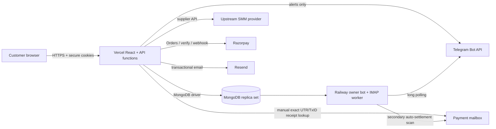
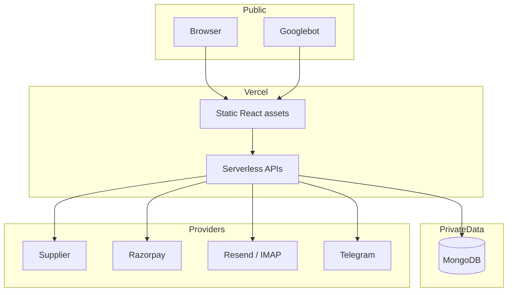
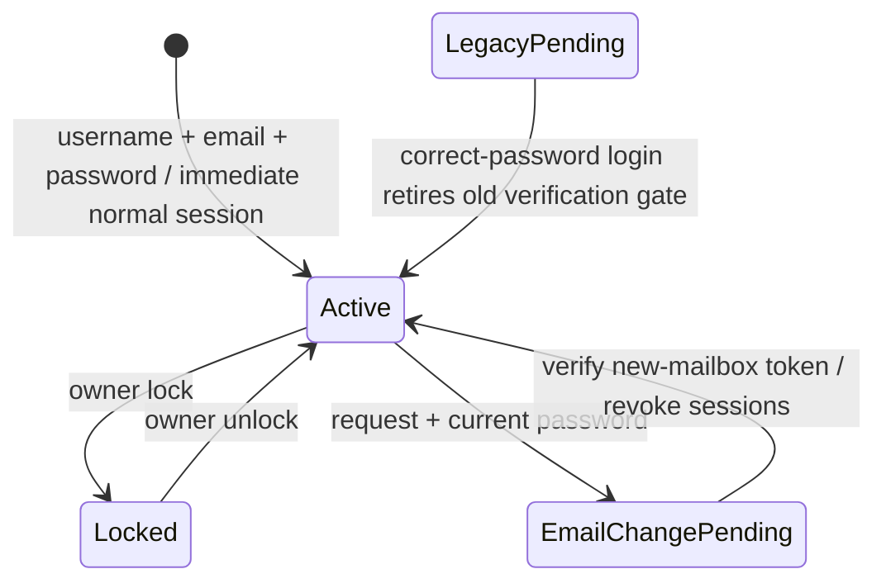
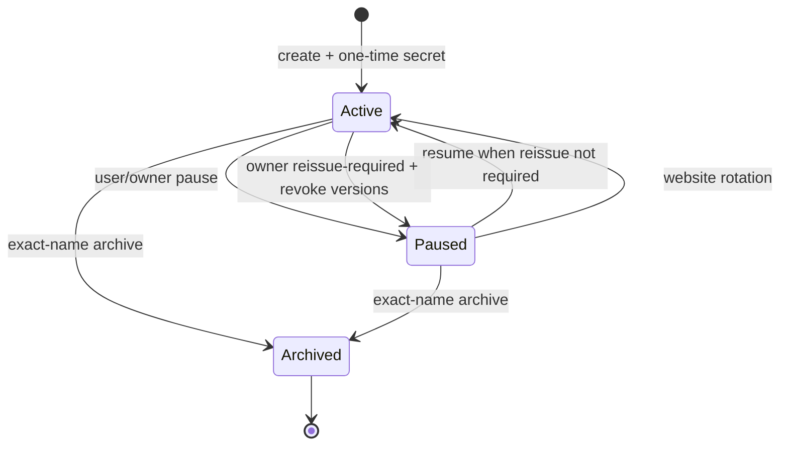
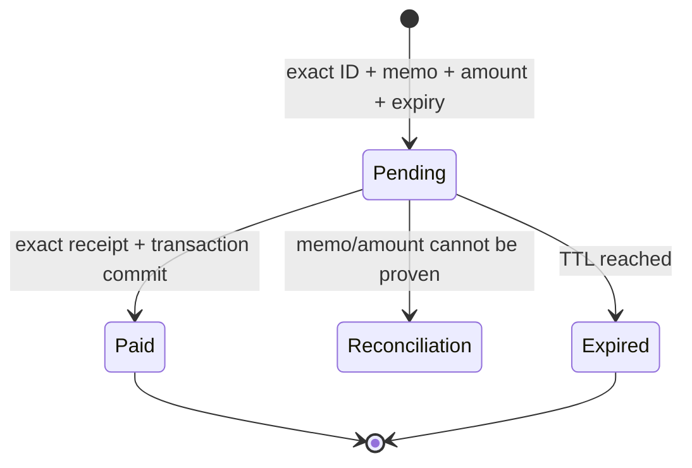
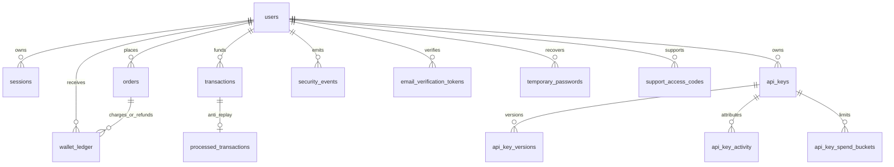

<p align="center">
  
</p>
<h1 align="center">SMM UP Website Architecture</h1>
<p align="center"><strong>Source-derived architecture snapshot · 2026-10-06</strong></p>
<p align="center"><code>FULL AUDIT @ 3220567</code> · <code>POST-PUSH DOCS LOCAL</code> · <code>DEPLOYMENT PENDING</code></p>


> **Inventory size:** 730 source-derived atomic capabilities and controls.
> **Scope:** browser UI, Vercel functions, shared server libraries, MongoDB, supplier integration, payments, email, SEO and website-facing operations.
> **Companions:** [Bot architecture](bot-architecture.md) · [Full architecture](full-architecture.md)

```text
SYSTEM STREAM
[route registry] -> [React view] -> [Vercel API] -> [authorization/rate limit]
-> [MongoDB transaction/index contract] -> [provider when required] -> [audit/event]
```

<details open>
<summary><strong>Architecture drawer — click to expand/collapse</strong></summary>

- [Purpose and truth rules](#purpose-and-truth-rules)
- [System map](#system-map)
- [Sitemap](#complete-sitemap)
- [Runtime layers](#runtime-layers)
- [Feature registry](#atomic-feature-registry)
- [Endpoint catalog](#endpoint-catalog)
- [Data model](#data-model)
- [Source manifest](#source-and-asset-manifest)
- [Environment](#environment-variable-contract)
- [Testing](#validation-and-traceability)
- [Operations](#website-operational-contract)
- [Accessibility and performance](#accessibility-and-performance-contract)
- [Failure and recovery](#failure-and-recovery-matrix)

</details>


## Purpose and truth rules

1. This is a codebase architecture document, not marketing copy.
2. Full audit remediation is pushed on `improvement/full-audit-remediation` at `32205672bd8a1c7ea4d243c72391248cf57fdd26`; this post-push documentation reconciliation is local and remains unpushed until separately authorized. The prior bot baseline remains `2c60e657c5759f7a22cf9fbb872e1d1e051e7201`.
3. A pushed implementation is not proof of Vercel, Railway, provider, domain or production validation.
4. Provider/dashboard operations are explicitly marked as deployment gates.
5. Secrets and private pricing values are named by variable only and never copied here.
6. Every atomic registry entry has a stable ID for review and test traceability.

## System map



### Trust boundaries



## Complete sitemap

```text
/
├── /order
├── /catalog
├── /mass
├── /logs                         [authenticated]
├── /auth
├── /api
├── /playground
├── /account                      [authenticated]
│   └── /account/password-change [restricted recovery]
├── /support-access               [owner/support]
├── /transactions                [authenticated]
├── /add-funds                   [authenticated]
├── /faq
├── /review
├── /support
├── /about
├── /responsible-growth
├── /status
├── /changelog
├── /security
├── /abuse
├── /press
├── /sitemap
├── /terms
├── /privacy
├── /refunds
├── /acceptable-use
├── /cookie-policy
├── /telegram-smm-panel
├── /instagram-smm-panel
├── /youtube-smm-panel
├── /twitter-smm-panel
├── /tiktok-smm-panel
└── /spotify-smm-panel

/profile -> permanent redirect -> /account
```

## Runtime layers

| Layer | Primary files | Responsibility |
|---|---|---|
| Browser shell | `src/App.tsx`, `src/main.tsx` | routing, state, page composition, hydration |
| Page components | `src/components/**` | forms, tables, responsive views, user feedback |
| SEO registry | `src/lib/routes.ts`, `src/lib/seo.ts` | routes, canonical metadata, JSON-LD |
| Vercel handlers | `api/**` | HTTP validation, auth, orchestration, provider calls |
| Shared server security | `server/lib/auth.ts`, `rateLimit.ts`, `db.ts` | sessions, authorization, limiter, indexes |
| Business libraries | `apiKeys.ts`, `wallet.ts`, `directUpiSettlement.ts`, `recovery.ts` | transactional domain rules |
| Provider adapters | `smm.ts`, `razorpay.ts`, `imap.ts`, `email.ts`, `telegram.ts` | external trust boundaries |
| Persistence | MongoDB collections below | durable state, uniqueness, audit and TTL |

## Primary state machines

### Account and email



### Named API key



### Direct UPI deposit



## Atomic feature registry


### Application shell and routing

- **WEB-0001** — The browser application is a React/Vite single-page application rooted in `src/App.tsx`.
- **WEB-0002** — `src/lib/routes.ts` is the canonical tab-to-path registry used by navigation and canonical URL generation.
- **WEB-0003** — Initial route state is derived from `window.location.pathname` with trailing-slash normalization.
- **WEB-0004** — Unknown paths render a dedicated not-found page instead of silently becoming the homepage.
- **WEB-0005** — Same-origin real `<a href>` links remain crawlable and are intercepted only for eligible unmodified clicks.
- **WEB-0006** — Browser back/forward events re-resolve route state, SEO metadata and structured data.
- **WEB-0007** — Route transitions scroll to the top and update title, description, canonical, Open Graph and JSON-LD.
- **WEB-0008** — Guarded account routes redirect unauthenticated users to the permanent authentication page.
- **WEB-0009** — The static top ambient haze orb remains part of the application shell.
- **WEB-0010** — Mobile bottom navigation and desktop navigation share real canonical destinations.
- **WEB-0011** — Support Access adds a persistent read-only banner and one-second expiry countdown.
- **WEB-0012** — Support Access automatically exits when its server-issued expiry time passes.

### Route /

- **WEB-0013** — Route `/` maps to tab `home` and renderer `LandingHero + GuaranteesBento + ReviewsSection + FaqSection`.
- **WEB-0014** — Route `/` access model is: Public.
- **WEB-0015** — Route `/` provides cinematic brand hero.
- **WEB-0016** — Route `/` provides embedded sign-in and registration terminal.
- **WEB-0017** — Route `/` provides live service-count display.
- **WEB-0018** — Route `/` provides platform discovery cards.
- **WEB-0019** — Route `/` provides guarantee and trust bento.
- **WEB-0020** — Route `/` provides preserved homepage review carousel.
- **WEB-0021** — Route `/` provides FAQ preview with real link to the full FAQ.
- **WEB-0022** — Route `/` provides real calls to order, catalog, API and account routes.

### Route /order

- **WEB-0023** — Route `/order` maps to tab `order` and renderer `NewOrder`.
- **WEB-0024** — Route `/order` access model is: Public; authentication required to submit.
- **WEB-0025** — Route `/order` provides service search and platform/category filtering.
- **WEB-0026** — Route `/order` provides service selection and preselection from catalog.
- **WEB-0027** — Route `/order` provides dynamic minimum/maximum validation.
- **WEB-0028** — Route `/order` provides Default, Package, Custom Comments and Poll input modes.
- **WEB-0029** — Route `/order` provides quantity, comments and answer-number handling.
- **WEB-0030** — Route `/order` provides live charge calculation without exposing internal markup.
- **WEB-0031** — Route `/order` provides public-target guidance.
- **WEB-0032** — Route `/order` provides wallet balance check.
- **WEB-0033** — Route `/order` provides authenticated order submission.
- **WEB-0034** — Route `/order` provides success-state account totals refresh.

### Route /catalog

- **WEB-0035** — Route `/catalog` maps to tab `catalog` and renderer `ServicesCatalog`.
- **WEB-0036** — Route `/catalog` access model is: Public.
- **WEB-0037** — Route `/catalog` provides live supplier-backed service list.
- **WEB-0038** — Route `/catalog` provides brand sanitization.
- **WEB-0039** — Route `/catalog` provides platform and category filters.
- **WEB-0040** — Route `/catalog` provides search.
- **WEB-0041** — Route `/catalog` provides sorting and responsive card/table views.
- **WEB-0042** — Route `/catalog` provides rate, minimum, maximum, refill, cancellation and average-time metadata.
- **WEB-0043** — Route `/catalog` provides real select-service navigation into /order.

### Route /mass

- **WEB-0044** — Route `/mass` maps to tab `mass` and renderer `MassOrder`.
- **WEB-0045** — Route `/mass` access model is: Public; authentication required to submit.
- **WEB-0046** — Route `/mass` provides multiline batch parser.
- **WEB-0047** — Route `/mass` provides service/target/quantity row syntax.
- **WEB-0048** — Route `/mass` provides row-level validation.
- **WEB-0049** — Route `/mass` provides batch submission sequencing.
- **WEB-0050** — Route `/mass` provides aggregate success and failure reporting.

### Route /logs

- **WEB-0051** — Route `/logs` maps to tab `logs` and renderer `OrderHistory`.
- **WEB-0052** — Route `/logs` access model is: Authenticated.
- **WEB-0053** — Route `/logs` provides bounded account order history.
- **WEB-0054** — Route `/logs` provides provider status synchronization.
- **WEB-0055** — Route `/logs` provides status badges.
- **WEB-0056** — Route `/logs` provides target and service metadata.
- **WEB-0057** — Route `/logs` provides refill eligibility/action.
- **WEB-0058** — Route `/logs` provides cancel eligibility/action.
- **WEB-0059** — Route `/logs` provides charge and quantity display.
- **WEB-0060** — Route `/logs` provides refresh control.

### Route /auth

- **WEB-0061** — Route `/auth` maps to tab `auth` and renderer `AuthPage`.
- **WEB-0062** — Route `/auth` access model is: Public.
- **WEB-0063** — Route `/auth` provides sign-in and registration modes.
- **WEB-0064** — Route `/auth` creates and signs in a valid new account immediately.
- **WEB-0065** — Route `/auth` consumes password-reset and requested email-change links after scrubbing secrets from the URL.
- **WEB-0066** — Route `/auth` exposes no signup-verification or resend state.
- **WEB-0067** — Route `/auth` provides forgot-password request.
- **WEB-0068** — Route `/auth` provides email-reset link consumption.
- **WEB-0069** — Route `/auth` provides temporary-password routing to mandatory permanent-password change.
- **WEB-0070** — Route `/auth` provides strong-password guidance.
- **WEB-0071** — Route `/auth` provides generic anti-enumeration recovery responses.

### Route /api

- **WEB-0072** — Route `/api` maps to tab `api` and renderer `ApiDocs`.
- **WEB-0073** — Route `/api` access model is: Public.
- **WEB-0074** — Route `/api` provides standard SMM v2 endpoint documentation.
- **WEB-0075** — Route `/api` provides named-key onboarding.
- **WEB-0076** — Route `/api` provides authentication methods.
- **WEB-0077** — Route `/api` provides scope mapping.
- **WEB-0078** — Route `/api` provides daily/monthly limits.
- **WEB-0079** — Route `/api` provides optional expiration.
- **WEB-0080** — Route `/api` provides pause/resume/rotate/archive lifecycle.
- **WEB-0081** — Route `/api` provides one-time secret warning.
- **WEB-0082** — Route `/api` provides request/response examples.
- **WEB-0083** — Route `/api` provides error and rate-limit matrix.
- **WEB-0084** — Route `/api` provides language examples.
- **WEB-0085** — Route `/api` provides responsive documentation index.

### Route /playground

- **WEB-0086** — Route `/playground` maps to tab `playground` and renderer `ApiPlayground`.
- **WEB-0087** — Route `/playground` access model is: Public shell; key required for calls.
- **WEB-0088** — Route `/playground` provides interactive action selection.
- **WEB-0089** — Route `/playground` provides parameter editing.
- **WEB-0090** — Route `/playground` provides request execution against /api/v2.
- **WEB-0091** — Route `/playground` provides JSON response inspection.
- **WEB-0092** — Route `/playground` provides key stays browser-entered and is not persisted by documentation code.
- **WEB-0093** — Route `/playground` provides links back to API documentation.

### Route /account

- **WEB-0094** — Route `/account` maps to tab `account` and renderer `AccountPage`.
- **WEB-0095** — Route `/account` access model is: Authenticated.
- **WEB-0096** — Route `/account` provides identity and verified-email display.
- **WEB-0097** — Route `/account` provides wallet/order/spend summary.
- **WEB-0098** — Route `/account` provides email-change request with current-password confirmation.
- **WEB-0099** — Route `/account` provides session inventory and revocation.
- **WEB-0100** — Route `/account` provides multiple named API-key identities.
- **WEB-0101** — Route `/account` provides scope editor and synchronized Full Access.
- **WEB-0102** — Route `/account` provides daily/monthly key limits.
- **WEB-0103** — Route `/account` provides optional key expiration.
- **WEB-0104** — Route `/account` provides one-time secret reveal/copy.
- **WEB-0105** — Route `/account` provides pause/resume/rotate/archive/reissue handling.
- **WEB-0106** — Route `/account` provides key activity filters.
- **WEB-0107** — Route `/account` provides lifetime key reports.
- **WEB-0108** — Route `/account` provides support-session read-only rendering.

### Route /account/password-change

- **WEB-0109** — Route `/account/password-change` maps to tab `password-change` and renderer `PasswordChangePage`.
- **WEB-0110** — Route `/account/password-change` access model is: Restricted temporary-password session.
- **WEB-0111** — Route `/account/password-change` provides recovery-session validation.
- **WEB-0112** — Route `/account/password-change` provides new-password policy.
- **WEB-0113** — Route `/account/password-change` provides confirmation input.
- **WEB-0114** — Route `/account/password-change` provides transactional permanent-password replacement.
- **WEB-0115** — Route `/account/password-change` provides temporary credential invalidation.
- **WEB-0116** — Route `/account/password-change` provides normal/support/recovery session revocation.
- **WEB-0117** — Route `/account/password-change` provides normal session issuance after completion.

### Route /support-access

- **WEB-0118** — Route `/support-access` maps to tab `support-access` and renderer `SupportAccessPage`.
- **WEB-0119** — Route `/support-access` access model is: Normal owner session to exchange; support session to view.
- **WEB-0120** — Route `/support-access` provides one-time code input.
- **WEB-0121** — Route `/support-access` provides owner-role validation.
- **WEB-0122** — Route `/support-access` provides five-minute exchange window.
- **WEB-0123** — Route `/support-access` provides 15-minute read-only subject session.
- **WEB-0124** — Route `/support-access` provides separate support cookie.
- **WEB-0125** — Route `/support-access` provides actor and subject separation.
- **WEB-0126** — Route `/support-access` provides live support banner handoff.

### Route /transactions

- **WEB-0127** — Route `/transactions` maps to tab `transactions` and renderer `TransactionsPage`.
- **WEB-0128** — Route `/transactions` access model is: Authenticated or read-only Support Access.
- **WEB-0129** — Route `/transactions` provides bounded deposit and wallet-facing history.
- **WEB-0130** — Route `/transactions` provides Direct UPI and Razorpay identifiers.
- **WEB-0131** — Route `/transactions` provides amount, status and timestamp presentation.
- **WEB-0132** — Route `/transactions` provides no banking secret collection.

### Route /add-funds

- **WEB-0133** — Route `/add-funds` maps to tab `add-funds` and renderer `AddFundsPage`.
- **WEB-0134** — Route `/add-funds` access model is: Authenticated; blocked in Support Access/payment hold.
- **WEB-0135** — Route `/add-funds` provides separate Direct UPI and Razorpay rails.
- **WEB-0136** — Route `/add-funds` provides amount validation.
- **WEB-0137** — Route `/add-funds` provides dynamic memo and QR creation.
- **WEB-0138** — Route `/add-funds` provides exact pending transaction identifier retention.
- **WEB-0139** — Route `/add-funds` provides UPI deep link and copy controls.
- **WEB-0140** — Route `/add-funds` provides automatic status polling.
- **WEB-0141** — Route `/add-funds` provides manual UTR/transaction-ID verification.
- **WEB-0142** — Route `/add-funds` provides expired-request handling.
- **WEB-0143** — Route `/add-funds` provides confetti and balance refresh on success.
- **WEB-0144** — Route `/add-funds` provides Razorpay test/live configuration.
- **WEB-0145** — Route `/add-funds` provides server-created Razorpay order checkout.
- **WEB-0146** — Route `/add-funds` provides server verification and status checks.
- **WEB-0147** — Route `/add-funds` provides deposit history.

### Route /faq

- **WEB-0148** — Route `/faq` maps to tab `faq` and renderer `FaqPage`.
- **WEB-0149** — Route `/faq` access model is: Public.
- **WEB-0150** — Route `/faq` provides full categorized FAQ.
- **WEB-0151** — Route `/faq` provides crawlable content.
- **WEB-0152** — Route `/faq` provides breadcrumb navigation.
- **WEB-0153** — Route `/faq` provides support and policy cross-links.

### Route /review

- **WEB-0154** — Route `/review` maps to tab `reviews` and renderer `ReviewsPage`.
- **WEB-0155** — Route `/review` access model is: Public list; authenticated purchase required to submit.
- **WEB-0156** — Route `/review` provides approved-review list.
- **WEB-0157** — Route `/review` provides six preserved homepage seed reviews.
- **WEB-0158** — Route `/review` provides purchase eligibility check.
- **WEB-0159** — Route `/review` provides one review per eligible account.
- **WEB-0160** — Route `/review` provides rating and bounded text.
- **WEB-0161** — Route `/review` provides pending moderation state.
- **WEB-0162** — Route `/review` provides Telegram-only owner moderation.

### Route /support

- **WEB-0163** — Route `/support` maps to tab `support` and renderer `SupportPage`.
- **WEB-0164** — Route `/support` access model is: Public.
- **WEB-0165** — Route `/support` provides clickable support channels.
- **WEB-0166** — Route `/support` provides operational help content.
- **WEB-0167** — Route `/support` provides security guidance.
- **WEB-0168** — Route `/support` provides authenticated support context where available.

### Route /about

- **WEB-0169** — Route `/about` maps to tab `about` and renderer `AboutPage`.
- **WEB-0170** — Route `/about` access model is: Public.
- **WEB-0171** — Route `/about` provides company narrative.
- **WEB-0172** — Route `/about` provides founder/brand context.
- **WEB-0173** — Route `/about` provides internal links.
- **WEB-0174** — Route `/about` provides structured breadcrumb context.

### Route /responsible-growth

- **WEB-0175** — Route `/responsible-growth` maps to tab `responsible-growth` and renderer `ResponsibleGrowthPage`.
- **WEB-0176** — Route `/responsible-growth` access model is: Public.
- **WEB-0177** — Route `/responsible-growth` provides responsible-use guidance.
- **WEB-0178** — Route `/responsible-growth` provides expectation setting.
- **WEB-0179** — Route `/responsible-growth` provides platform-policy disclaimers.
- **WEB-0180** — Route `/responsible-growth` provides service selection guidance.

### Route /terms

- **WEB-0181** — Route `/terms` maps to tab `terms` and renderer `TermsPage`.
- **WEB-0182** — Route `/terms` access model is: Public.
- **WEB-0183** — Route `/terms` provides real Service Terms page.
- **WEB-0184** — Route `/terms` provides account/order/payment terms.
- **WEB-0185** — Route `/terms` provides limitation and acceptable-use cross-links.

### Route /privacy

- **WEB-0186** — Route `/privacy` maps to tab `privacy` and renderer `PrivacyPage`.
- **WEB-0187** — Route `/privacy` access model is: Public.
- **WEB-0188** — Route `/privacy` provides data categories.
- **WEB-0189** — Route `/privacy` provides processing purposes.
- **WEB-0190** — Route `/privacy` provides security boundaries.
- **WEB-0191** — Route `/privacy` provides retention and contact information.

### Route /refunds

- **WEB-0192** — Route `/refunds` maps to tab `refunds` and renderer `RefundsPage`.
- **WEB-0193** — Route `/refunds` access model is: Public.
- **WEB-0194** — Route `/refunds` provides wallet refund policy.
- **WEB-0195** — Route `/refunds` provides provider outcome rules.
- **WEB-0196** — Route `/refunds` provides non-refundable conditions.
- **WEB-0197** — Route `/refunds` provides support escalation.

### Route /acceptable-use

- **WEB-0198** — Route `/acceptable-use` maps to tab `acceptable-use` and renderer `AcceptableUsePage`.
- **WEB-0199** — Route `/acceptable-use` access model is: Public.
- **WEB-0200** — Route `/acceptable-use` provides prohibited conduct.
- **WEB-0201** — Route `/acceptable-use` provides platform-account responsibilities.
- **WEB-0202** — Route `/acceptable-use` provides abuse enforcement.
- **WEB-0203** — Route `/acceptable-use` provides security restrictions.

### Route /cookie-policy

- **WEB-0204** — Route `/cookie-policy` maps to tab `cookie-policy` and renderer `CookiePolicyPage`.
- **WEB-0205** — Route `/cookie-policy` access model is: Public.
- **WEB-0206** — Route `/cookie-policy` provides session-cookie explanation.
- **WEB-0207** — Route `/cookie-policy` provides restricted/support cookie purposes.
- **WEB-0208** — Route `/cookie-policy` provides browser preference disclosure.
- **WEB-0209** — Route `/cookie-policy` provides security attributes.

### Route /security

- **WEB-0210** — Route `/security` maps to tab `security` and renderer `SecurityPage`.
- **WEB-0211** — Route `/security` access model is: Public.
- **WEB-0212** — Route `/security` provides hash-only secret claims.
- **WEB-0213** — Route `/security` provides session and payment safeguards.
- **WEB-0214** — Route `/security` provides responsible disclosure path.
- **WEB-0215** — Route `/security` provides credential safety guidance.

### Route /abuse

- **WEB-0216** — Route `/abuse` maps to tab `abuse` and renderer `AbusePage`.
- **WEB-0217** — Route `/abuse` access model is: Public.
- **WEB-0218** — Route `/abuse` provides abuse reporting.
- **WEB-0219** — Route `/abuse` provides required evidence.
- **WEB-0220** — Route `/abuse` provides enforcement process.
- **WEB-0221** — Route `/abuse` provides contact path.

### Route /press

- **WEB-0222** — Route `/press` maps to tab `press` and renderer `PressPage`.
- **WEB-0223** — Route `/press` access model is: Public.
- **WEB-0224** — Route `/press` provides brand facts.
- **WEB-0225** — Route `/press` provides official identity links.
- **WEB-0226** — Route `/press` provides press/contact context.

### Route /status

- **WEB-0227** — Route `/status` maps to tab `status` and renderer `StatusPage`.
- **WEB-0228** — Route `/status` access model is: Public.
- **WEB-0229** — Route `/status` provides platform-status presentation.
- **WEB-0230** — Route `/status` provides dependency categories.
- **WEB-0231** — Route `/status` provides incident expectations.

### Route /changelog

- **WEB-0232** — Route `/changelog` maps to tab `changelog` and renderer `ChangelogPage`.
- **WEB-0233** — Route `/changelog` access model is: Public.
- **WEB-0234** — Route `/changelog` provides product change history.
- **WEB-0235** — Route `/changelog` provides security and capability highlights.

### Route /sitemap

- **WEB-0236** — Route `/sitemap` maps to tab `sitemap` and renderer `SitemapPage`.
- **WEB-0237** — Route `/sitemap` access model is: Public.
- **WEB-0238** — Route `/sitemap` provides human-readable route directory.
- **WEB-0239** — Route `/sitemap` provides real anchors to public pages.
- **WEB-0240** — Route `/sitemap` provides platform and legal grouping.

### Route /telegram-smm-panel

- **WEB-0241** — Route `/telegram-smm-panel` maps to tab `p-telegram` and renderer `PlatformPage`.
- **WEB-0242** — Route `/telegram-smm-panel` access model is: Public.
- **WEB-0243** — Route `/telegram-smm-panel` provides Telegram-specific services and copy.
- **WEB-0244** — Route `/telegram-smm-panel` provides platform-filtered catalog CTA.
- **WEB-0245** — Route `/telegram-smm-panel` provides platform FAQ and schema.

### Route /instagram-smm-panel

- **WEB-0246** — Route `/instagram-smm-panel` maps to tab `p-instagram` and renderer `PlatformPage`.
- **WEB-0247** — Route `/instagram-smm-panel` access model is: Public.
- **WEB-0248** — Route `/instagram-smm-panel` provides Instagram-specific services and copy.
- **WEB-0249** — Route `/instagram-smm-panel` provides platform-filtered catalog CTA.
- **WEB-0250** — Route `/instagram-smm-panel` provides platform FAQ and schema.

### Route /youtube-smm-panel

- **WEB-0251** — Route `/youtube-smm-panel` maps to tab `p-youtube` and renderer `PlatformPage`.
- **WEB-0252** — Route `/youtube-smm-panel` access model is: Public.
- **WEB-0253** — Route `/youtube-smm-panel` provides YouTube-specific services and copy.
- **WEB-0254** — Route `/youtube-smm-panel` provides platform-filtered catalog CTA.
- **WEB-0255** — Route `/youtube-smm-panel` provides platform FAQ and schema.

### Route /twitter-smm-panel

- **WEB-0256** — Route `/twitter-smm-panel` maps to tab `p-twitter` and renderer `PlatformPage`.
- **WEB-0257** — Route `/twitter-smm-panel` access model is: Public.
- **WEB-0258** — Route `/twitter-smm-panel` provides Twitter/X-specific services and copy.
- **WEB-0259** — Route `/twitter-smm-panel` provides platform-filtered catalog CTA.
- **WEB-0260** — Route `/twitter-smm-panel` provides platform FAQ and schema.

### Route /tiktok-smm-panel

- **WEB-0261** — Route `/tiktok-smm-panel` maps to tab `p-tiktok` and renderer `PlatformPage`.
- **WEB-0262** — Route `/tiktok-smm-panel` access model is: Public.
- **WEB-0263** — Route `/tiktok-smm-panel` provides TikTok-specific services and copy.
- **WEB-0264** — Route `/tiktok-smm-panel` provides platform-filtered catalog CTA.
- **WEB-0265** — Route `/tiktok-smm-panel` provides platform FAQ and schema.

### Route /spotify-smm-panel

- **WEB-0266** — Route `/spotify-smm-panel` maps to tab `p-spotify` and renderer `PlatformPage`.
- **WEB-0267** — Route `/spotify-smm-panel` access model is: Public.
- **WEB-0268** — Route `/spotify-smm-panel` provides Spotify-specific services and copy.
- **WEB-0269** — Route `/spotify-smm-panel` provides platform-filtered catalog CTA.
- **WEB-0270** — Route `/spotify-smm-panel` provides platform FAQ and schema.

### Route /profile

- **WEB-0271** — Route `/profile` maps to tab `account alias` and renderer `Vercel redirect`.
- **WEB-0272** — Route `/profile` access model is: Permanent redirect.
- **WEB-0273** — Route `/profile` provides 308-style permanent redirect to /account.
- **WEB-0274** — Route `/profile` provides prevents duplicate profile/account URLs.

### Route unknown route

- **WEB-0275** — Route `unknown route` maps to tab `notfound` and renderer `NotFoundPage`.
- **WEB-0276** — Route `unknown route` access model is: Public.
- **WEB-0277** — Route `unknown route` provides safe not-found presentation.
- **WEB-0278** — Route `unknown route` provides real navigation back to valid routes.

### Component/module: App.tsx

- **WEB-0279** — `App.tsx` implements owns SPA route state derived from pathname.
- **WEB-0280** — `App.tsx` implements intercepts same-origin real anchors while retaining crawlable href values.
- **WEB-0281** — `App.tsx` implements handles history back/forward.
- **WEB-0282** — `App.tsx` implements applies route SEO and structured data.
- **WEB-0283** — `App.tsx` loads authentication, services and orders; auth bootstrap retries deployment/network/5xx failures and shows a cookie-preserving retry state instead of false logout.
- **WEB-0284** — `App.tsx` implements enforces guarded-page fallback.
- **WEB-0285** — `App.tsx` implements keeps the static top haze orb.
- **WEB-0286** — `App.tsx` implements updates local user wallet/order totals.
- **WEB-0287** — `App.tsx` implements records Support Access page views.
- **WEB-0288** — `App.tsx` implements renders persistent support-session countdown banner.

### Component/module: Navbar

- **WEB-0289** — `Navbar` implements desktop primary navigation.
- **WEB-0290** — `Navbar` implements authenticated and unauthenticated actions.
- **WEB-0291** — `Navbar` implements account/wallet shortcuts.
- **WEB-0292** — `Navbar` implements real href navigation.
- **WEB-0293** — `Navbar` implements logout handling.
- **WEB-0294** — `Navbar` implements responsive mobile menu.

### Component/module: MobileBottomNav

- **WEB-0295** — `MobileBottomNav` implements mobile-first permanent navigation.
- **WEB-0296** — `MobileBottomNav` implements current-tab state.
- **WEB-0297** — `MobileBottomNav` implements real route destinations.
- **WEB-0298** — `MobileBottomNav` implements authenticated wallet/account access.

### Component/module: LandingHero

- **WEB-0299** — `LandingHero` implements brand headline and live metrics.
- **WEB-0300** — `LandingHero` implements embedded authentication.
- **WEB-0301** — `LandingHero` implements service/platform discovery.
- **WEB-0302** — `LandingHero` implements primary conversion actions.
- **WEB-0303** — `LandingHero` implements responsive layout.
- **WEB-0304** — `LandingHero` implements immediate-registration and sign-in messaging.

### Component/module: NewOrder

- **WEB-0305** — `NewOrder` implements service filtering and selection.
- **WEB-0306** — `NewOrder` implements type-specific fields.
- **WEB-0307** — `NewOrder` implements client validation.
- **WEB-0308** — `NewOrder` implements price calculation.
- **WEB-0309** — `NewOrder` implements server submission.
- **WEB-0310** — `NewOrder` implements auth prompt.
- **WEB-0311** — `NewOrder` implements success handling.

### Component/module: MassOrder

- **WEB-0312** — `MassOrder` implements multiline parsing.
- **WEB-0313** — `MassOrder` implements batch validation.
- **WEB-0314** — `MassOrder` implements per-row submission/results.

### Component/module: OrderHistory

- **WEB-0315** — `OrderHistory` implements status display.
- **WEB-0316** — `OrderHistory` implements refresh.
- **WEB-0317** — `OrderHistory` implements cancel/refill actions.
- **WEB-0318** — `OrderHistory` implements provider metadata.
- **WEB-0319** — `OrderHistory` implements empty/loading states.

### Component/module: ServicesCatalog

- **WEB-0320** — `ServicesCatalog` implements search/filter/sort.
- **WEB-0321** — `ServicesCatalog` implements responsive views.
- **WEB-0322** — `ServicesCatalog` implements service metadata.
- **WEB-0323** — `ServicesCatalog` implements order preselection link.

### Component/module: AddFundsPage

- **WEB-0324** — `AddFundsPage` displays the exact unique payable amount, explains that its full value is credited, preserves the SUP reference, and shows safe receipt-lookup support codes without exposing mailbox data.
- **WEB-0325** — `AddFundsPage` implements Razorpay checkout state machine.
- **WEB-0326** — `AddFundsPage` implements polling and timers.
- **WEB-0327** — `AddFundsPage` implements manual verification.
- **WEB-0328** — `AddFundsPage` implements history.
- **WEB-0329** — `AddFundsPage` implements clipboard and success feedback.

### Component/module: AuthPage

- **WEB-0330** — `AuthPage` implements login/register/recovery/reset modes.
- **WEB-0331** — `AuthPage` implements reset/email-change-token auto-consumption after immediate URL scrubbing.
- **WEB-0332** — `AuthPage` implements immediate account-created and signed-in handoff without verification/resend UI.
- **WEB-0333** — `AuthPage` implements password policy and confirmation.
- **WEB-0334** — `AuthPage` implements temporary-login redirect.

### Component/module: PasswordChangePage

- **WEB-0335** — `PasswordChangePage` implements restricted recovery context.
- **WEB-0336** — `PasswordChangePage` implements permanent-password completion.

### Component/module: SupportAccessPage

- **WEB-0337** — `SupportAccessPage` implements code exchange.
- **WEB-0338** — `SupportAccessPage` implements owner-only access checks.
- **WEB-0339** — `SupportAccessPage` implements support-session activation.

### Component/module: AccountPage

- **WEB-0340** — `AccountPage` implements account identity and metrics.
- **WEB-0341** — `AccountPage` implements email-change request.
- **WEB-0342** — `AccountPage` implements session controls.
- **WEB-0343** — `AccountPage` implements API-key CRUD/lifecycle.
- **WEB-0344** — `AccountPage` implements activity and reporting.

### Component/module: TransactionsPage

- **WEB-0345** — `TransactionsPage` implements deposit history view.
- **WEB-0346** — `TransactionsPage` implements method/status/identifier formatting.

### Component/module: ApiDocs

- **WEB-0347** — `ApiDocs` implements developer onboarding.
- **WEB-0348** — `ApiDocs` implements lifecycle/scopes/limits/security docs.
- **WEB-0349** — `ApiDocs` implements endpoint reference.
- **WEB-0350** — `ApiDocs` implements examples and responsive index.

### Component/module: ApiPlayground

- **WEB-0351** — `ApiPlayground` implements interactive API requests.
- **WEB-0352** — `ApiPlayground` implements structured input and output.

### Component/module: ReviewsPage

- **WEB-0353** — `ReviewsPage` implements review listing.
- **WEB-0354** — `ReviewsPage` implements eligibility.
- **WEB-0355** — `ReviewsPage` implements submission.
- **WEB-0356** — `ReviewsPage` implements auth prompt.

### Component/module: ReviewsSection

- **WEB-0357** — `ReviewsSection` implements homepage review presentation.
- **WEB-0358** — `ReviewsSection` implements preserved seed content.

### Component/module: FaqPage/FaqSection

- **WEB-0359** — `FaqPage/FaqSection` implements full and preview FAQ renderers.
- **WEB-0360** — `FaqPage/FaqSection` implements real link from preview to full page.

### Component/module: ContentPage/Breadcrumbs

- **WEB-0361** — `ContentPage/Breadcrumbs` implements shared page shell.
- **WEB-0362** — `ContentPage/Breadcrumbs` implements non-fake middle breadcrumb labels.
- **WEB-0363** — `ContentPage/Breadcrumbs` implements real linked crumbs only when destinations exist.

### Component/module: CompanyPages

- **WEB-0364** — `CompanyPages` implements about, responsible growth, support, status, changelog, security, abuse and press content.

### Component/module: LegalPages

- **WEB-0365** — `LegalPages` implements terms, privacy, refunds, acceptable use and cookie policy.

### Component/module: PlatformPage

- **WEB-0366** — `PlatformPage` implements six approved SEO platform pages only.
- **WEB-0367** — `PlatformPage` implements platform-specific content and service filtering.

### Component/module: Footer

- **WEB-0368** — `Footer` implements crawlable internal links.
- **WEB-0369** — `Footer` implements legal/company/platform navigation.
- **WEB-0370** — `Footer` implements support path.

### Component/module: Reveal

- **WEB-0371** — `Reveal` implements intersection-based progressive reveal.
- **WEB-0372** — `Reveal` implements reduced content duplication.

### Component/module: Skeleton

- **WEB-0373** — `Skeleton` implements catalog/order loading placeholders.

### Component/module: BackToTop

- **WEB-0374** — `BackToTop` implements scroll restoration control.

### Component/module: ExecutiveIcons

- **WEB-0375** — `ExecutiveIcons` implements brand logo and primary product icons.

### Component/module: PlatformIcons

- **WEB-0376** — `PlatformIcons` implements platform icon set and category-to-platform mapping.

### Component/module: seo.ts

- **WEB-0377** — `seo.ts` implements dynamic title/description/canonical/Open Graph.
- **WEB-0378** — `seo.ts` implements route robots directives.
- **WEB-0379** — `seo.ts` implements breadcrumb and page structured data.

### Component/module: routes.ts

- **WEB-0380** — `routes.ts` implements single tab-to-path source of truth.
- **WEB-0381** — `routes.ts` implements absolute canonical helper.
- **WEB-0382** — `routes.ts` implements /profile compatibility alias.

### Component/module: utils.ts

- **WEB-0383** — `utils.ts` implements INR/number formatting.
- **WEB-0384** — `utils.ts` implements brand sanitization.
- **WEB-0385** — `utils.ts` implements service-description cleaning.
- **WEB-0386** — `utils.ts` implements refill-policy parsing.

### Endpoint: POST /api/auth/register

- **WEB-0387** — `POST /api/auth/register` access boundary: Public.
- **WEB-0388** — `POST /api/auth/register` behavior: Enforces registration rate limit, uniqueness and password policy; creates a bcrypt-protected active account plus revocable normal session immediately; creates no registration token and sends no email.
- **WEB-0389** — `POST /api/auth/register` is covered by the central no-store/noindex API response policy.
- **WEB-0390** — `POST /api/auth/register` does not intentionally return passwords, raw stored tokens, API-key hashes or provider secrets.

### Retired signup-verification surface

- **WEB-0391** — Signup has no verification-required response or blocked-account state.
- **WEB-0392** — The former resend action is a `404` tombstone for stale clients and performs no account lookup.
- **WEB-0393** — Registration and the retired tombstone create no email token and invoke no email provider.
- **WEB-0394** — Website authentication interfaces expose no signup-verification or resend control.

### Endpoint: POST /api/auth/verify-email

- **WEB-0395** — `POST /api/auth/verify-email` access boundary: Public token.
- **WEB-0396** — `POST /api/auth/verify-email` behavior: Atomically consumes requested email-change tokens and, for backward compatibility, legacy registration tokens issued before signup verification was retired; records security events and revokes sessions for email changes.
- **WEB-0397** — `POST /api/auth/verify-email` is covered by the central no-store/noindex API response policy.
- **WEB-0398** — `POST /api/auth/verify-email` does not intentionally return passwords, raw stored tokens, API-key hashes or provider secrets.

### Endpoint: POST /api/auth/forgot-password

- **WEB-0399** — `POST /api/auth/forgot-password` access boundary: Public.
- **WEB-0400** — `POST /api/auth/forgot-password` behavior: Generic anti-enumeration response; rate limited; sends reset only for eligible unlocked account; records request event.
- **WEB-0401** — `POST /api/auth/forgot-password` is covered by the central no-store/noindex API response policy.
- **WEB-0402** — `POST /api/auth/forgot-password` does not intentionally return passwords, raw stored tokens, API-key hashes or provider secrets.

### Endpoint: POST /api/auth/reset-password-email

- **WEB-0403** — `POST /api/auth/reset-password-email` access boundary: Public token.
- **WEB-0404** — `POST /api/auth/reset-password-email` behavior: Validates strong new password; one-time transaction; replaces bcrypt hash; verifies mailbox; revokes sessions, restricted sessions and temporary credentials.
- **WEB-0405** — `POST /api/auth/reset-password-email` is covered by the central no-store/noindex API response policy.
- **WEB-0406** — `POST /api/auth/reset-password-email` does not intentionally return passwords, raw stored tokens, API-key hashes or provider secrets.

### Endpoint: POST /api/auth/request-email-change

- **WEB-0407** — `POST /api/auth/request-email-change` access boundary: Normal session.
- **WEB-0408** — `POST /api/auth/request-email-change` behavior: Requires current password and a different unused email; rate limited; sends confirmation to new address; does not mutate current email early.
- **WEB-0409** — `POST /api/auth/request-email-change` is covered by the central no-store/noindex API response policy.
- **WEB-0410** — `POST /api/auth/request-email-change` does not intentionally return passwords, raw stored tokens, API-key hashes or provider secrets.

### Endpoint: POST /api/auth/login

- **WEB-0411** — `POST /api/auth/login` access boundary: Public.
- **WEB-0412** — `POST /api/auth/login` behavior: Rate limited by client IP; accepts username/email plus bounded legacy-compatible login password; supports permanent and restricted temporary credential paths; blocks locked accounts and retires a legacy signup-verification flag after correct-password authentication.
- **WEB-0413** — `POST /api/auth/login` is covered by the central no-store/noindex API response policy.
- **WEB-0414** — `POST /api/auth/login` does not intentionally return passwords, raw stored tokens, API-key hashes or provider secrets.

### Endpoint: POST /api/auth/logout

- **WEB-0415** — `POST /api/auth/logout` access boundary: Session aware.
- **WEB-0416** — `POST /api/auth/logout` behavior: Revokes current server session and clears normal/support cookies.
- **WEB-0417** — `POST /api/auth/logout` is covered by the central no-store/noindex API response policy.
- **WEB-0418** — `POST /api/auth/logout` does not intentionally return passwords, raw stored tokens, API-key hashes or provider secrets.

### Endpoint: POST /api/auth/exchange-support-access

- **WEB-0419** — `POST /api/auth/exchange-support-access` access boundary: Normal admin session.
- **WEB-0420** — `POST /api/auth/exchange-support-access` behavior: Consumes one-time five-minute support code atomically and issues separate 15-minute read-only actor/subject session.
- **WEB-0421** — `POST /api/auth/exchange-support-access` is covered by the central no-store/noindex API response policy.
- **WEB-0422** — `POST /api/auth/exchange-support-access` does not intentionally return passwords, raw stored tokens, API-key hashes or provider secrets.

### Endpoint: POST /api/auth/exit-support-access

- **WEB-0423** — `POST /api/auth/exit-support-access` access boundary: Support session.
- **WEB-0424** — `POST /api/auth/exit-support-access` behavior: Transactionally ends support session while preserving owner normal session.
- **WEB-0425** — `POST /api/auth/exit-support-access` is covered by the central no-store/noindex API response policy.
- **WEB-0426** — `POST /api/auth/exit-support-access` does not intentionally return passwords, raw stored tokens, API-key hashes or provider secrets.

### Endpoint: POST /api/auth/support-page-view

- **WEB-0427** — `POST /api/auth/support-page-view` access boundary: Support session.
- **WEB-0428** — `POST /api/auth/support-page-view` behavior: Fail-closed audit of support browsing with bounded route input.
- **WEB-0429** — `POST /api/auth/support-page-view` is covered by the central no-store/noindex API response policy.
- **WEB-0430** — `POST /api/auth/support-page-view` does not intentionally return passwords, raw stored tokens, API-key hashes or provider secrets.

### Endpoint: GET /api/auth/me

- **WEB-0431** — `GET /api/auth/me` access boundary: Normal or support session.
- **WEB-0432** — `GET /api/auth/me` behavior: Returns safe account state, API-key count and explicit support actor/subject metadata; never returns raw secrets.
- **WEB-0433** — `GET /api/auth/me` is covered by the central no-store/noindex API response policy.
- **WEB-0434** — `GET /api/auth/me` does not intentionally return passwords, raw stored tokens, API-key hashes or provider secrets.

### Endpoint: GET /api/auth/recovery-status

- **WEB-0435** — `GET /api/auth/recovery-status` access boundary: Restricted recovery session.
- **WEB-0436** — `GET /api/auth/recovery-status` behavior: Validates password-change-only context and expiry.
- **WEB-0437** — `GET /api/auth/recovery-status` is covered by the central no-store/noindex API response policy.
- **WEB-0438** — `GET /api/auth/recovery-status` does not intentionally return passwords, raw stored tokens, API-key hashes or provider secrets.

### Endpoint: POST /api/auth/complete-password-change

- **WEB-0439** — `POST /api/auth/complete-password-change` access boundary: Restricted recovery session.
- **WEB-0440** — `POST /api/auth/complete-password-change` behavior: Completes permanent password transaction, revokes all related session types and invalidates temporary credentials.
- **WEB-0441** — `POST /api/auth/complete-password-change` is covered by the central no-store/noindex API response policy.
- **WEB-0442** — `POST /api/auth/complete-password-change` does not intentionally return passwords, raw stored tokens, API-key hashes or provider secrets.

### Endpoint: GET /api/auth/list-sessions

- **WEB-0443** — `GET /api/auth/list-sessions` access boundary: Authenticated/read-only support.
- **WEB-0444** — `GET /api/auth/list-sessions` behavior: Returns bounded safe session metadata without raw token hashes.
- **WEB-0445** — `GET /api/auth/list-sessions` is covered by the central no-store/noindex API response policy.
- **WEB-0446** — `GET /api/auth/list-sessions` does not intentionally return passwords, raw stored tokens, API-key hashes or provider secrets.

### Endpoint: POST /api/auth/revoke-session

- **WEB-0447** — `POST /api/auth/revoke-session` access boundary: Normal session.
- **WEB-0448** — `POST /api/auth/revoke-session` behavior: Revokes selected owned session.
- **WEB-0449** — `POST /api/auth/revoke-session` is covered by the central no-store/noindex API response policy.
- **WEB-0450** — `POST /api/auth/revoke-session` does not intentionally return passwords, raw stored tokens, API-key hashes or provider secrets.

### Endpoint: POST /api/auth/revoke-other-sessions

- **WEB-0451** — `POST /api/auth/revoke-other-sessions` access boundary: Normal session.
- **WEB-0452** — `POST /api/auth/revoke-other-sessions` behavior: Revokes every other owned session and advances revocation cutoff.
- **WEB-0453** — `POST /api/auth/revoke-other-sessions` is covered by the central no-store/noindex API response policy.
- **WEB-0454** — `POST /api/auth/revoke-other-sessions` does not intentionally return passwords, raw stored tokens, API-key hashes or provider secrets.

### Endpoint: GET /api/auth/list-api-keys

- **WEB-0455** — `GET /api/auth/list-api-keys` access boundary: Authenticated/read-only support.
- **WEB-0456** — `GET /api/auth/list-api-keys` behavior: Returns named-key metadata, scopes, limits, expiry, status and safe hints; never raw key.
- **WEB-0457** — `GET /api/auth/list-api-keys` is covered by the central no-store/noindex API response policy.
- **WEB-0458** — `GET /api/auth/list-api-keys` does not intentionally return passwords, raw stored tokens, API-key hashes or provider secrets.

### Endpoint: POST /api/auth/create-api-key

- **WEB-0459** — `POST /api/auth/create-api-key` access boundary: Normal session.
- **WEB-0460** — `POST /api/auth/create-api-key` behavior: Rate-limited transactional identity creation, configurable wallet fee, idempotency key, one-time raw secret response.
- **WEB-0461** — `POST /api/auth/create-api-key` is covered by the central no-store/noindex API response policy.
- **WEB-0462** — `POST /api/auth/create-api-key` does not intentionally return passwords, raw stored tokens, API-key hashes or provider secrets.

### Endpoint: POST /api/auth/update-api-key

- **WEB-0463** — `POST /api/auth/update-api-key` access boundary: Normal session.
- **WEB-0464** — `POST /api/auth/update-api-key` behavior: Updates name/scopes/limits/expiry with validation and active-name uniqueness.
- **WEB-0465** — `POST /api/auth/update-api-key` is covered by the central no-store/noindex API response policy.
- **WEB-0466** — `POST /api/auth/update-api-key` does not intentionally return passwords, raw stored tokens, API-key hashes or provider secrets.

### Endpoint: POST /api/auth/pause-api-key

- **WEB-0467** — `POST /api/auth/pause-api-key` access boundary: Normal session.
- **WEB-0468** — `POST /api/auth/pause-api-key` behavior: Pauses key while preserving current secret version.
- **WEB-0469** — `POST /api/auth/pause-api-key` is covered by the central no-store/noindex API response policy.
- **WEB-0470** — `POST /api/auth/pause-api-key` does not intentionally return passwords, raw stored tokens, API-key hashes or provider secrets.

### Endpoint: POST /api/auth/resume-api-key

- **WEB-0471** — `POST /api/auth/resume-api-key` access boundary: Normal session.
- **WEB-0472** — `POST /api/auth/resume-api-key` behavior: Resumes eligible key; refuses owner-reissue-required keys until secure rotation.
- **WEB-0473** — `POST /api/auth/resume-api-key` is covered by the central no-store/noindex API response policy.
- **WEB-0474** — `POST /api/auth/resume-api-key` does not intentionally return passwords, raw stored tokens, API-key hashes or provider secrets.

### Endpoint: POST /api/auth/rotate-api-key

- **WEB-0475** — `POST /api/auth/rotate-api-key` access boundary: Normal session.
- **WEB-0476** — `POST /api/auth/rotate-api-key` behavior: Free reissue; permanently revokes prior version; returns new secret once; clears reissue-required state.
- **WEB-0477** — `POST /api/auth/rotate-api-key` is covered by the central no-store/noindex API response policy.
- **WEB-0478** — `POST /api/auth/rotate-api-key` does not intentionally return passwords, raw stored tokens, API-key hashes or provider secrets.

### Endpoint: POST /api/auth/archive-api-key

- **WEB-0479** — `POST /api/auth/archive-api-key` access boundary: Normal session.
- **WEB-0480** — `POST /api/auth/archive-api-key` behavior: Requires exact key-name confirmation; permanently archives without refund and revokes versions.
- **WEB-0481** — `POST /api/auth/archive-api-key` is covered by the central no-store/noindex API response policy.
- **WEB-0482** — `POST /api/auth/archive-api-key` does not intentionally return passwords, raw stored tokens, API-key hashes or provider secrets.

### Endpoint: GET /api/auth/api-key-activity

- **WEB-0483** — `GET /api/auth/api-key-activity` access boundary: Authenticated/read-only support.
- **WEB-0484** — `GET /api/auth/api-key-activity` behavior: Bounded 90-day activity filters by action/outcome/date/service/order/amount.
- **WEB-0485** — `GET /api/auth/api-key-activity` is covered by the central no-store/noindex API response policy.
- **WEB-0486** — `GET /api/auth/api-key-activity` does not intentionally return passwords, raw stored tokens, API-key hashes or provider secrets.

### Endpoint: GET /api/auth/api-key-report

- **WEB-0487** — `GET /api/auth/api-key-report` access boundary: Authenticated/read-only support.
- **WEB-0488** — `GET /api/auth/api-key-report` behavior: Lifetime financial/order aggregates with preserved archived-key attribution.
- **WEB-0489** — `GET /api/auth/api-key-report` is covered by the central no-store/noindex API response policy.
- **WEB-0490** — `GET /api/auth/api-key-report` does not intentionally return passwords, raw stored tokens, API-key hashes or provider secrets.

### Endpoint: POST /api/orders/create

- **WEB-0491** — `POST /api/orders/create` access boundary: Normal session.
- **WEB-0492** — `POST /api/orders/create` behavior: Shared rate limit; ordering hold enforcement; validates service/type/quantity; atomically charges wallet and creates local order before provider dispatch.
- **WEB-0493** — `POST /api/orders/create` is covered by the central no-store/noindex API response policy.
- **WEB-0494** — `POST /api/orders/create` does not intentionally return passwords, raw stored tokens, API-key hashes or provider secrets.

### Endpoint: GET /api/orders/list

- **WEB-0495** — `GET /api/orders/list` access boundary: Authenticated/read-only support.
- **WEB-0496** — `GET /api/orders/list` behavior: Returns bounded sanitized account order history.
- **WEB-0497** — `GET /api/orders/list` is covered by the central no-store/noindex API response policy.
- **WEB-0498** — `GET /api/orders/list` does not intentionally return passwords, raw stored tokens, API-key hashes or provider secrets.

### Endpoint: GET /api/orders/status

- **WEB-0499** — `GET /api/orders/status` access boundary: Authenticated normal session.
- **WEB-0500** — `GET /api/orders/status` behavior: Fetches owned order and synchronizes safe provider status.
- **WEB-0501** — `GET /api/orders/status` is covered by the central no-store/noindex API response policy.
- **WEB-0502** — `GET /api/orders/status` does not intentionally return passwords, raw stored tokens, API-key hashes or provider secrets.

### Endpoint: POST /api/orders/refill

- **WEB-0503** — `POST /api/orders/refill` access boundary: Normal session.
- **WEB-0504** — `POST /api/orders/refill` behavior: Validates ownership/refill policy and forwards eligible request.
- **WEB-0505** — `POST /api/orders/refill` is covered by the central no-store/noindex API response policy.
- **WEB-0506** — `POST /api/orders/refill` does not intentionally return passwords, raw stored tokens, API-key hashes or provider secrets.

### Endpoint: POST /api/orders/cancel

- **WEB-0507** — `POST /api/orders/cancel` access boundary: Normal session.
- **WEB-0508** — `POST /api/orders/cancel` behavior: Validates ownership/cancel policy; forwards request and supports safe refund accounting.
- **WEB-0509** — `POST /api/orders/cancel` is covered by the central no-store/noindex API response policy.
- **WEB-0510** — `POST /api/orders/cancel` does not intentionally return passwords, raw stored tokens, API-key hashes or provider secrets.

### Endpoint: POST /api/payments/create-order

- **WEB-0511** — `POST /api/payments/create-order` access boundary: Normal session.
- **WEB-0512** — `POST /api/payments/create-order` behavior: Payment-hold and shared-rate checks; validates the requested bound, atomically reserves a globally unique payable-paise amount for the late-verification window, and creates the exact expiring Direct UPI pending record, memo and QR; the full quote is credited with no fee.
- **WEB-0513** — `POST /api/payments/create-order` is covered by the central no-store/noindex API response policy.
- **WEB-0514** — `POST /api/payments/create-order` does not intentionally return passwords, raw stored tokens, API-key hashes or provider secrets.

### Endpoint: GET /api/payments/check-status

- **WEB-0515** — `GET /api/payments/check-status` access boundary: Authenticated normal session.
- **WEB-0516** — `GET /api/payments/check-status` behavior: Exact owned pending-ID polling; returns paid/pending/expired state and triggers bounded delayed alert.
- **WEB-0517** — `GET /api/payments/check-status` is covered by the central no-store/noindex API response policy.
- **WEB-0518** — `GET /api/payments/check-status` does not intentionally return passwords, raw stored tokens, API-key hashes or provider secrets.

### Endpoint: POST /api/payments/verify-identifier

- **WEB-0519** — `POST /api/payments/verify-identifier` access boundary: Normal session.
- **WEB-0520** — `POST /api/payments/verify-identifier` behavior: Independently of Railway, Vercel searches bounded exact-sender Inbox/All-Mail receipts by exact UTR/TxID across supported MIME/reference forms. SUP binds normally; if FamApp removed it, only an unexpired globally unique payable-paise reservation owned by the account may bind. The original request can be recovered after browser-state loss; distinct diagnostics remain reconciliation-only and exact settlement credits once.
- **WEB-0521** — `POST /api/payments/verify-identifier` is covered by the central no-store/noindex API response policy.
- **WEB-0522** — `POST /api/payments/verify-identifier` does not intentionally return passwords, raw stored tokens, API-key hashes or provider secrets.

### Endpoint: POST /api/payments/verify-utr

- **WEB-0523** — `POST /api/payments/verify-utr` access boundary: Normal session.
- **WEB-0524** — `POST /api/payments/verify-utr` behavior: Compatibility alias for exact identifier verification with identical safeguards.
- **WEB-0525** — `POST /api/payments/verify-utr` is covered by the central no-store/noindex API response policy.
- **WEB-0526** — `POST /api/payments/verify-utr` does not intentionally return passwords, raw stored tokens, API-key hashes or provider secrets.

### Endpoint: GET /api/payments/history

- **WEB-0527** — `GET /api/payments/history` access boundary: Authenticated/read-only support.
- **WEB-0528** — `GET /api/payments/history` behavior: Returns bounded owned transaction history.
- **WEB-0529** — `GET /api/payments/history` is covered by the central no-store/noindex API response policy.
- **WEB-0530** — `GET /api/payments/history` does not intentionally return passwords, raw stored tokens, API-key hashes or provider secrets.

### Endpoint: GET /api/razorpay/config

- **WEB-0531** — `GET /api/razorpay/config` access boundary: Authenticated/read-only support.
- **WEB-0532** — `GET /api/razorpay/config` behavior: Returns safe enabled/mode/test-credit configuration without provider secrets.
- **WEB-0533** — `GET /api/razorpay/config` is covered by the central no-store/noindex API response policy.
- **WEB-0534** — `GET /api/razorpay/config` does not intentionally return passwords, raw stored tokens, API-key hashes or provider secrets.

### Endpoint: POST /api/razorpay/create-order

- **WEB-0535** — `POST /api/razorpay/create-order` access boundary: Normal session.
- **WEB-0536** — `POST /api/razorpay/create-order` behavior: Payment-hold and rate checks; server creates Razorpay order in paise and stores unique pending transaction.
- **WEB-0537** — `POST /api/razorpay/create-order` is covered by the central no-store/noindex API response policy.
- **WEB-0538** — `POST /api/razorpay/create-order` does not intentionally return passwords, raw stored tokens, API-key hashes or provider secrets.

### Endpoint: POST /api/razorpay/verify

- **WEB-0539** — `POST /api/razorpay/verify` access boundary: Normal session.
- **WEB-0540** — `POST /api/razorpay/verify` behavior: Rate limited; validates HMAC/order/payment/capture and settles idempotently through transaction.
- **WEB-0541** — `POST /api/razorpay/verify` is covered by the central no-store/noindex API response policy.
- **WEB-0542** — `POST /api/razorpay/verify` does not intentionally return passwords, raw stored tokens, API-key hashes or provider secrets.

### Endpoint: GET /api/razorpay/status

- **WEB-0543** — `GET /api/razorpay/status` access boundary: Authenticated normal session.
- **WEB-0544** — `GET /api/razorpay/status` behavior: Rate-limited owned payment status and reconciliation-safe response.
- **WEB-0545** — `GET /api/razorpay/status` is covered by the central no-store/noindex API response policy.
- **WEB-0546** — `GET /api/razorpay/status` does not intentionally return passwords, raw stored tokens, API-key hashes or provider secrets.

### Endpoint: POST /api/razorpay-webhook

- **WEB-0547** — `POST /api/razorpay-webhook` access boundary: Razorpay signature.
- **WEB-0548** — `POST /api/razorpay-webhook` behavior: Raw-body HMAC verification; event-id deduplication; captured-payment settlement; refund/dispute holds and audit handling.
- **WEB-0549** — `POST /api/razorpay-webhook` is covered by the central no-store/noindex API response policy.
- **WEB-0550** — `POST /api/razorpay-webhook` does not intentionally return passwords, raw stored tokens, API-key hashes or provider secrets.

### Endpoint: GET /api/reviews/list

- **WEB-0551** — `GET /api/reviews/list` access boundary: Public.
- **WEB-0552** — `GET /api/reviews/list` behavior: Returns approved bounded reviews while preserving seed records.
- **WEB-0553** — `GET /api/reviews/list` is covered by the central no-store/noindex API response policy.
- **WEB-0554** — `GET /api/reviews/list` does not intentionally return passwords, raw stored tokens, API-key hashes or provider secrets.

### Endpoint: GET /api/reviews/eligibility

- **WEB-0555** — `GET /api/reviews/eligibility` access boundary: Authenticated.
- **WEB-0556** — `GET /api/reviews/eligibility` behavior: Checks valid prior purchase and existing-review state.
- **WEB-0557** — `GET /api/reviews/eligibility` is covered by the central no-store/noindex API response policy.
- **WEB-0558** — `GET /api/reviews/eligibility` does not intentionally return passwords, raw stored tokens, API-key hashes or provider secrets.

### Endpoint: POST /api/reviews/submit

- **WEB-0559** — `POST /api/reviews/submit` access boundary: Normal session.
- **WEB-0560** — `POST /api/reviews/submit` behavior: Shared rate limit; purchase proof; one bounded review per user; pending Telegram moderation.
- **WEB-0561** — `POST /api/reviews/submit` is covered by the central no-store/noindex API response policy.
- **WEB-0562** — `POST /api/reviews/submit` does not intentionally return passwords, raw stored tokens, API-key hashes or provider secrets.

### Endpoint: GET /api/services/list

- **WEB-0563** — `GET /api/services/list` access boundary: Public.
- **WEB-0564** — `GET /api/services/list` behavior: Returns cached/sanitized live service catalog.
- **WEB-0565** — `GET /api/services/list` is covered by the central no-store/noindex API response policy.
- **WEB-0566** — `GET /api/services/list` does not intentionally return passwords, raw stored tokens, API-key hashes or provider secrets.

### Endpoint: POST /api/services/list?refresh=1

- **WEB-0567** — `POST /api/services/list?refresh=1` access boundary: Normal admin session.
- **WEB-0568** — `POST /api/services/list?refresh=1` behavior: Owner-authorized supplier refresh; public refresh attempts fail.
- **WEB-0569** — `POST /api/services/list?refresh=1` is covered by the central no-store/noindex API response policy.
- **WEB-0570** — `POST /api/services/list?refresh=1` does not intentionally return passwords, raw stored tokens, API-key hashes or provider secrets.

### Endpoint: GET /api/cron/status-sync

- **WEB-0571** — `GET /api/cron/status-sync` access boundary: Bearer CRON_SECRET.
- **WEB-0572** — `GET /api/cron/status-sync` behavior: Fails closed if secret missing/short; constant-time authorization; bounded provider status synchronization.
- **WEB-0573** — `GET /api/cron/status-sync` is covered by the central no-store/noindex API response policy.
- **WEB-0574** — `GET /api/cron/status-sync` does not intentionally return passwords, raw stored tokens, API-key hashes or provider secrets.

### Endpoint: GET|POST /api/v2

- **WEB-0575** — `GET\|POST /api/v2` access boundary: Named API key.
- **WEB-0576** — `GET\|POST /api/v2` behavior: Standard SMM v2 actions; shared per-key limiter; explicit scopes; expiry/status/limit/hold enforcement; activity attribution.
- **WEB-0577** — `GET\|POST /api/v2` is covered by the central no-store/noindex API response policy.
- **WEB-0578** — `GET\|POST /api/v2` does not intentionally return passwords, raw stored tokens, API-key hashes or provider secrets.

### Data collection: users

- **WEB-0579** — `users` purpose: Account identity, bcrypt password hash, wallet/order totals, role, holds, truthful mailbox-evidence timestamp, revocation cutoff and legacy signup-verification migration fields.
- **WEB-0580** — `users` index/retention contract: Unique email; case-insensitive unique username; sparse legacy API key.
- **WEB-0581** — `users` security boundary: Never stores a readable permanent password.

### Data collection: sessions

- **WEB-0582** — `sessions` purpose: Hash-only normal and Support Access website sessions with user, actor, purpose, device metadata, activity, expiry and revocation.
- **WEB-0583** — `sessions` index/retention contract: Unique token hash; user/actor history; TTL expiry.
- **WEB-0584** — `sessions` security boundary: Raw session tokens exist only in secure cookies/client handoff.

### Data collection: restricted_sessions

- **WEB-0585** — `restricted_sessions` purpose: Hash-only temporary-password password-change sessions.
- **WEB-0586** — `restricted_sessions` index/retention contract: Unique token hash; user history; TTL expiry.
- **WEB-0587** — `restricted_sessions` security boundary: Cannot access normal account mutations.

### Data collection: temporary_passwords

- **WEB-0588** — `temporary_passwords` purpose: bcrypt temporary credential, use count, max uses, status, expiry, Telegram message references and reason.
- **WEB-0589** — `temporary_passwords` index/retention contract: User history; bounded post-expiry retention.
- **WEB-0590** — `temporary_passwords` security boundary: No readable temporary credential persists after action state is consumed.

### Data collection: support_access_codes

- **WEB-0591** — `support_access_codes` purpose: Hash-only five-minute one-time code and resulting support-session state.
- **WEB-0592** — `support_access_codes` index/retention contract: Unique code hash; one active per actor/subject purpose; TTL cleanup.
- **WEB-0593** — `support_access_codes` security boundary: Actor admin and subject user remain separate.

### Data collection: support_access_audit

- **WEB-0594** — `support_access_audit` purpose: Support code exchange/page/exit audit events.
- **WEB-0595** — `support_access_audit` index/retention contract: Actor, subject and session indexes.
- **WEB-0596** — `support_access_audit` security boundary: Never stores cookies or raw code.

### Data collection: email_verification_tokens

- **WEB-0597** — `email_verification_tokens` purpose: Hash-only password-reset and email-change token state plus cleanup/consumption of legacy registration tokens; new registrations create none.
- **WEB-0598** — `email_verification_tokens` index/retention contract: Unique token hash; TTL expiration.
- **WEB-0599** — `email_verification_tokens` security boundary: Raw link token is delivered once by transactional email.

### Data collection: api_keys

- **WEB-0600** — `api_keys` purpose: Stable named key identity, status, scopes, limits, expiry, counters and safe hint.
- **WEB-0601** — `api_keys` index/retention contract: User/date; case-insensitive active-name uniqueness; public ID uniqueness.
- **WEB-0602** — `api_keys` security boundary: No raw secret.

### Data collection: api_key_versions

- **WEB-0603** — `api_key_versions` purpose: Hash-only versioned secrets and revocation history.
- **WEB-0604** — `api_key_versions` index/retention contract: Unique secret hash and key/version.
- **WEB-0605** — `api_key_versions` security boundary: Old raw versions cannot be restored.

### Data collection: api_key_spend_buckets

- **WEB-0606** — `api_key_spend_buckets` purpose: Atomic IST daily/monthly per-key spend counters.
- **WEB-0607** — `api_key_spend_buckets` index/retention contract: Unique key/bucket type/bucket start.
- **WEB-0608** — `api_key_spend_buckets` security boundary: Used for concurrent limit enforcement.

### Data collection: api_key_activity

- **WEB-0609** — `api_key_activity` purpose: Bounded request telemetry and operational attribution.
- **WEB-0610** — `api_key_activity` index/retention contract: User/key/action/order/service indexes; 90-day TTL.
- **WEB-0611** — `api_key_activity` security boundary: Excludes raw secret/header/cookie/password.

### Data collection: api_key_audit

- **WEB-0612** — `api_key_audit` purpose: Lifecycle and owner/user key events.
- **WEB-0613** — `api_key_audit` index/retention contract: User/key time indexes.
- **WEB-0614** — `api_key_audit` security boundary: Stores metadata and reason only.

### Data collection: orders

- **WEB-0615** — `orders` purpose: Local order source of truth, provider ID/status, target, service, quantity, charge, refunds and API-key attribution.
- **WEB-0616** — `orders` index/retention contract: User/time and key/service indexes.
- **WEB-0617** — `orders` security boundary: Retains operational target data; no authorization secrets.

### Data collection: transactions

- **WEB-0618** — `transactions` purpose: Direct UPI, Razorpay and administrative transaction records.
- **WEB-0619** — `transactions` index/retention contract: User/time; unique memo; unique settlement and Razorpay IDs.
- **WEB-0620** — `transactions` security boundary: Exact pending deposit and provider identifiers.

### Data collection: processed_transactions

- **WEB-0621** — `processed_transactions` purpose: Anti-replay claims for UTR, transaction ID and memo.
- **WEB-0622** — `processed_transactions` index/retention contract: Sparse unique UTR, transaction ID and memo.
- **WEB-0623** — `processed_transactions` security boundary: Prevents cross-user or concurrent reclaims.

### Data collection: wallet_ledger

- **WEB-0624** — `wallet_ledger` purpose: Append-only-ish financial settlement records for credits, debits, charges and refunds.
- **WEB-0625** — `wallet_ledger` index/retention contract: Unique settlement key; user/key time indexes.
- **WEB-0626** — `wallet_ledger` security boundary: Idempotency source for wallet mutation.

### Data collection: payment_events

- **WEB-0627** — `payment_events` purpose: Deduplicated provider webhook events.
- **WEB-0628** — `payment_events` index/retention contract: Unique provider/event ID.
- **WEB-0629** — `payment_events` security boundary: Prevents webhook replay.

### Data collection: payment_reconciliation

- **WEB-0630** — `payment_reconciliation` purpose: Open/resolved payment anomalies, retry attempts and owner-alert state.
- **WEB-0631** — `payment_reconciliation` index/retention contract: One open memo/status/reason issue.
- **WEB-0632** — `payment_reconciliation` security boundary: No automatic credit when receipt cannot be exactly bound.

### Data collection: reviews

- **WEB-0633** — `reviews` purpose: Seed and purchase-verified submitted reviews with moderation status.
- **WEB-0634** — `reviews` index/retention contract: Unique user and seed keys; status/time.
- **WEB-0635** — `reviews` security boundary: Moderation only through Telegram.

### Data collection: security_events

- **WEB-0636** — `security_events` purpose: Bounded account/payment/security events.
- **WEB-0637** — `security_events` index/retention contract: User/time and one-year TTL.
- **WEB-0638** — `security_events` security boundary: No raw credentials.

### Data collection: rate_limits

- **WEB-0639** — `rate_limits` purpose: Shared fixed-window HMAC-key counters.
- **WEB-0640** — `rate_limits` index/retention contract: TTL expiration; atomic _id window key.
- **WEB-0641** — `rate_limits` security boundary: Raw limiter keys/IP+email combinations are not stored.

### Data collection: admin_pending_actions

- **WEB-0642** — `admin_pending_actions` purpose: Five-minute actor-bound Telegram confirmations and status.
- **WEB-0643** — `admin_pending_actions` index/retention contract: Unique token hash; actor/time; delayed cleanup.
- **WEB-0644** — `admin_pending_actions` security boundary: Raw callback token not stored.

### Data collection: admin_action_tokens

- **WEB-0645** — `admin_action_tokens` purpose: Protected temporary-password reset confirmation state.
- **WEB-0646** — `admin_action_tokens` index/retention contract: Unique token hash; immediate TTL.
- **WEB-0647** — `admin_action_tokens` security boundary: Owner-selected temporary value is AES-GCM encrypted only until confirmation/cancel.

### Data collection: admin_audit

- **WEB-0648** — `admin_audit` purpose: Administrative action outcomes, actor, subject and bounded details.
- **WEB-0649** — `admin_audit` index/retention contract: Time and subject indexes.
- **WEB-0650** — `admin_audit` security boundary: Mandatory reasons retained without secrets.

### Data collection: admin_notes

- **WEB-0651** — `admin_notes` purpose: Owner-only notes attached to users.
- **WEB-0652** — `admin_notes` index/retention contract: User/time.
- **WEB-0653** — `admin_notes` security boundary: Operational owner context.

### Data collection: worker_leases

- **WEB-0654** — `worker_leases` purpose: Railway singleton lease and heartbeat ownership.
- **WEB-0655** — `worker_leases` index/retention contract: String _id uniqueness.
- **WEB-0656** — `worker_leases` security boundary: Coordinates multiple replicas.

### Data collection: system_health

- **WEB-0657** — `system_health` purpose: Worker status, heartbeat, success/error and consecutive-failure state.
- **WEB-0658** — `system_health` index/retention contract: String _id uniqueness.
- **WEB-0659** — `system_health` security boundary: Drives owner alerts and operations.

### Cross-cutting security controls

- **WEB-0660** — Permanent passwords are bcrypt hashes and are never retrievable by owner or user.
- **WEB-0661** — Password complexity runs on registration and password creation/reset, never as a login rejection rule.
- **WEB-0662** — Normal sessions are random 30-day hash-only MongoDB records in HttpOnly SameSite cookies; shared persistence survives Vercel process replacement/redeployment and is independent of JWT signing-key changes.
- **WEB-0663** — Legacy JWT acceptance is bounded by per-user revocation cutoffs during migration.
- **WEB-0664** — Support Access uses a separate cookie and cannot replace or destroy the owner normal session.
- **WEB-0665** — Support actor and subject IDs are preserved independently on every support audit/session record.
- **WEB-0666** — Support sessions are read-only across orders, deposits, reviews, keys, sessions, registration and password mutation.
- **WEB-0667** — API-key raw secrets are returned once; only version hashes and masked hints persist.
- **WEB-0668** — API-key pause preserves the secret; archive and reissue revoke versions.
- **WEB-0669** — Owner-required reissue cannot resume until secure website rotation completes.
- **WEB-0670** — Wallet charges/refunds/credits use settlement keys and replica-set transactions.
- **WEB-0671** — Direct UPI requires exact user, pending ID, UTR/TxID, receipt time and either SUP or an unexpired globally unique payable-paise reservation; only exact website verification may recover recently expired/original state inside the bounded window.
- **WEB-0672** — UTR, transaction ID and memo have independent sparse uniqueness constraints.
- **WEB-0673** — Razorpay checkout orders are server-created in paise and signatures are server verified.
- **WEB-0674** — Razorpay webhooks require raw-body HMAC and provider event deduplication.
- **WEB-0675** — Refund/dispute signals can place holds that block new spend or deposits.
- **WEB-0676** — Rate limits are shared MongoDB counters rather than process memory.
- **WEB-0677** — Rate-limit identifiers are HMACed before storage.
- **WEB-0678** — Cron execution fails closed when CRON_SECRET is absent or short.
- **WEB-0679** — Cron bearer comparison is constant time when lengths match.
- **WEB-0680** — Catalog refresh requires POST plus a normal owner session.
- **WEB-0681** — Critical indexes are awaited before getDb resolves.
- **WEB-0682** — Security events are persistent and TTL bounded.
- **WEB-0683** — Email action tokens are random, hash-only, expiring, superseded and one-time.
- **WEB-0684** — Resend and forgot-password responses avoid account enumeration.
- **WEB-0685** — Email change requires the current password and new-mailbox confirmation.
- **WEB-0686** — Email change and password reset revoke normal, support and restricted sessions.
- **WEB-0687** — Telegram commands and callbacks reject every non-owner numeric Telegram ID.
- **WEB-0688** — Telegram confirmations bind to actor, token hash, status and five-minute expiry.
- **WEB-0689** — Confirmation claiming and mutation occur in one MongoDB transaction.
- **WEB-0690** — Telegram stale/replayed buttons cannot execute twice.
- **WEB-0691** — Owner-selected temporary-password action state is AES-GCM protected and removed on completion/cancel.
- **WEB-0692** — Temporary-password login can create only a restricted password-change session.
- **WEB-0693** — IMAP settlement replicas coordinate through a MongoDB lease and exact transactional settlement.
- **WEB-0694** — Worker health records heartbeat, success, errors and consecutive failure counts.
- **WEB-0695** — Payment reconciliation never guesses a credit when amount or memo cannot be proven.
- **WEB-0696** — No UPI PIN, OTP, CVV or banking password is requested or stored.
- **WEB-0697** — No raw cookie, authorization header, API secret or password is placed in activity/audit records.
- **WEB-0698** — Content Security Policy restricts scripts, frames, images, fonts and connections to required origins.
- **WEB-0699** — All API routes return no-store/noindex headers through Vercel configuration.
- **WEB-0700** — The apex domain is the canonical target and www is configured for permanent redirect.

### SEO and discoverability

- **WEB-0701** — The canonical origin is `https://smmup.co.in`.
- **WEB-0702** — `www.smmup.co.in` is configured to permanently redirect to the apex while preserving paths.
- **WEB-0703** — Every indexed route receives a self-referencing canonical URL.
- **WEB-0704** — Open Graph and Twitter cards use the canonical apex image URLs.
- **WEB-0705** — Organization, WebSite, WebPage, FAQ and breadcrumb structured data are emitted where applicable.
- **WEB-0706** — `robots.txt` points to the apex sitemap.
- **WEB-0707** — `sitemap.xml` includes core, six platform, company and legal routes.
- **WEB-0708** — Only Telegram, Instagram, YouTube, Twitter/X, TikTok and Spotify have dedicated platform SEO pages.
- **WEB-0709** — Favicon assets include ICO and square PNG formats rather than relying on SVG alone.
- **WEB-0710** — The organization logo is a stable square crawlable PNG.
- **WEB-0711** — Breadcrumb middle labels become links only when a real destination exists.
- **WEB-0712** — Support links are genuine clickable anchors.
- **WEB-0713** — Service Terms links open the real Terms route.

### Validation and release controls

- **WEB-0714** — npm run typecheck: Root TypeScript.
- **WEB-0715** — npm run build: Vite production build.
- **WEB-0716** — npm run test:search-appearance: favicon/logo/schema static eligibility.
- **WEB-0717** — npm run test:api-keys: replica-set API-key financial/lifecycle concurrency.
- **WEB-0718** — npm run test:recovery: temporary credential and session concurrency.
- **WEB-0719** — npm run test:support-access: actor/subject, read-only and one-time exchange.
- **WEB-0720** — npm run test:rate-limit: shared limiter concurrency and raw-key exclusion.
- **WEB-0721** — npm run test:direct-upi/test:imap-receipts plus admin tests cover concurrent unique-paise allocation, missing-SUP fallback, exact/late settlement, MIME diagnostics and owner reconciliation replay denial.
- **WEB-0722** — npm run test:email-delivery: hash-only token and provider payload.
- **WEB-0723** — npm run test:email-auth/session-bootstrap/session-redeploy: immediate registration, zero signup delivery, recovery/action replay, transient bootstrap retry and opaque cross-instance session persistence.
- **WEB-0724** — npm run test:core-indexes: critical index availability/options.
- **WEB-0725** — admin: npx tsc --noEmit: bot TypeScript.
- **WEB-0726** — admin: npm run test:admin-actions: wallet/refund/control/API/worker transactional checks.
- **WEB-0727** — npm audit --omit=dev: root production dependency audit.
- **WEB-0728** — admin npm audit --omit=dev: bot production dependency audit.
- **WEB-0729** — git diff --check: whitespace integrity.
- **WEB-0730** — credential-pattern scan: working tree and Git history secret patterns.

## Endpoint catalog

| Endpoint | Access | Contract summary |
|---|---|---|
| `POST /api/auth/register` | Public | Creates an active bcrypt-protected account and revocable normal session immediately; creates no registration token and sends no email. |
| `POST /api/auth/verify-email` | Public token | Confirms a requested email change or consumes a legacy pre-retirement registration token; records security events and revokes sessions for email changes. |
| `POST /api/auth/forgot-password` | Public | Generic anti-enumeration response; rate limited; sends reset only for eligible unlocked account; records request event. |
| `POST /api/auth/reset-password-email` | Public token | Validates strong new password; one-time transaction; replaces bcrypt hash; verifies mailbox; revokes sessions, restricted sessions and temporary credentials. |
| `POST /api/auth/request-email-change` | Normal session | Requires current password and a different unused email; rate limited; sends confirmation to new address; does not mutate current email early. |
| `POST /api/auth/login` | Public | Rate limited by client IP; accepts username/email plus a bounded legacy-compatible password; supports permanent and restricted temporary credentials, blocks locked accounts and repairs legacy pending-signup state after password authentication. |
| `POST /api/auth/logout` | Session aware | Revokes current server session and clears normal/support cookies. |
| `POST /api/auth/exchange-support-access` | Normal admin session | Consumes one-time five-minute support code atomically and issues separate 15-minute read-only actor/subject session. |
| `POST /api/auth/exit-support-access` | Support session | Transactionally ends support session while preserving owner normal session. |
| `POST /api/auth/support-page-view` | Support session | Fail-closed audit of support browsing with bounded route input. |
| `GET /api/auth/me` | Normal or support session | Returns safe account state, API-key count and explicit support actor/subject metadata; never returns raw secrets. |
| `GET /api/auth/recovery-status` | Restricted recovery session | Validates password-change-only context and expiry. |
| `POST /api/auth/complete-password-change` | Restricted recovery session | Completes permanent password transaction, revokes all related session types and invalidates temporary credentials. |
| `GET /api/auth/list-sessions` | Authenticated/read-only support | Returns bounded safe session metadata without raw token hashes. |
| `POST /api/auth/revoke-session` | Normal session | Revokes selected owned session. |
| `POST /api/auth/revoke-other-sessions` | Normal session | Revokes every other owned session and advances revocation cutoff. |
| `GET /api/auth/list-api-keys` | Authenticated/read-only support | Returns named-key metadata, scopes, limits, expiry, status and safe hints; never raw key. |
| `POST /api/auth/create-api-key` | Normal session | Rate-limited transactional identity creation, configurable wallet fee, idempotency key, one-time raw secret response. |
| `POST /api/auth/update-api-key` | Normal session | Updates name/scopes/limits/expiry with validation and active-name uniqueness. |
| `POST /api/auth/pause-api-key` | Normal session | Pauses key while preserving current secret version. |
| `POST /api/auth/resume-api-key` | Normal session | Resumes eligible key; refuses owner-reissue-required keys until secure rotation. |
| `POST /api/auth/rotate-api-key` | Normal session | Free reissue; permanently revokes prior version; returns new secret once; clears reissue-required state. |
| `POST /api/auth/archive-api-key` | Normal session | Requires exact key-name confirmation; permanently archives without refund and revokes versions. |
| `GET /api/auth/api-key-activity` | Authenticated/read-only support | Bounded 90-day activity filters by action/outcome/date/service/order/amount. |
| `GET /api/auth/api-key-report` | Authenticated/read-only support | Lifetime financial/order aggregates with preserved archived-key attribution. |
| `POST /api/orders/create` | Normal session | Shared rate limit; ordering hold enforcement; validates service/type/quantity; atomically charges wallet and creates local order before provider dispatch. |
| `GET /api/orders/list` | Authenticated/read-only support | Returns bounded sanitized account order history. |
| `GET /api/orders/status` | Authenticated normal session | Fetches owned order and synchronizes safe provider status. |
| `POST /api/orders/refill` | Normal session | Validates ownership/refill policy and forwards eligible request. |
| `POST /api/orders/cancel` | Normal session | Validates ownership/cancel policy; forwards request and supports safe refund accounting. |
| `POST /api/payments/create-order` | Normal session | Reserves a globally unique payable-paise quote, then creates the exact pending request/memo/QR; the full quote is wallet credit, not a fee. |
| `GET /api/payments/check-status` | Authenticated normal session | Exact owned pending-ID polling; returns paid/pending/expired state and triggers bounded delayed alert. |
| `POST /api/payments/verify-identifier` | Normal session | Exact UTR/TxID mailbox lookup recovers the original owned request; SUP is primary and missing SUP may fall back only to its unexpired global payable-paise reservation. Distinct diagnostics remain fail-closed; exact settlement credits once. |
| `POST /api/payments/verify-utr` | Normal session | Compatibility alias for exact identifier verification with identical safeguards. |
| `GET /api/payments/history` | Authenticated/read-only support | Returns bounded owned transaction history. |
| `GET /api/razorpay/config` | Authenticated/read-only support | Returns safe enabled/mode/test-credit configuration without provider secrets. |
| `POST /api/razorpay/create-order` | Normal session | Payment-hold and rate checks; server creates Razorpay order in paise and stores unique pending transaction. |
| `POST /api/razorpay/verify` | Normal session | Rate limited; validates HMAC/order/payment/capture and settles idempotently through transaction. |
| `GET /api/razorpay/status` | Authenticated normal session | Rate-limited owned payment status and reconciliation-safe response. |
| `POST /api/razorpay-webhook` | Razorpay signature | Raw-body HMAC verification; event-id deduplication; captured-payment settlement; refund/dispute holds and audit handling. |
| `GET /api/reviews/list` | Public | Returns approved bounded reviews while preserving seed records. |
| `GET /api/reviews/eligibility` | Authenticated | Checks valid prior purchase and existing-review state. |
| `POST /api/reviews/submit` | Normal session | Shared rate limit; purchase proof; one bounded review per user; pending Telegram moderation. |
| `GET /api/services/list` | Public | Returns cached/sanitized live service catalog. |
| `POST /api/services/list?refresh=1` | Normal admin session | Owner-authorized supplier refresh; public refresh attempts fail. |
| `GET /api/cron/status-sync` | Bearer CRON_SECRET | Fails closed if secret missing/short; constant-time authorization; bounded provider status synchronization. |
| `GET\|POST /api/v2` | Named API key | Standard SMM v2 actions; shared per-key limiter; explicit scopes; expiry/status/limit/hold enforcement; activity attribution. |


## Data model



<details>
<summary><strong>Collection-by-collection contract</strong></summary>

| Collection | Purpose | Index/retention | Secret boundary |
|---|---|---|---|
| `users` | Account identity, bcrypt password hash, wallet/order totals, role, holds, truthful mailbox-evidence timestamp, revocation cutoff and legacy signup-verification migration fields. | Unique email; case-insensitive unique username; sparse legacy API key. | Never stores a readable permanent password. |
| `sessions` | Hash-only normal and Support Access website sessions with user, actor, purpose, device metadata, activity, expiry and revocation. | Unique token hash; user/actor history; TTL expiry. | Raw session tokens exist only in secure cookies/client handoff. |
| `restricted_sessions` | Hash-only temporary-password password-change sessions. | Unique token hash; user history; TTL expiry. | Cannot access normal account mutations. |
| `temporary_passwords` | bcrypt temporary credential, use count, max uses, status, expiry, Telegram message references and reason. | User history; bounded post-expiry retention. | No readable temporary credential persists after action state is consumed. |
| `support_access_codes` | Hash-only five-minute one-time code and resulting support-session state. | Unique code hash; one active per actor/subject purpose; TTL cleanup. | Actor admin and subject user remain separate. |
| `support_access_audit` | Support code exchange/page/exit audit events. | Actor, subject and session indexes. | Never stores cookies or raw code. |
| `email_verification_tokens` | Hash-only password-reset/email-change state and legacy registration-token cleanup. New signup creates none. | Unique token hash; TTL expiration. | Raw reset/change link token is delivered once by transactional email. |
| `api_keys` | Stable named key identity, status, scopes, limits, expiry, counters and safe hint. | User/date; case-insensitive active-name uniqueness; public ID uniqueness. | No raw secret. |
| `api_key_versions` | Hash-only versioned secrets and revocation history. | Unique secret hash and key/version. | Old raw versions cannot be restored. |
| `api_key_spend_buckets` | Atomic IST daily/monthly per-key spend counters. | Unique key/bucket type/bucket start. | Used for concurrent limit enforcement. |
| `api_key_activity` | Bounded request telemetry and operational attribution. | User/key/action/order/service indexes; 90-day TTL. | Excludes raw secret/header/cookie/password. |
| `api_key_audit` | Lifecycle and owner/user key events. | User/key time indexes. | Stores metadata and reason only. |
| `orders` | Local order source of truth, provider ID/status, target, service, quantity, charge, refunds and API-key attribution. | User/time and key/service indexes. | Retains operational target data; no authorization secrets. |
| `transactions` | Direct UPI, Razorpay and administrative transaction records. | User/time; unique memo; unique settlement and Razorpay IDs. | Exact pending deposit, requested amount, unique payable amount and provider identifiers. |
| `direct_upi_amount_reservations` | Globally unique payable-paise bindings retained through the late-verification window. | Unique amount in paise; TTL expiry. | Missing-SUP fallback must resolve through this reservation and account-owned pending ID. |
| `processed_transactions` | Anti-replay claims for UTR, transaction ID and memo. | Sparse unique UTR, transaction ID and memo. | Prevents cross-user or concurrent reclaims. |
| `wallet_ledger` | Append-only-ish financial settlement records for credits, debits, charges and refunds. | Unique settlement key; user/key time indexes. | Idempotency source for wallet mutation. |
| `payment_events` | Deduplicated provider webhook events. | Unique provider/event ID. | Prevents webhook replay. |
| `payment_reconciliation` | Open/resolved payment anomalies, retry attempts and owner-alert state. | One open memo/status/reason issue. | No automatic credit when receipt cannot be exactly bound. |
| `reviews` | Seed and purchase-verified submitted reviews with moderation status. | Unique user and seed keys; status/time. | Moderation only through Telegram. |
| `security_events` | Bounded account/payment/security events. | User/time and one-year TTL. | No raw credentials. |
| `rate_limits` | Shared fixed-window HMAC-key counters. | TTL expiration; atomic _id window key. | Raw limiter keys/IP+email combinations are not stored. |
| `admin_pending_actions` | Five-minute actor-bound Telegram confirmations and status. | Unique token hash; actor/time; delayed cleanup. | Raw callback token not stored. |
| `admin_action_tokens` | Protected temporary-password reset confirmation state. | Unique token hash; immediate TTL. | Owner-selected temporary value is AES-GCM encrypted only until confirmation/cancel. |
| `admin_audit` | Administrative action outcomes, actor, subject and bounded details. | Time and subject indexes. | Mandatory reasons retained without secrets. |
| `admin_notes` | Owner-only notes attached to users. | User/time. | Operational owner context. |
| `worker_leases` | Railway singleton lease and heartbeat ownership. | String _id uniqueness. | Coordinates multiple replicas. |
| `system_health` | Worker status, heartbeat, success/error and consecutive-failure state. | String _id uniqueness. | Drives owner alerts and operations. |

</details>

## Source and asset manifest

<details>
<summary><strong>Expand the complete website/server source-unit map</strong></summary>

| Source file | Architectural responsibility |
|---|---|
| `api/auth/[action].ts` | Account, email, session, Support Access and API-key HTTP actions |
| `api/cron/status-sync.ts` | Fail-closed scheduled provider status reconciliation |
| `api/orders/[action].ts` | Website order create/list/status/refill/cancel actions |
| `api/payments/[action].ts` | Direct UPI pending, polling, manual exact verification and history |
| `api/razorpay/[action].ts` | Razorpay config/order/verification/status actions |
| `api/razorpay-webhook.ts` | Raw-body verified Razorpay webhook |
| `api/reviews/[action].ts` | Review list, eligibility and purchase-verified submission |
| `api/services/list.ts` | Public catalog and owner-authorized refresh |
| `api/v2.ts` | Scoped named-key standard SMM v2 API |
| `server/lib/apiKeys.ts` | Named API-key identity/version/lifecycle/spend/telemetry domain |
| `server/lib/auth.ts` | Password policy, cookies, sessions, Support Access authorization |
| `server/lib/db.ts` | Mongo client, critical indexes and transaction client access |
| `server/lib/directUpiQuote.ts` | Globally unique payable-paise reservation allocation and expiry |
| `server/lib/directUpiSettlement.ts` | Exact transaction-safe Direct UPI settlement with fail-closed missing-SUP reservation fallback |
| `server/lib/email.ts` | Resend adapter and hash-only action-token issuance |
| `server/lib/http.ts` | Shared Vercel request/response types |
| `server/lib/imap.ts` | Bounded Inbox/All-Mail payment parser/search with exact identifier matching and safe lookup diagnostics |
| `server/lib/rateLimit.ts` | Shared persistent HMAC-key fixed-window limiter |
| `server/lib/razorpay.ts` | Razorpay signing, client and mode helpers |
| `server/lib/recovery.ts` | Temporary-password restricted-session lifecycle |
| `server/lib/sanitize.ts` | Environment-independent brand text sanitization |
| `server/lib/smm.ts` | Supplier catalog/order/status adapter and public price transformation |
| `server/lib/telegram.ts` | Website-to-owner operational alert adapter |
| `server/lib/wallet.ts` | Transactional wallet settlement/refund primitives |
| `src/App.tsx` | SPA composition, guarded routing, top haze and shared state |
| `src/components/AddFundsPage.tsx` | React presentation/interaction component: AddFundsPage |
| `src/components/ApiDocs.tsx` | React presentation/interaction component: ApiDocs |
| `src/components/ApiPlayground.tsx` | React presentation/interaction component: ApiPlayground |
| `src/components/AuthPage.tsx` | React presentation/interaction component: AuthPage |
| `src/components/BackToTop.tsx` | React presentation/interaction component: BackToTop |
| `src/components/Breadcrumbs.tsx` | React presentation/interaction component: Breadcrumbs |
| `src/components/ContentPage.tsx` | React presentation/interaction component: ContentPage |
| `src/components/FaqPage.tsx` | React presentation/interaction component: FaqPage |
| `src/components/FaqSection.tsx` | React presentation/interaction component: FaqSection |
| `src/components/Footer.tsx` | React presentation/interaction component: Footer |
| `src/components/GuaranteesBento.tsx` | React presentation/interaction component: GuaranteesBento |
| `src/components/LandingHero.tsx` | React presentation/interaction component: LandingHero |
| `src/components/MassOrder.tsx` | React presentation/interaction component: MassOrder |
| `src/components/MobileBottomNav.tsx` | React presentation/interaction component: MobileBottomNav |
| `src/components/Navbar.tsx` | React presentation/interaction component: Navbar |
| `src/components/NewOrder.tsx` | React presentation/interaction component: NewOrder |
| `src/components/OrderHistory.tsx` | React presentation/interaction component: OrderHistory |
| `src/components/PasswordChangePage.tsx` | React presentation/interaction component: PasswordChangePage |
| `src/components/Reveal.tsx` | React presentation/interaction component: Reveal |
| `src/components/ReviewsSection.tsx` | React presentation/interaction component: ReviewsSection |
| `src/components/ServicesCatalog.tsx` | React presentation/interaction component: ServicesCatalog |
| `src/components/Skeleton.tsx` | React presentation/interaction component: Skeleton |
| `src/components/SupportAccessPage.tsx` | React presentation/interaction component: SupportAccessPage |
| `src/components/SupportModal.tsx` | React presentation/interaction component: SupportModal |
| `src/components/icons/ExecutiveIcons.tsx` | Inline SVG brand/platform icon component library |
| `src/components/icons/PlatformIcons.tsx` | Inline SVG brand/platform icon component library |
| `src/components/pages/AccountPages.tsx` | Permanent page module for Account page groups |
| `src/components/pages/CompanyPages.tsx` | Permanent page module for Company page groups |
| `src/components/pages/LegalPages.tsx` | Permanent page module for Legal page groups |
| `src/components/pages/PlatformPage.tsx` | Permanent page module for PlatformPage |
| `src/components/pages/ReviewsPage.tsx` | Permanent page module for ReviewsPage |
| `src/lib/faqs.ts` | Central FAQ content registry |
| `src/lib/routes.ts` | Canonical path registry |
| `src/lib/seo.ts` | Dynamic metadata and structured-data registry |
| `src/lib/utils.ts` | Browser formatting, service sanitization and refill parsing |
| `src/main.tsx` | React/Vite browser entry point |

</details>

<details>
<summary><strong>Expand public crawl/PWA/brand assets</strong></summary>

| Asset | Responsibility |
|---|---|
| `public/apple-touch-icon.png` | Apple home-screen icon |
| `public/favicon-48x48.png` | preferred square search favicon size |
| `public/favicon-96x96.png` | higher-density square favicon |
| `public/favicon.ico` | Google/browser-compatible ICO favicon |
| `public/favicon.svg` | scalable browser favicon fallback |
| `public/logo-512x512.png` | stable square organization/logo schema asset |
| `public/manifest.json` | PWA identity, colors and icon declarations |
| `public/og-image.png` | Open Graph/Twitter share image |
| `public/pwa-192x192.png` | PWA small icon |
| `public/pwa-512x512.png` | PWA large icon |
| `public/robots.txt` | crawler policy and sitemap pointer |
| `public/sitemap.xml` | canonical crawl URL inventory |

</details>

## Environment-variable contract

> Values belong only in provider secret stores. Variables prefixed with `VITE_` are browser-visible and therefore must never contain secrets.

| Variable(s) | Runtime | Purpose |
|---|---|---|
| `MONGODB_URI` | Vercel + Railway | MongoDB replica-set/Atlas connection; secret. |
| `DATABASE_NAME / MONGODB_DB_NAME` | Vercel / Railway | Shared logical database name. |
| `JWT_SECRET` | Vercel | Legacy token and fallback HMAC secret; high entropy. |
| `SESSION_METADATA_HASH_SECRET` | Vercel | Hashes session device/network metadata. |
| `RATE_LIMIT_HASH_SECRET` | Vercel | HMACs persistent limiter keys. |
| `PANEL_URL / PANEL_KEY` | Vercel | Supplier API endpoint and secret. |
| `TIER1_MARKUP / TIER2_MARKUP` | Vercel | Private pricing configuration; values must never be disclosed in public source/docs. |
| `UPI_VPA / UPI_MERCHANT_NAME` | Vercel | Direct UPI destination and display name. |
| `DIRECT_UPI_PENDING_TTL_MINUTES` | Vercel | Bounded pending QR lifetime. |
| `DIRECT_UPI_MAX_AMOUNT_INR` | Vercel | Bounded Direct UPI amount ceiling. |
| `DIRECT_UPI_LATE_VERIFICATION_HOURS` | Vercel | Bounded 1–72-hour manual exact-receipt recovery window; default 24. |
| `RAZORPAY_KEY_ID / RAZORPAY_KEY_SECRET` | Vercel | Razorpay API credentials. |
| `RAZORPAY_WEBHOOK_SECRET` | Vercel | Webhook HMAC secret. |
| `RAZORPAY_MODE / RAZORPAY_ALLOW_TEST_WALLET_CREDIT` | Vercel | Explicit test/live safeguards. |
| `RAZORPAY_MAX_DEPOSIT_INR` | Vercel | Optional bounded Razorpay deposit ceiling. |
| `RESEND_API_KEY / EMAIL_FROM` | Vercel | Transactional email provider and verified sender. |
| `EMAIL_TOKEN_TTL_MINUTES` | Vercel | Optional bounded password-reset/email-change token lifetime; also bounds any pre-retirement legacy token. |
| `PUBLIC_SITE_URL` | Vercel | Canonical origin used in email links. |
| `SITE_URL` | Vercel | Legacy compatibility fallback; new deployments should set `PUBLIC_SITE_URL`. |
| `NODE_ENV` | Vercel/Node runtime | Runtime mode used by production security/cookie behavior. |
| `CRON_SECRET` | Vercel | At least 32-character internal cron bearer secret. |
| `API_KEY_CREATION_FEE_INR / API_KEY_MAX_IDENTITIES` | Vercel | Key product policy with bounded defaults. |
| `API_ACTIVITY_HASH_SECRET` | Vercel | Hashes sensitive activity dimensions where used. |
| `TELEGRAM_BOT_TOKEN` | Vercel + Railway | Bot API credential for website alerts and Railway long polling; server-only. |
| `TELEGRAM_OWNER_ID` | Railway | Immutable numeric bot authorization identity. |
| `ADMIN_BOT_STATE_SECRET` | Railway | AES-GCM key material for short-lived protected action state. |
| `TELEGRAM_ADMIN_CHAT_ID` | Vercel | Payment/security alert destination. |
| `IMAP_USER / IMAP_PASSWORD` | Railway | Worker mailbox credentials; app password only. |
| `FAMPAY_EMAIL / FAMPAY_APP_PASSWORD` | Vercel | Website-side manual receipt-verifier mailbox configuration. |
| `FAMPAY_SENDER_FILTER` | Vercel + Railway | One exact expected payment-email sender. |
| `DIRECT_UPI_IMAP_SCAN_LIMIT` | Vercel | Bounded 10–100 recent trusted-receipt fallback scan; default 40. |
| `ENABLE_IMAP_WORKER` | Railway | Worker is active unless explicitly set to `false`; set intended service role deliberately. |
| `ADMIN_BOT_DISABLE_AUTOSTART` | Railway/tests | Controlled-import/integration-test switch; never a production authorization bypass. |
| `TEMP_PASSWORD_TTL_MINUTES / TEMP_PASSWORD_MAX_USES` | Both | Bounded temporary-credential policy. |
| `TEMP_PASSWORD_SESSION_TTL_MINUTES` | Vercel | Restricted change-session lifetime. |


## Validation and traceability

| Gate | Covers |
|---|---|
| `npm run typecheck` | Root TypeScript |
| `npm run build` | Vite production build |
| `npm run test:search-appearance` | favicon/logo/schema static eligibility |
| `npm run test:api-keys` | replica-set API-key financial/lifecycle concurrency |
| `npm run test:recovery` | temporary credential and session concurrency |
| `npm run test:support-access` | actor/subject, read-only and one-time exchange |
| `npm run test:rate-limit` | shared limiter concurrency and raw-key exclusion |
| `npm run test:direct-upi` | concurrent unique-paise reservation, exact/missing-SUP/held/expired/late settlement and replay denial |
| `npm run test:imap-receipts` | plain/quoted-printable/base64 MIME, current FamApp wording, alternate references, exact identifier matching and safe failure classification |
| `npm run test:email-delivery` | hash-only token and provider payload |
| `npm run test:email-auth` | immediate signup/session, zero signup delivery, legacy pending login, reset/email-change/replay |
| `npm run test:session-bootstrap` | transient deployment/network/5xx retry, authoritative anonymous handling and exhausted-retry unavailable state |
| `npm run test:session-redeploy` | opaque hash-only session persistence across independent database clients/deployment instances and JWT-secret change |
| `npm run test:core-indexes` | critical index availability/options |
| `admin: npx tsc --noEmit` | bot TypeScript |
| `admin: npm run test:admin-actions` | wallet/refund/control/API/worker transactional checks |
| `npm audit --omit=dev` | root production dependency audit |
| `admin npm audit --omit=dev` | bot production dependency audit |
| `git diff --check` | whitespace integrity |
| `credential-pattern scan` | working tree and Git history secret patterns |


### Current release truth

- Phases 0–8, including the earlier bot/hardening work, are pushed on `improvement/full-audit-remediation` at `32205672bd8a1c7ea4d243c72391248cf57fdd26`; deployment proof remains separate.
- Root build, static checks, audits and replica-set integration suites passed for that implementation workstream.
- This exhaustive Markdown and customer-facing `/api` reconciliation is a separate local change set until explicitly pushed.
- Vercel/Railway staging, production provider checks, Search Console and production smoke tests remain mandatory.
- Any additional push requires explicit authorization, ephemeral least-privilege credential handling and immediate revocation.

## Website operational contract

### Runtime ownership

| Area | Primary owner | Evidence/source |
|---|---|---|
| Static React routes, SEO and headers | Vercel release owner | deployment ID, route/content-type/header checks |
| Auth/session/email APIs | application security owner | auth tests, security events, Resend delivery evidence |
| Order/catalog/status APIs | supplier integration owner | provider requests, local order IDs, cron outcome |
| Direct UPI and Razorpay | payment owner | exact transaction/ledger/provider IDs and reconciliation |
| MongoDB data/indexes/backups | database owner | index gate, backup/PITR and restore drill |
| Telegram/IMAP integration | Railway owner | bot identity, lease, heartbeat and settlement evidence |
| Domain/Search Console | domain owner | primary domain, redirects, sitemap and inspection state |

### Observability

Monitor Vercel function errors/latency, shared rate-limit anomalies, auth/email failure events, supplier failures, cron results, payment reconciliation, Razorpay webhook deliveries, account/order/payment holds, Railway worker health and domain/content-type regressions. Logs may contain bounded internal/public IDs and safe categories but never credentials, cookies, authorization headers, private pricing or complete receipt bodies.

### Data retention and recovery

- `api_key_activity` detailed telemetry has a 90-day TTL.
- `security_events` are bounded by the implemented one-year TTL contract.
- sessions, short-lived codes/tokens and limiter buckets expire through purpose-specific TTL indexes.
- financial/order/audit records are not assigned an arbitrary deletion period by architecture; formal legal/business retention remains an operational policy gate.
- Atlas backup/PITR must be confirmed before high-risk deployment.
- Restore tests run in an isolated database and verify collection/index presence plus transaction/ledger relations.
- A Vercel rollback does not reverse committed data, wallet changes, provider events or sent email.

## Accessibility and performance contract

### Implemented foundations

- Semantic real links for discoverable navigation and support.
- Breadcrumb links only where a real destination exists.
- Responsive desktop/mobile navigation.
- Visible labels and error copy on account/order/funding flows.
- Central page/SEO registries and bounded API lists.

### Release verification

- Keyboard traversal, visible focus, dialog focus return and no keyboard traps.
- Screen-reader smoke for registration, order and Add Funds.
- Programmatic form labels/error associations.
- Light/dark contrast and reduced-motion behavior.
- Mobile-width layout, throttled initial load and failure recovery.
- Layout-shift checks around fonts, logo, lists and checkout.
- Browser console/CSP validation.

The build currently has a non-failing large main-chunk advisory. Route/component splitting, automated Lighthouse budgets and a formal WCAG 2.2 AA audit remain explicit post-launch work rather than claimed implementation.

## Failure and recovery matrix

| Failure | Safe behavior | Recovery owner action |
|---|---|---|
| MongoDB/index failure | startup/API fails rather than bypassing uniqueness | stop rollout; reconcile data; restore connectivity/index contract |
| Resend unavailable | signup and login remain available; recovery/email-change confirmation may be delayed | communicate affected requested email flows and inspect delivery evidence |
| Supplier timeout | local state/error remains; no secret returned | avoid blind duplicate provider order; reconcile exact local/provider IDs |
| Cron secret missing/bad | 503/401 fail-closed | correct server secret and redeploy; do not expose cron publicly |
| Direct UPI evidence mismatch | reconciliation and no guessed credit | inspect exact pending ID/user/memo/amount/identifier |
| Razorpay callback/webhook race | one settlement winner through unique keys | inspect exact provider payment/event and ledger |
| Refund/dispute | account/transaction review hold | reconcile spend and provider state before adjustment/release |
| Shared limiter unavailable/error | sensitive flow returns safe failure | restore database; investigate abuse; do not replace with per-instance guess |
| Domain/static rewrite error | asset may return SPA HTML | restore Vercel route/config and verify content types |
| Deployment regression | prior Vercel deployment may be restored | reconcile in-flight data/providers separately; run smoke tests |

Detailed staging, rollback and incident steps live in [`../SECURITY_DEPLOYMENT_RUNBOOK.md`](../SECURITY_DEPLOYMENT_RUNBOOK.md).

## 2026-10-06 production-hardening reconciliation

### Frontend transport boundary

All executable browser API clients use the bounded, content-type-aware parser in `src/lib/apiResponse.ts`. The client does not call `response.json()` blindly when a Vercel/provider failure returns text or HTML, and it rejects oversized response bodies with a controlled message. Endpoint-specific code still validates required fields before mutating UI state.

Direct UPI QR rendering occurs locally through `qrcode`. The UPI URI contains VPA, amount and payment memo and is not sent to a public QR-image endpoint. CSP no longer needs the removed QR provider.

### Order reservation boundary

Website `POST /api/orders/create` and reseller `action=add` now share the same safety ordering:

1. validate current service and compute charge server-side;
2. transactionally check holds/balance, reserve key limits when applicable, debit wallet, write ledger and insert local `Submitting` order;
3. call supplier outside MongoDB;
4. persist provider ID and active state, or preserve failed/uncertain state for owner review.

This ordering prevents a supplier-accepted order from preceding the local wallet reservation. It cannot make the supplier call atomic. A timeout or malformed response after reservation is therefore ambiguous and must not trigger blind retry or automatic refund.

### API documentation boundary

[`../API_REFERENCE.md`](../API_REFERENCE.md) is the detailed engineering/integrator contract. The customer `/api` route now explains header/body authentication, URL-secret rejection, dynamic catalog validation, local versus supplier IDs, transactional reservation and action-specific retry safety. Source remains authoritative for the exact deployment.

### Environment and deployment boundary

`vercel.env.example` exhaustively owns website/API variables; `railway.env.example` owns bot/worker variables. Production authentication requires a 32+ character `JWT_SECRET`; the status cron independently requires a 32+ character `CRON_SECRET`. Changing either requires a new Vercel deployment and smoke evidence.

### Added release evidence

The root release suite includes `test:order-reservations` in addition to API-key, recovery, Support Access, limiting, Direct UPI, email and index tests. Provider-template completeness, workflow-trigger parsing, credential scans and bounded public-copy review are explicit gates.

---

**End of website registry: 730 atomic entries.**

## 2026-10-06 full-audit website delta

### Added/changed HTTP contracts

- `POST /api/auth/update-profile`: password-reauthenticated username/display-name/avatar-colour update with uniqueness, sanitization, limiting and support-session mutation denial.
- `POST /api/auth/delete-account`: exact-confirmation destructive transaction with wallet/order/deposit gates, pseudonymization, personal-target erasure and broad credential/session/key revocation.
- `GET /api/payments/config`: authenticated safe Direct UPI bounds.
- `GET /api/presets/list`: current user's favourites/templates.
- `POST /api/presets/toggle-favorite`: ownership-scoped favourite toggle.
- `POST /api/presets/save-template`: stores name/service/optional quantity only.
- `POST|DELETE /api/presets/delete-template`: ownership-scoped deletion.
- non-read cookie mutations in auth/orders/payments/reviews/presets reject mismatched supplied origins.

### Added collections and fields

`service_favorites` owns `user_id`, `service_id`, `created_at` with a unique user/service index and 50-item cap. `order_templates` owns `user_id`, sanitized `name`, `service_id`, optional integer `quantity`, timestamps and a 25-item cap. Neither collection stores targets, usernames, links or comments.

Optional user fields now include `display_name`, `avatar_color`, `profile_updated_at` and `username_normalized`. Erasure sets `account_deleted_at`, lock/revocation fields and pseudonymous identity. Orders may gain `personal_target_deleted_at` and lose all personal target/comment fields.

### Browser behavior

- initial navigation renders a neutral session-restoration state until auth resolves; transient deployment/network/5xx responses retry without clearing the cookie or redirecting to sign-in, and exhausted retries expose a manual retry state;
- reset/email-change credentials are removed from URL history before requests;
- mobile navigation is a modal dialog with initial focus, trap, Escape, inert background, scroll lock and focus restoration;
- Order History has skeleton, first-order empty, filter-miss, failure, desktop table and mobile-card states;
- cancellation copy distinguishes a request from a guarantee;
- reorder/template application clears target/comments and reuses current catalog data only;
- review submission/feed feedback uses persistent accessible status/error regions;
- Add Funds renders server bounds and per-method eligibility;
- the owner-supplied static 404 is self-contained, interactive, noindex and served only after explicit known-route rewrites fail.

### Validation trace

`test:email-auth` covers profile update and erasure; `test:presets` covers privacy, ownership and cross-origin rejection; `manualBrowserAudit.mjs` covers static 404 interaction, public routes, guarded metadata/token scrubbing, mobile dialog and authenticated Account/Logs/Order/Add Funds rendering. The pushed source commit is `3220567`; deployment behavior remains unproven until Preview checks.
