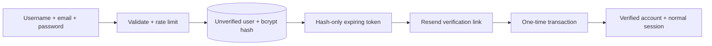
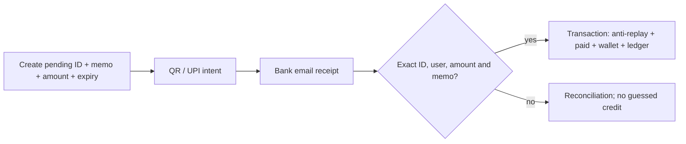
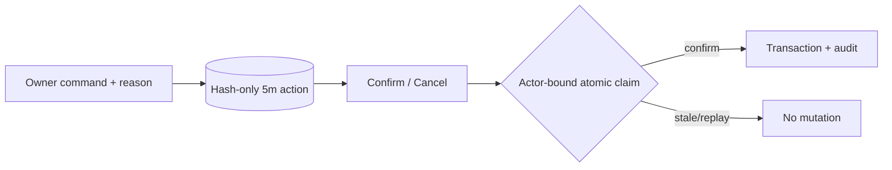

# SMM UP — Implementation Planner and Source-of-Truth Index

> **Updated:** 2026-10-06
> **Pushed feature-branch checkpoint:** `2c60e657c5759f7a22cf9fbb872e1d1e051e7201`
> **Canonical domain:** `https://smmup.co.in`
> **Current stage:** audited application/bot hardening is pushed and locally validated; exhaustive docs/API reference are committed locally but unpushed; Vercel/Railway staging and production repair remain.

This planner replaces historical assumptions about service counts, balances, old API layouts, manual-only settlement and JWT-only authentication. Live supplier counts, rates, provider balances and credentials are dynamic operational data and must not be hardcoded as architecture truth.

---

## 1. Documentation hierarchy

1. [`architecture/full-architecture.md`](architecture/full-architecture.md) — complete system map and 1,000+ entry registry.
2. [`architecture/website-architecture.md`](architecture/website-architecture.md) — website/API/data details.
3. [`architecture/bot-architecture.md`](architecture/bot-architecture.md) — Telegram/Railway details.
4. [`HANDOVER.md`](HANDOVER.md) — current continuation rules.
5. [`SECURITY_DEPLOYMENT_RUNBOOK.md`](SECURITY_DEPLOYMENT_RUNBOOK.md) — staging, launch and rollback gates.
6. [`LATER_ON_UPGRADATIONS.md`](LATER_ON_UPGRADATIONS.md) — completed phases and approved backlog.
7. [`RAZORPAY_SETUP.md`](RAZORPAY_SETUP.md) — Razorpay activation.

If this planner conflicts with the source or architecture registry, inspect the source and update the documents together.

---

## 2. Product mission

SMM UP is a responsive SMM ordering and reseller platform with:

- public service discovery;
- account-based wallet and order management;
- Direct UPI and Razorpay funding rails;
- standard SMM v2 reseller API;
- multiple scoped named API keys;
- verified-email account lifecycle;
- revocable MongoDB sessions;
- owner-only Telegram administration;
- Railway payment settlement/reconciliation;
- crawlable SEO/company/legal/platform pages.

Security, financial idempotency and owner auditability take priority over convenience.

---

## 3. Immutable product decisions

### Navigation and design

- Keep the top haze orb.
- Account is `/account`.
- `/profile` permanently redirects to `/account`.
- Add Funds is `/add-funds`.
- Use real href links for discoverable navigation.
- Breadcrumbs link only to real destinations.
- Support is clickable.
- Service Terms opens `/terms`.
- Do not add a rate calculator.

### Platform SEO

Only these six dedicated pages are approved:

1. Telegram;
2. Instagram;
3. YouTube;
4. Twitter/X;
5. TikTok;
6. Spotify.

Other service platforms may appear in the live catalog without receiving dedicated SEO landing pages.

### Reviews

- A valid prior purchase is required.
- Preserve the six existing homepage reviews.
- One submitted review per eligible user.
- New reviews enter pending moderation.
- Moderation is performed only through Telegram.

### Administration

- No website admin panel.
- Owner authority is through Telegram Bot API long polling.
- Prefer inline menus and confirmation buttons.
- Full operational email/order/deposit data may be shown to the owner.
- Raw passwords, password hashes, API secrets, cookies, authorization headers and banking credentials may not be shown.

---

## 4. Completed dependency phases

### Phase 0 — permanent pages and payment foundations

- Permanent `/account`, `/add-funds`, order, catalog, logs and transaction pages.
- Separate Direct UPI and Razorpay rails.
- Server-created Razorpay orders in paise.
- Raw-body webhook HMAC.
- Captured-only idempotent wallet settlement.
- Test-mode wallet protection.
- Refund/dispute hold foundations.
- Payment/legal/CSP updates.

### Phase 1 — multiple paid API keys

- Named key identities and versioned hash-only secrets.
- Stable public ID and one-time raw reveal.
- Configurable default ₹29 identity fee.
- Atomic fee debit and idempotency.
- Explicit scopes and Full Access synchronization.
- Daily/monthly IST spend limits.
- Optional expiration.
- Pause, resume, free rotation and permanent archive.
- Exact-name archive confirmation and no refund.
- Legacy-key migration.
- Replica-set concurrency tests.

### Phase 2 — API activity and reporting

- Bounded detailed telemetry.
- Key/version/order/target/service/amount attribution.
- Filtered 90-day activity view.
- Lifetime financial and order summaries.
- Archived-key historical reporting.
- Secret/header/cookie exclusion.

### Phase 3 — temporary-password recovery

- Owner-generated or owner-selected temporary credential.
- Five-minute protected confirmation state.
- bcrypt durable temporary hash.
- Configurable three-hour default and one/two uses.
- Restricted password-change session.
- Atomic use counting and concurrency protection.
- Mandatory permanent-password creation.
- Session revocation and Telegram status updates.

### Phase 4 — sessions and Support Access

- Hash-only revocable MongoDB sessions.
- Safe JWT cutover/revocation.
- Session inventory and revocation.
- One-time five-minute Support Access exchange.
- Fifteen-minute read-only support session.
- Separate support cookie.
- Actor/subject separation.
- Mutation blocking and page-view audit.

### Phase 5 — Telegram owner control plane

- Numeric owner authorization for all updates.
- Persistent inline menu.
- Actor-bound five-minute confirmations.
- Transactional wallet and refund operations.
- Lock/unlock and ordering/payment holds.
- User/order/deposit/wallet/event/note inspection.
- API-key pause/resume/archive/reissue-required controls.
- Review moderation.
- Railway worker lease, heartbeat, reconciliation and alerts.
- Concurrent worker settlement tests.

### Phase 6 — platform hardening

- Shared persistent rate limiting.
- Fail-closed cron authentication.
- Owner-authorized catalog refresh.
- Exact Direct UPI binding.
- Persistent bounded security events.
- Awaited critical MongoDB indexes.
- Canonical apex/`www` redirect configuration.
- Resend transactional email.
- Verified registration, recovery and email changes.
- Expanded `/api` key-lifecycle documentation.

---

## 5. Current system flows

### Verified registration

### Direct UPI

### Telegram administration

---

## 6. Dynamic supplier policy

- `PANEL_URL` and `PANEL_KEY` remain server-only.
- Service count, category count, provider balance, rates, minimums, maximums, refill state, cancellation state and average time are dynamic.
- Public names/descriptions are sanitized.
- Public rates are calculated server-side.
- Private markup multipliers must not appear in browser source, documentation or API metadata.
- Catalog refresh is owner-only and POST-only.
- Public catalog requests may use server caching.
- Order creation revalidates the service server-side rather than trusting browser-calculated prices.

---

## 7. Payment planning rules

### Direct UPI

- Create a unique expiring pending transaction before displaying payment instructions.
- Retain exact pending transaction ID in browser state.
- Poll status by exact ID, not merely amount.
- Manual identifier submission includes exact pending ID and memo.
- Receipt memo is mandatory for automatic credit.
- Compare amount as integer paise.
- Enforce unique memo, UTR, transaction ID and settlement key.
- Use MongoDB transactions for claim and wallet settlement.
- Worker and website verifier use equivalent exactness and idempotency rules.
- Reconciliation records missing/mismatched evidence.

### Razorpay

- Server creates orders.
- Amount/currency/order ownership are server validated.
- Browser callback signature is verified.
- Captured provider state is authoritative.
- Webhook raw body is HMAC verified.
- Provider event ID and settlement key prevent replay.
- Test payments cannot fund the production wallet by default.
- Refund/dispute events trigger review/holds.

---

## 8. Authentication planning rules

- New account passwords must satisfy the creation policy.
- Login accepts existing valid long passwords without applying creation complexity.
- New accounts require verified email before normal login.
- Existing accounts without `email_verification_required=true` remain compatible.
- Email links use random `sme_` values with SHA-256 hashes at rest.
- Registration, reset and email-change tokens have distinct purposes.
- Issuing a replacement invalidates the prior active token for that purpose.
- Password reset and email change revoke normal, support and restricted sessions.
- Account lock blocks login.
- Temporary-password login is unavailable to an unverified new account.

---

## 9. Named API-key planning rules

- New identity fee is configurable; default ₹29.
- Rotation is free.
- Archive has no refund.
- Names are case-insensitively unique among active identities.
- Maximum non-archived identities is configurable.
- Full Access selects current scopes but is not a future wildcard.
- Daily/monthly limits are in integer paise and enforced atomically.
- Expiration is optional.
- Pause preserves the secret.
- Archive and reissue-required revoke versions.
- Owner reissue requires secure website rotation before resume.
- Raw secret appears only in one HTTP response.
- Activity records exclude secrets, passwords, headers and cookies.

---

## 10. Testing strategy

### Static gates

- TypeScript root and bot.
- Vite production build.
- `git diff --check`.
- JSON/config validation.
- Markdown fence/details/link structure.
- Secret-pattern scans.
- Root and bot production dependency audits.

### Replica-set gates

- API-key transactions and concurrency.
- Temporary-password use and completion.
- Support Access one-time exchange and read-only enforcement.
- Persistent rate-limit concurrency.
- Direct UPI exact settlement and rollback.
- Email token storage/delivery/replay.
- Verified registration/reset/email-change lifecycle.
- Critical indexes.
- Telegram wallet/refund/control/key operations.
- IMAP worker concurrent settlement and payment-hold rollback.

### Provider staging gates

- Resend domain/sender and link origin.
- Vercel cron authorization.
- Razorpay callback/webhook orderings.
- Supplier refresh authorization and status sync.
- Railway multi-replica lease.
- Apex/`www` redirect and icon content types.

---

## 11. Post-launch backlog

These are not part of the completed Phases 0–6 and require separate approval:

1. Optional customer two-factor authentication.
2. Multi-admin Telegram roles and separation of duties.
3. Automated encrypted database backup evidence and restore drills.
4. Formal observability dashboards and external uptime checks.
5. Route-level code splitting to reduce the Vite chunk advisory.
6. Optional SIEM/export integration for bounded security events.
7. Accessibility audit against WCAG 2.2 AA.
8. Disaster-recovery RTO/RPO policy.
9. Privacy retention/export/deletion workflows beyond current bounded telemetry.
10. Supplier failover only after financial and service-mapping semantics are designed.

Do not implement these by implication; each needs an explicit requirement and security review.

---

## 12. Immediate operational sequence

1. Revoke any exposed push credential.
2. Verify the remote `improvement/private-repo-and-bot-modules` commit and compare it with the deployment source.
3. Review post-push local documentation changes.
4. Run documentation structure and secret scans.
5. Commit documentation separately when authorized.
6. Deploy isolated Vercel/Railway staging.
7. Complete all provider and concurrency gates.
8. Deploy production only after evidence review.
9. Run production smoke checks.
10. Request Search Console homepage indexing.

## 13. Emergency hardening workstream

### Completed source work

- bounded frontend parsing for JSON/text/oversized API responses;
- lazy controlled API initialization failures;
- strong authentication and cron secret minimums;
- local Direct UPI QR generation;
- transactional website and reseller order reservations;
- durable supplier ambiguity and owner-review states;
- supplier response/status normalization;
- order-reservation integration coverage;
- exhaustive Vercel/Railway environment templates;
- pushed behavior-preserving bot module split;
- public-copy and customer `/api` retry-contract correction.

### Still operational

1. retain the exhaustive Markdown/API pass as a separate local commit until push authorization exists;
2. confirm emergency PAT revocation;
3. set strong Vercel Production `JWT_SECRET` and `CRON_SECRET`;
4. populate every applicable provider variable from the correct template;
5. redeploy and verify authentication/cron controlled behavior;
6. stage Railway bot/worker with exact identity, lease and settlement evidence;
7. obtain separate workflow-write authorization before pushing the local `workflow_dispatch`-only commit;
8. never introduce automatic Actions triggers as a workaround.

### Definition of done

“Fixed” requires source commit, provider deployment ID, successful negative/positive smoke tests, index readiness, provider evidence, monitoring window and rollback owner. A successful GitHub push or local test suite satisfies only the source gate.
